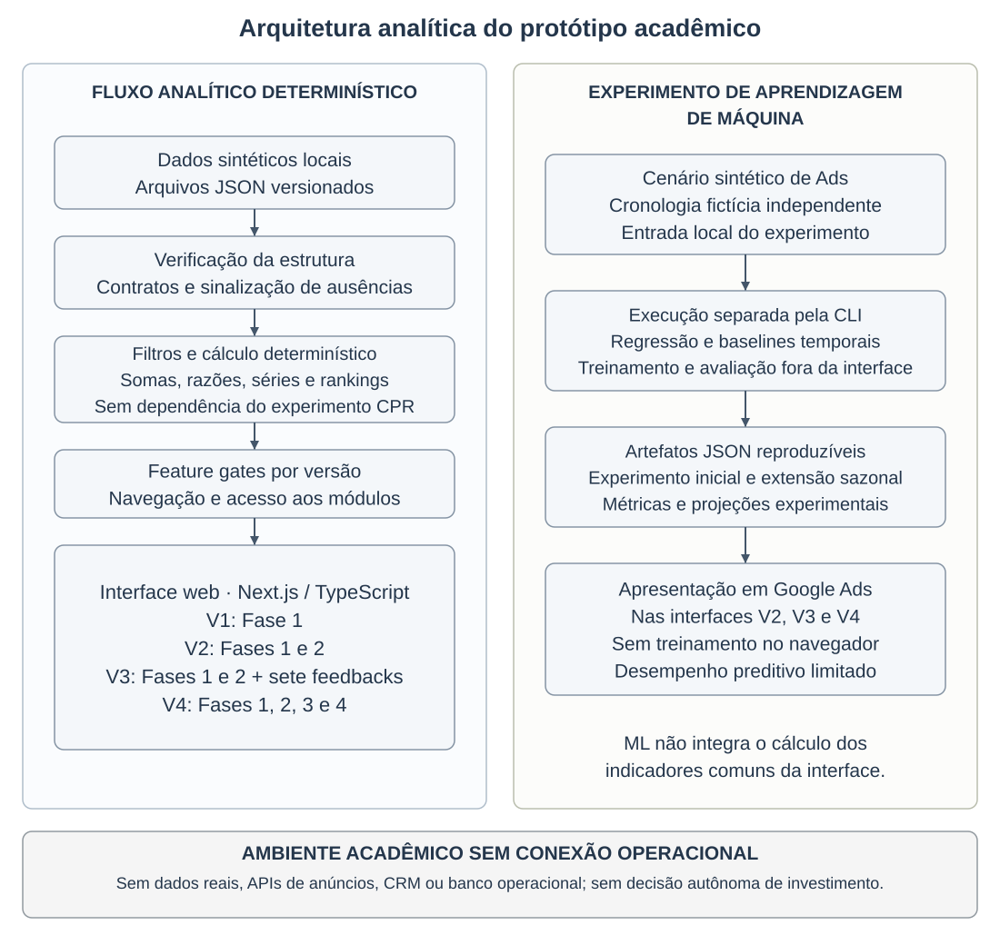

# Revisão controlada V1 → V2 — Relatório Final

Data: 25/10/2026. **Candidata à revisão humana; não é nova baseline oficial.** A criação foi expressamente autorizada nesta tarefa, nos termos da exceção de ADR-012. V1 é a fonte científica; texto do Google Docs não foi importado. Nenhuma edição foi feita no documento online.

## 1. Comentários atuais auditados

Documento: [Relatorio_Final](https://docs.google.com/document/d/1MYJIhDmHKGOXMB0JLkXQUh1c1ZpGeNwzxwdDkKysD70/edit). O link foi localizado em `docs/pendencias/comentarios_google_doc.md`, após busca por título sem resultado exato. Consulta autenticada em 25/10/2026: 17 tópicos retornados, dos quais **14 iniciados por Letícia**, e três iniciados por Rodrigo; `nextPageToken = null`. As respostas de Letícia ao Resumo, às Considerações Finais e à disposição da Tabela 1 também foram lidas. Isso descreve o retorno do conector, sem pretender certificar comentários excluídos ou não expostos pela API. Nenhuma conversa foi respondida ou resolvida.

Categorias: A = conteúdo científico; B = organização estrutural; C = figura/fluxograma; D = formatação exclusiva do Google Docs; E = já atendido; F = depende de revisão humana. Um comentário pode ter mais de uma dimensão. As orientações da tarefa sobre objetivos e redundância são instruções do responsável; não foi inventado um 15º tópico de Letícia.

| Comentário Letícia | Local | Categoria | Situação na V1 | Ação V2 |
|---|---|---|---|---|
| AAACJEIh0dc: Sugiro que revejam o texto como um todo. O resumo deve apresentar uma ou duas frases para cada tópico, a versão atual contém um texto muito fragmentado e com etapas sem delimitação. | Resumo | A / B | Texto de 239 palavras; cronologia fragmenta o encadeamento | Reescrita em 217 palavras; introdução, objetivo, método, resultados e limites |
| AAACJHT_vbE: O sumário vai precisar se ajuste na identificação das páginas | Sumário | D | Sem páginas definitivas no Markdown | Títulos atualizados; páginas na composição |
| AAACJEIh0hM: conferir a formatação do trabalho como um todo: | Todo o documento; âncora em 2.5.1 | D | Markdown não determina tamanho de fonte | Checklist de estilos 12/10 |
| AAACJEIh0hQ: times new romam 12 em itálico | 2.5.2; arquivos citados | D | Caminhos em código inline | Converter para Times New Roman 12 itálico na composição |
| AAACJIctg2k: o tópico está muito curto, remover esse título e incluir o texto em outro tópico conectando com outra etapa | 2.5.8 da V1 | B | Título curto com dois parágrafos relevantes | Integração integral em 2.5.5 e renumeração |
| AAACJIctg2o: formatar esses textos verdes | 2.5.10 V1 → 2.5.9 V2; comandos e arquivos | D | Markdown sem cor verde; código inline distingue comandos | Retirar verde e compor estilos conforme função |
| AAACJIctg3A: ótima síntese | Tabela 5 | E | Síntese elogiada | Preservada literalmente |
| AAACJEC-ROA: é um fluxograma? Se sim, podem montar com balões clicando em: | 3.1.2 | C | Fluxo ASCII omite V4 | SVG/PNG técnico; Fluxograma 1; V1–V4 e ML separado |
| AAACJIctnyI: Notas devem ser inseridas no pé da página, separadas do texto por uma linha de 5 cm. Pesquisar na internet como fazer | Nota após Figura 1 | B / D | Nota comum no corpo | Marcador e definição Markdown; separador no Word/Docs |
| AAACJIctnyQ: A variável é uma equação? se sim, sinalizar em itálico | 3.1.5, 3.1.6 e fórmulas V4 | A / D | CPR escrito como fórmula em texto corrido | Notação matemática com símbolo em itálico e nomes descritivos retos; valores preservados |
| AAACJIctnyU: é um tópico? parece que sim. Se for msm, adicionem o número de identificação | 3.1.6 | B | Subtítulo de nível 4 sem número | 3.1.6.1; Sumário e menção à reutilização V4 |
| AAACJIctnyY: A figura 14 se chama "V4: ranking sintético de Reels orgânicos", se realmente estiverem se referindo a ela, ela precisaria aparecer aqui. É possível retomar algo que já foi apresentado, mas referenciar algo que está páginas adiante não é recomendado. | 3.1.8 / Figuras 14–18 | B / C | Primeira chamada distante das capturas | Explicações detalhadas junto às figuras em 3.2.6; sequência 1–18 preservada |
| AAACJEIh0eo: Usar a formação dessa tabela como padrão para as demais: | Tabela 10 como padrão para 1–14 | D | Dados e estrutura Markdown íntegros | Compor fonte 10, simples, espaçamentos zero, bordas pretas 1 pt e altura mínima |
| AAACJHT_vaw: Apresentar as contribuições do trabalho a partir dos resultados.  | 4 Considerações finais | A | Contribuições e limites já presentes; cronologia extensa | Síntese reflexiva vinculada aos seis objetivos e à contribuição percebida |


Resposta de Letícia ao comentário das Considerações Finais (`AAACJIctnyg`):

> Vi que ja apresentam uma limitação do trabalho e contribuições do estudo para distinção entre a ausência dado e o valor zero. São análises interessantes mas vou manter o comentário para que possam avaliar se podem/querem adicionar mais alguma informação.

A resposta ao Resumo trouxe exemplo de outro projeto; foi lida como orientação de estrutura, sem copiar conteúdo, dados ou método. Na conversa iniciada por Rodrigo sobre a Tabela 1, Letícia respondeu (`AAACJHT_vbM`): “Sugeri na Tabela 10 a formatação a ser seguida, vai ser necessário alterar todas as tabelas do documento.” Os três tópicos de Rodrigo (`AAACG930ESM`, `AAACG930ESI`, `AAACG930ESE`) tratam da disposição de tabelas; não foram contados como tópicos iniciados por Letícia.

Pendências F herdadas: URL do vídeo, total de folhas, inserção protegida dos TCLEs, situação do consentimento da quarta aplicação e ausência de data/modalidade da terceira. Não foram preenchidas por inferência. A orientação sobre conclusão do vídeo está na checklist. A paginação atual não é exposta pelo conector; não foram inventados números de página.

## 2. Auditoria anterior à edição

Lidos V1 integralmente, controle, ADRs (incluindo ADR-012), master_context e auditorias de evidências, referências, H07, IA agêntica e organização. Inventariado o diretório `docs/relatorio/`, incluindo parciais, snapshots e PDF histórico; os históricos não substituem a V1. As contagens antigas de 19/25 referências e estados anteriores de fases nas auditorias foram tratadas como histórico, não aplicadas à candidata atual.

Conferidos seis objetivos aprovados, quatro aplicações com P1, sete feedbacks da terceira aplicação, oito notas 5/5 e opção A na quarta. Consultados os registros primários e a rastreabilidade existente; transcrições não foram corrigidas. Conferência de arquitetura em `src/lib/fases.ts`, `gate-servidor.ts`, contratos/dados locais, componentes CPR V2/V3 e `src/ui/v4/pages/google.tsx`: V4 compõe GoogleV3 e reutiliza sua apresentação de CPR. Leitura de código apenas; nenhum código alterado.

## 3. Mudanças aplicadas

| ALT | Seção | Motivo | Status |
|---|---|---|---|
| ALT-001 | Resumo | Explicitar sequência acadêmica sem modificar resultados. | APLICADA |
| ALT-002 | Lista de ilustrações | Acrescentar Fluxograma 1 à lista, sem renumerar figuras históricas. | APLICADA |
| ALT-003 | Sumário | Sincronizar Sumário com a metodologia renumerada, 3.1.6.1 e 3.2.6. | APLICADA |
| ALT-004 | 2.3 Fundamentação teórica | Atualizar chamada 2.5.10 → 2.5.9 na fundamentação. | APLICADA |
| ALT-005 | 2.5.5 Preparação, governança e rastreabilidade dos dados | Receber integralmente os dois parágrafos de 2.5.8 em 2.5.5, após governança e ausências. | APLICADA |
| ALT-006 | 2.5.6 Níveis de interpretação analítica | Atualizar chamadas do experimento e da IA agêntica em 2.5.6. | APLICADA |
| ALT-007 | 2.5.8 Auditoria, reprodutibilidade e limites de atribuição | Suprimir título 2.5.8 e retirar seus parágrafos apenas da origem; conteúdo recebido em ALT-005; Criar e prototipar passa a 2.5.8. | APLICADA |
| ALT-008 | 2.5.10 Protocolo experimental de aprendizagem de máquina | Renumerar protocolo experimental: 2.5.10 → 2.5.9. | APLICADA |
| ALT-009 | 2.5.11 Uso assistivo de IA agêntica e verificação humana | Renumerar IA agêntica: 2.5.11 → 2.5.10. | APLICADA |
| ALT-010 | 2.5.11 Uso assistivo de IA agêntica e verificação humana | Corrigir referência ao protocolo e renumerar Implementar, testar, validar e ajustar: 2.5.12 → 2.5.11. | APLICADA |
| ALT-011 | 3.1.2 Estratégia incremental e arquitetura da solução | Substituir ASCII completo pelo Fluxograma 1 e atualizar arquitetura para V4 conforme código. | APLICADA |
| ALT-012 | 3.1.3 Módulo de Captação | Associar a nota de rodapé à Figura 1. | APLICADA |
| ALT-013 | 3.1.3 Módulo de Captação | Converter integralmente a informação do rótulo legado para definição de nota Markdown. | APLICADA |
| ALT-014 | 3.1.5 Módulos de Ads | Representar CPR como expressão matemática, com nomes descritivos e denominador preservados. | APLICADA |
| ALT-015 | 3.1.6 Experimento de aprendizagem de máquina para CPR | Priorizar disponibilidade dos artefatos e resultado previsto; remeter execução e fórmula às seções próprias; corrigir 2.5.9. | APLICADA |
| ALT-016 | Previsão sazonal mensal — extensão técnica introduzida na V2 e mantida na V3 | Numerar 3.1.6.1, incluir V4 no título e reduzir repetição do protocolo, preservado em 2.5.9. | APLICADA |
| ALT-017 | Previsão sazonal mensal — extensão técnica introduzida na V2 e mantida na V3 | Explicitar reutilização do artefato na V4, conferida no componente GoogleV4 que compõe GoogleV3. | APLICADA |
| ALT-018 | 3.1.7 Uso assistivo de IA agêntica | Atualizar referência da IA agêntica para 2.5.10. | APLICADA |
| ALT-019 | 3.1.8 V4 e conclusão do escopo especificado das quatro fases | Retirar explicações detalhadas de 3.1.8 e remetê-las à seção 3.2.6 junto às capturas; destino integral em ALT-021–025. | APLICADA |
| ALT-020 | Terceiro momento — avaliação ampliada da V2 | Atualizar referência metodológica 2.5.12 → 2.5.11 após evidências V3. | APLICADA |
| ALT-021 | 3.2.6 Evidências da evolução técnica da V4 (origem: 3.1.8) | Criar 3.2.6 e receber parágrafo de Conteúdo Orgânico imediatamente antes da Figura 14. | APLICADA |
| ALT-022 | 3.2.6 Evidências da evolução técnica da V4 (origem: 3.1.8) | Receber parágrafo integral de Gestão imediatamente antes da Figura 15. | APLICADA |
| ALT-023 | 3.2.6 Evidências da evolução técnica da V4 (origem: 3.1.8) | Receber descrição Meta junto à Figura 16 e padronizar fórmula sem alterar denominador. | APLICADA |
| ALT-024 | 3.2.6 Evidências da evolução técnica da V4 (origem: 3.1.8) | Receber descrição Google junto à Figura 17 e padronizar fórmula sem alterar denominador. | APLICADA |
| ALT-025 | 3.2.6 Evidências da evolução técnica da V4 (origem: 3.1.8) | Receber descrição Estratégia junto à Figura 18 e remover indicação de que as figuras estavam adiante. | APLICADA |
| ALT-026 | 4 CONSIDERAÇÕES FINAIS | Conservar achados e limites da conclusão, tornando explícitas expectativas, atendimento dos seis objetivos e contribuições acadêmica, comunitária e da interface. | APLICADA |
| ALT-027 | 3.1.2 — arquivos do Fluxograma 1 | Criar imagem técnica vetorial e PNG renderizado a partir do próprio SVG; sem editar capturas históricas. | APLICADA |
| ALT-028 | Registro da execução — docs/run_log.md | Registrar execução relevante conforme padrão do projeto, sem alterar decisões nem promover baseline. | APLICADA |


## 4. Resumo, metodologia e resultados

Resumo: **239 → 217 palavras**, contagem por separação em espaços, sem título nem palavras-chave. Um parágrafo, cinco palavras-chave originais intactas. A nova ordem é introdução → objetivo → método → resultados → conclusão. Preservados V1–V4, avaliação posterior da V4, oito 5/5, A, dados sintéticos, ausência de impacto demonstrado e desempenho limitado do CPR.

Metodologia: os dois parágrafos de 2.5.8 foram transferidos integralmente ao fim de 2.5.5, onde fonte, transformação, fórmula, governança e limites de atribuição formam uma sequência coerente. Nenhum achado ou citação foi excluído. Os tópicos seguintes passaram de 2.5.9–12 para 2.5.8–11. Sumário e todas as chamadas foram atualizados; as novas referências de protocolo e IA apontam a 2.5.9 e 2.5.10. As outras subseções foram auditadas; 2.5.3 é curta, mas delimita um passo próprio (problema e requisitos), por isso foi mantida. Não houve reescrita geral da metodologia.

Resultados: 3.1.6 passou a enfatizar disponibilidade dos artefatos, cobertura válida e resultados, remetendo treinamento, entradas e particionamento ao protocolo. Detalhes necessários à interpretação e todas as métricas permaneceram. O subtítulo sazonal tornou-se 3.1.6.1 e registra reutilização na V4. Em 3.1.8 ficou a síntese da entrega; os cinco parágrafos detalhados foram recebidos em 3.2.6 imediatamente antes das Figuras 14–18. Os arquivos das capturas não foram movidos nem editados. Não houve renumeração das 18 figuras.

### Mapa explícito dos deslocamentos

| Origem V1 | Retirada/reescrita | Destino V2 | Recebimento |
|---|---|---|---|
| Dois parágrafos de 2.5.8 | ALT-007 | Final de 2.5.5 | ALT-005 |
| Conteúdo Orgânico em 3.1.8 | ALT-019 | 3.2.6, antes da Figura 14 | ALT-021 |
| Gestão em 3.1.8 | ALT-019 | 3.2.6, antes da Figura 15 | ALT-022 |
| Meta Ads em 3.1.8 | ALT-019 | 3.2.6, antes da Figura 16 | ALT-023; fórmula padronizada |
| Google Ads em 3.1.8 | ALT-019 | 3.2.6, antes da Figura 17 | ALT-024; fórmula padronizada |
| Estratégia em 3.1.8 | ALT-019 | 3.2.6, antes da Figura 18 | ALT-025; localização atualizada |

Cada retirada e recebimento é transcrito integralmente nos registros abaixo. A ordem dos IDs segue a ocorrência na V1, inclusive quando o recebimento da metodologia antecede a retirada. Não há perda de parágrafos nesses deslocamentos.

## 5. Fluxograma e figuras

Arquivos: `figuras/fluxograma-arquitetura-v2.svg` e `figuras/fluxograma-arquitetura-v2.png`. Desenho vetorial próprio, fundo branco, fluxos em colunas distintas, blocos e setas explícitos, tipografia Arial e cores discretas. PNG renderizado do próprio SVG com MuPDF, 2200 × 2080 pixels. Inspeção visual executada, sem cortes; a leitura final em página A4 será reconferida na composição. Fonte de verdade: código e documentação locais; não há desenho de API real, banco operacional, campanha automatizada, treinamento no navegador ou decisão autônoma.

As setas representam dependências analíticas conceituais, não uma ordem obrigatória de execução de funções. Os gates controlam acesso aos módulos; o desenho não afirma que só sejam avaliados após o cálculo. O fluxo de CPR termina na apresentação Google Ads V2–V4 e não alimenta o cálculo de indicadores comuns. Fluxograma 1 tem legenda, fonte e entrada própria na Lista de Ilustrações.

As 18 imagens históricas (1600 × 900) foram abertas em pranchas de inspeção, conferidas quanto a versão, contexto e legenda e preservadas. Para figuras sem chamada numérica separada, a primeira chamada específica abaixo corresponde à legenda que segue a explicação do módulo. Menções coletivas às faixas 1–6/7–13/14–18 funcionam como síntese; não substituem a explicação específica junto às capturas.

| Figura | Versão / local V2 | Primeira chamada específica V1 → V2 (linha) | Imagem V1 → V2 (linha) | Conferência |
|---|---|---|---|---|
| 1 | V1; 3.1.3 | 1004 → 990 | 1006 → 992 | Arquivo, legenda e fonte preservados; imagem inspecionada |
| 2 | V1; 3.1.4 | 1026 → 1010 | 1028 → 1012 | Arquivo, legenda e fonte preservados; imagem inspecionada |
| 3 | V2; 3.1.5 | 1049 → 1032 | 1051 → 1034 | Arquivo, legenda e fonte preservados; imagem inspecionada |
| 4 | V2; 3.1.6.1 | 1145 → 1120 | 1147 → 1122 | Arquivo, legenda e fonte preservados; imagem inspecionada |
| 5 | V1; 3.2.2 | 1239 → 1182 | 1241 → 1184 | Arquivo, legenda e fonte preservados; imagem inspecionada |
| 6 | V2; 3.2.2 | 1252 → 1195 | 1254 → 1197 | Arquivo, legenda e fonte preservados; imagem inspecionada |
| 7 | V3; 3.2.2 | 1293 → 1236 | 1295 → 1238 | Arquivo, legenda e fonte preservados; imagem inspecionada |
| 8 | V3; 3.2.2 | 1299 → 1242 | 1301 → 1244 | Arquivo, legenda e fonte preservados; imagem inspecionada |
| 9 | V3; 3.2.2 | 1311 → 1254 | 1313 → 1256 | Arquivo, legenda e fonte preservados; imagem inspecionada |
| 10 | V3; 3.2.2 | 1317 → 1260 | 1319 → 1262 | Arquivo, legenda e fonte preservados; imagem inspecionada |
| 11 | V3; 3.2.2 | 1331 → 1274 | 1333 → 1276 | Arquivo, legenda e fonte preservados; imagem inspecionada |
| 12 | V3; 3.2.2 | 1337 → 1280 | 1339 → 1282 | Arquivo, legenda e fonte preservados; imagem inspecionada |
| 13 | V3; 3.2.2 | 1349 → 1292 | 1351 → 1294 | Arquivo, legenda e fonte preservados; imagem inspecionada |
| 14 | V4; 3.2.6 | 1172 → 1452 | 1507 → 1457 | Arquivo, legenda e fonte preservados; imagem inspecionada |
| 15 | V4; 3.2.6 | 1177 → 1463 | 1513 → 1469 | Arquivo, legenda e fonte preservados; imagem inspecionada |
| 16 | V4; 3.2.6 | 1185 → 1477 | 1519 → 1481 | Arquivo, legenda e fonte preservados; imagem inspecionada |
| 17 | V4; 3.2.6 | 1188 → 1486 | 1525 → 1493 | Arquivo, legenda e fonte preservados; imagem inspecionada |
| 18 | V4; 3.2.6 | 1195 → 1498 | 1531 → 1506 | Arquivo, legenda e fonte preservados; imagem inspecionada |


## 6. Considerações finais e seis objetivos

| Objetivo aprovado | Reflexão/evidência retomada | Limite declarado |
|---|---|---|
| 1. Organizar dados | Estrutura de cenários de Captação, Matrículas e Ads | Não consolida fontes institucionais reais |
| 2. Construir indicadores | Fórmulas rastreáveis e recortes comparáveis | Denominadores e cenários distintos não autorizam causalidade |
| 3. Desenvolver interface | V1–V4; comparação temporal facilitada relatada por P1 | Não prova melhoria de decisões reais |
| 4. Avaliar CPR | Experimentos executados e reproduzidos | Resultado limitado; avaliar não significa obter modelo eficaz |
| 5. Aplicar IA agêntica | Apoio à construção, análise e verificação | Supervisão humana; sem experimento de eficácia do agente |
| 6. Avaliar e incorporar | Quatro aplicações; sete feedbacks incorporados | Uma participante, sem generalização e sem avaliação da V3 |

A conclusão atual foi revisada conservando os achados, a distinção ausência/zero, a rastreabilidade, os limites e as perspectivas futuras. Foram fortalecidas: expectativa atendida no protótipo; alcance parcial da aplicação à distribuição real do orçamento; obstáculos de dados e integração; contribuição acadêmica; contribuição à comunidade por participação no projeto; contribuição da interface na percepção de P1. A fala sobre comparação anual não é prova de impacto. A quarta avaliação não originou a V4, e não foi criada V5.

## 7. Composição e revisão humana

Ver `PENDENCIAS_COMPOSICAO_GOOGLE_DOCS_V2.md`: checklist com comentário original, localizador/página indisponível, elemento, ajuste, prioridade e critério de conclusão. Tamanhos, fonte, cor, espaçamento, borda, orientação horizontal, paginação, separador de notas e conversão visual de equações pertencem ao editor. A nota Markdown preserva a informação; nenhuma linha artificial foi desenhada. Arquivos continuam literais no Markdown, e sua apresentação em itálico será composta no editor.

## 8. Integridade e verificação final

| Arquivo | Bytes | Linhas | SHA-256 |
|---|---:|---:|---|
| V1 antes | 142914 | 1997 | `3af4147e3deb97ad00d55d44b79ab53fcfa4e0fe0b837fb01f2a820213f1276c` |
| V1 depois | 142914 | 1997 | `3af4147e3deb97ad00d55d44b79ab53fcfa4e0fe0b837fb01f2a820213f1276c` |
| V2 candidata | 140985 | 1933 | `7acc99bb2134959b34412f66ed34aaca529934f28247e59060611a086c8a4564` |

Baseline e `final.md` com identidade confirmada. A candidata foi gerada a partir da V1; o conjunto de pares ALT-001–026 reconstrói exatamente seu texto, aplicando os intervalos originais de trás para frente. Todos os blocos alterados têm SAI/ENTRA literal; ALT-027 registra criação dos arquivos gráficos e ALT-028 registra o log. Cabeçalhos e Sumário conferidos; nenhuma chamada a subseção inexistente resultante da renumeração. Objetivos e bibliografia comparados literalmente; tabelas comparadas como blocos integrais, inclusive células, ordem, datas, notas, feedbacks e status. Equações mudaram apenas de notação.

- 18 figuras históricas + 1 Fluxograma, todos os caminhos existentes.
- 14 tabelas numeradas + quadro metodológico não numerado, todos os 15 blocos literalmente iguais aos da V1.
- 28 referências, seção bibliográfica integralmente preservada; cinco palavras-chave; seis objetivos específicos intactos.
- Avaliação 3.2.2 preservada integralmente salvo atualização de referência 2.5.12 → 2.5.11; instrumentos dos apêndices intactos.
- Dados e artefatos ML não alterados. `node scripts/experimento-google-cpr.mjs --verificar` e `node scripts/experimento-google-cpr-sazonal.mjs --verificar`: sucesso e reprodução confirmada, sem gravação. Aviso preexistente do Node sobre MODULE_TYPELESS_PACKAGE_JSON; sem alteração do package.json.
- `node scripts/test-nao-vazamento.mjs`: 38/38 no runtime. Esse script não varre docs; revisão documental separada não encontrou novos identificadores da participante, e os nomes/RAs dos autores da capa foram preservados. Portanto, não se afirma ausência absoluta de PII no relatório: existem identificadores acadêmicos dos autores já presentes na baseline.
- Cronologia preservada: V1 → primeira avaliação → V2 → segunda avaliação/V2 mantida → terceira avaliação da V2/sete feedbacks → V3 → evolução técnica sem questionário → V4 → quarta avaliação/oito 5/5/A → V4 mantida. Nenhuma V5 criada.

### Hashes das capturas históricas

| Arquivo histórico | SHA-256 preservado |
|---|---|
| figuras/fig-v1-captacao.png | `12d76d6df2391717b1f14306433e52fb291debf6086cfbebe063bd938ebe8ff4` |
| figuras/fig-v1-matriculas.png | `de034b9404843799d4b11daedb827098acd1c0f3ddaac77dc290f41e43c1089a` |
| figuras/fig-v2-ads-visao-geral-pji410.png | `1c2c9ea1586410118aff57abfdd9ecd88c9e6f661f063f5823766f2396b81160` |
| figuras/fig-v2-google-cpr-sazonal.png | `7c7ed065b25261d7768079a36608223ed28672ef1d02fc6326aca71bc62e059d` |
| figuras/fig-v1-captacao-graficos-temporais.png | `66a5417adb445c2d4c3568e9192ab9bf8f490f22f315189df4b33f5e037c94a9` |
| figuras/fig-v2-captacao-evolucao-temporal-pji410.png | `60a9956b79acda615aec1c67bbb713d3c8198758f0663e95ceb5fe6b6484be49` |
| figuras/fig-v3-captacao-efetivacao.png | `951afb717d62a41c7a24fc430ed70ac726457ebd3097ff1fd0cc61c745d78406` |
| figuras/fig-v3-matriculas-series.png | `67bec5e1d033770f54103e73b40d324ab695f7eb36f904891b1712653d18c6c1` |
| figuras/fig-v3-ads-resumo-mensal.png | `ec284fb73cf2c9de64a00fd745bc848e7f76f07d33d2108043840b49e5ddee14` |
| figuras/fig-v3-google-leads.png | `320c4d1d3fd1e731c69a055c3d1788817da6cf84e8c651e4048041926e848660` |
| figuras/fig-v3-meta-metricas.png | `02b38659f7ab03060e58cf0dc7f3b11ed62bf2967cc250b3584e15c485f10f00` |
| figuras/fig-v3-estrategia-temporal.png | `de9fa84fbfdd692fdc95586b18b5a8d073f0a97d7cf495e7c5738835cb3885b4` |
| figuras/fig-v3-google-cpr-limitacoes.png | `c012f47ce53d1ee72f07fe12d90d1aa4e62aab18566aa62c8f04c83c20c21e71` |
| figuras/fig-v4-organico-reels.png | `760c61bb9e6d205af902abd186733a411a3a7951deccebac6ff90b2cea707692` |
| figuras/fig-v4-gestao-ocupacao.png | `0efffafbd2c94e46f193436da7ed0a5aaaace92b1bc96358f1f4782af23b8a0c` |
| figuras/fig-v4-meta-ranking-anuncios.png | `0e798f669c372c2f417c826b3f352f9ef52ea285d872270de851e59d5f75935c` |
| figuras/fig-v4-google-palavras-chave.png | `27eccf91dff26f95052356d296230355f2b8f8ec5ef50e7874b4777bc79abd2b` |
| figuras/fig-v4-estrategia-cpr-temporal.png | `ef89400c3f9814b929c74350b55c9368b3d07a3b878e1ea1b48c5451fba7cf32` |


## 9. Controle e Git

**28 ALT, 28 APLICADAS, zero PROPOSTAS e zero REJEITADAS.** Próximo ID: ALT-029. Pendências humanas/composição não são alterações textuais propostas; nada incerto foi aplicado. A aplicação direta decorre da ordem expressa desta tarefa, sem promover a candidata à baseline.

`git diff --check`: aprovado. Escopo esperado de `git status --short`: controle e run_log modificados; V2, revisão, checklist e SVG/PNG novos. Código, dados, respostas, figuras históricas, V1 e `final.md` não modificados. Sem commit, push, deploy ou escrita no Google Docs.

## 10. Gate final

**B. RELATORIO_FINAL_V2.MD CRIADO COM PENDÊNCIAS DOCUMENTADAS QUE EXIGEM REVISÃO HUMANA.**

As orientações científicas e estruturais foram aplicadas com rastreabilidade. Permanecem a revisão humana da candidata e as pendências institucionais herdadas (vídeo, folhas e documentação protegida/consentimento), além da composição visual fora do Markdown. A V1 continua sendo a baseline oficial.

## 11. Registros literais completos

Nos pares seguintes, quebras de linha e aspas pertencem ao texto original ou novo. Campo vazio identifica inclusão ou exclusão; não há reticências editoriais substituindo conteúdo. Os mesmos registros constam do controle central.

### ALT-001

Data: 25/10/2026

Seção: Resumo

Comentário motivador:

> AAACJEIh0dc: Sugiro que revejam o texto como um todo. O resumo deve apresentar uma ou duas frases para cada tópico, a versão atual contém um texto muito fragmentado e com etapas sem delimitação.
> Segue a sequência dos tópicos: Breve introdução, objetivos, metodologia adotada, resultados obtidos e considerações finais.
> Segue um exemplo de resumo:

Motivo: Explicitar sequência acadêmica sem modificar resultados.

Origem: ORIENTAÇÃO DA PROFESSORA

Status: APLICADA

Localizador literal: V1 linha 74; V2 linha 74.

````text
(SAI: "Este relatório apresenta uma plataforma acadêmica para organizar informações sobre investimentos em mídia digital e apoiar decisões de marketing em uma instituição de ensino. A necessidade de reunir registros dispersos foi identificada em conversas com profissionais da instituição. O grupo desenvolveu uma aplicação web com indicadores, filtros e gráficos, usando dados sintéticos, sem integrar registros operacionais. A V1 reuniu Captação e Matrículas. Após a primeira avaliação de uma gerente de Marketing, identificada como P1, a V2 incorporou um gráfico temporal consolidado; uma segunda aplicação confirmou sua utilidade percebida. Na terceira aplicação, ampliada à V2, P1 apresentou contribuições, das quais sete feedbacks foram aceitos e incorporados à V3. Sem nova avaliação comunitária entre versões, o grupo desenvolveu a V4 por evolução técnica e acadêmica: ela reúne o escopo especificado das quatro fases, incluindo Conteúdo Orgânico, Gestão e Arquitetura & Algoritmos, além de rankings sintéticos em Ads e séries temporais de custo por resultado (CPR). Depois da implementação, P1 avaliou a V4 online, em 14/10/2026. Atribuiu 5/5 às oito questões fechadas, escolheu a opção A e não solicitou alteração relevante; a V4 foi mantida. Em experimento separado, a aprendizagem de máquina estimou o CPR Google, definido como investimento dividido pelas conversões registradas. O modelo sazonal apresentou desempenho preditivo limitado, insuficiente para orientar investimentos reais. Testes e registros versionados sustentam a execução técnica. Dados fictícios, ausência de integração operacional e avaliação por uma única participante impedem generalização ou comprovação de impacto institucional.

" | ENTRA: "A dispersão de registros de mídia digital dificulta sua comparação no contexto educacional. O objetivo foi desenvolver uma solução analítica para organizar esses dados e apoiar a discussão da distribuição do orçamento de marketing em uma instituição de ensino. A metodologia combinou escuta de profissionais, prototipação incremental com dados sintéticos, cálculos determinísticos, testes e quatro avaliações sucessivas com uma gerente de Marketing, identificada como P1. Em experimento separado e reproduzível, regressões lineares estimaram o custo por resultado (CPR) Google, definido como investimento dividido pelas conversões registradas. Como resultados, a V1 apresentou Captação e Matrículas; a primeira avaliação motivou o gráfico consolidado da V2, confirmado na segunda, e sete feedbacks da terceira aplicação ampliada à V2 foram incorporados à V3. A V4 resultou de evolução técnica e acadêmica sem questionário intermediário, reunindo o escopo especificado das quatro fases, rankings sintéticos e séries de CPR; em avaliação posterior online, em 14/10/2026, P1 atribuiu oito notas 5/5, escolheu a classificação A e não solicitou alteração relevante, mantendo-se a V4. Os testes sustentam a execução técnica, mas o experimento sazonal apresentou desempenho preditivo limitado, insuficiente para orientar investimentos reais. A contribuição demonstrada consiste na organização rastreável dos indicadores e na apresentação ajustada à participante; dados sintéticos, ausência de integração operacional e uma única avaliadora impedem generalização e comprovação de impacto institucional.

")
````

### ALT-002

Data: 25/10/2026

Seção: Lista de ilustrações

Comentário motivador:

> AAACJEC-ROA: é um fluxograma? Se sim, podem montar com balões clicando em:
>
> "Inserir"-> "Desenho" -> "Novo"

Motivo: Acrescentar Fluxograma 1 à lista, sem renumerar figuras históricas.

Origem: ORIENTAÇÃO DA PROFESSORA

Status: APLICADA

Localizador literal: V1 linha 82; V2 linha 82.

````text
(SAI: "- Figura 1 – Indicadores e filtros da Captação na V1
- Figura 2 – Indicadores e composição por safra em Matrículas na V1
- Figura 3 – Visão geral acadêmica de Ads na V2
- Figura 4 – Histórico sintético e previsão sazonal experimental de CPR na V2
- Figura 5 – Gráficos temporais separados de Captação na V1
- Figura 6 – Evolução temporal consolidada de Captação na V2
- Figura 7 – V3: efetivação visita–matrícula em Captação
- Figura 8 – V3: matrículas e rematrículas por série
- Figura 9 – V3: resumo mensal da Visão Geral de Ads
- Figura 10 – V3: investimento e leads simulados no Google Ads
- Figura 11 – V3: alcance, investimento e resultados no Meta Ads
- Figura 12 – V3: comparação temporal no módulo Estratégia
- Figura 13 – V3: comunicação dos limites da previsão experimental de CPR
- Figura 14 – V4: ranking sintético de Reels orgânicos
- Figura 15 – V4: plano fictício de vagas e ocupação em Gestão
- Figura 16 – V4: ranking sintético de anúncios no Meta Ads
- Figura 17 – V4: ranking sintético de palavras-chave no Google Ads
- Figura 18 – V4: séries temporais separadas de CPR em Estratégia

" | ENTRA: "- Figura 1 – Indicadores e filtros da Captação na V1
- Figura 2 – Indicadores e composição por safra em Matrículas na V1
- Figura 3 – Visão geral acadêmica de Ads na V2
- Figura 4 – Histórico sintético e previsão sazonal experimental de CPR na V2
- Figura 5 – Gráficos temporais separados de Captação na V1
- Figura 6 – Evolução temporal consolidada de Captação na V2
- Figura 7 – V3: efetivação visita–matrícula em Captação
- Figura 8 – V3: matrículas e rematrículas por série
- Figura 9 – V3: resumo mensal da Visão Geral de Ads
- Figura 10 – V3: investimento e leads simulados no Google Ads
- Figura 11 – V3: alcance, investimento e resultados no Meta Ads
- Figura 12 – V3: comparação temporal no módulo Estratégia
- Figura 13 – V3: comunicação dos limites da previsão experimental de CPR
- Figura 14 – V4: ranking sintético de Reels orgânicos
- Figura 15 – V4: plano fictício de vagas e ocupação em Gestão
- Figura 16 – V4: ranking sintético de anúncios no Meta Ads
- Figura 17 – V4: ranking sintético de palavras-chave no Google Ads
- Figura 18 – V4: séries temporais separadas de CPR em Estratégia
- Fluxograma 1 – Arquitetura analítica do protótipo acadêmico

")
````

### ALT-003

Data: 25/10/2026

Seção: Sumário

Comentário motivador:

> AAACJIctg2k: o tópico está muito curto, remover esse título e incluir o texto em outro tópico conectando com outra etapa

> AAACJIctnyU: é um tópico? parece que sim. Se for msm, adicionem o número de identificação

> AAACJIctnyY: A figura 14 se chama "V4: ranking sintético de Reels orgânicos", se realmente estiverem se referindo a ela, ela precisaria aparecer aqui. É possível retomar algo que já foi apresentado, mas referenciar algo que está páginas adiante não é recomendado.

Motivo: Sincronizar Sumário com a metodologia renumerada, 3.1.6.1 e 3.2.6.

Origem: ORIENTAÇÃO DA PROFESSORA

Status: APLICADA

Localizador literal: V1 linha 124; V2 linha 125.

````text
(SAI: "- 1 Introdução
- 2 Desenvolvimento
  - 2.1 Objetivos
    - 2.1.1 Objetivo geral
    - 2.1.2 Objetivos específicos
  - 2.2 Justificativa e delimitação do problema
  - 2.3 Fundamentação teórica
    - 2.3.1 Marketing digital e decisão orientada por dados
    - 2.3.2 Tráfego pago e campanhas de anúncios
    - 2.3.3 Indicadores e tomada de decisão
    - 2.3.4 Análise de dados em escala e apoio à tomada de decisão
    - 2.3.5 Aprendizagem de máquina aplicada ao marketing digital
    - 2.3.6 Visualização de dados e dashboards para apoio à gestão educacional
    - 2.3.7 Uso controlado de IA agêntica e supervisão humana
  - 2.4 Aplicação das disciplinas estudadas no Projeto Integrador
  - 2.5 Metodologia
    - 2.5.1 Delineamento aplicado e Design Thinking
    - 2.5.2 Ouvir e interpretar o contexto
    - 2.5.3 Definir o problema e os requisitos
    - 2.5.4 Fontes de dados, recortes temporais e confidencialidade
    - 2.5.5 Preparação, governança e rastreabilidade dos dados
    - 2.5.6 Níveis de interpretação analítica
    - 2.5.7 Indicadores, regras de negócio e cenários determinísticos
    - 2.5.8 Auditoria, reprodutibilidade e limites de atribuição
    - 2.5.9 Criar e prototipar
    - 2.5.10 Protocolo experimental de aprendizagem de máquina
    - 2.5.11 Uso assistivo de IA agêntica e verificação humana
    - 2.5.12 Implementar, testar, validar e ajustar
- 3 Resultados: solução final
  - 3.1 Desenvolvimento e resultados técnicos
    - 3.1.1 Estado real das fases do protótipo
    - 3.1.2 Estratégia incremental e arquitetura da solução
    - 3.1.3 Módulo de Captação
    - 3.1.4 Módulo de Matrículas
    - 3.1.5 Módulos de Ads
    - 3.1.6 Experimento de aprendizagem de máquina para CPR
    - 3.1.7 Uso assistivo de IA agêntica
    - 3.1.8 V4 e conclusão do escopo especificado das quatro fases
  - 3.2 Avaliação com a comunidade e alterações decorrentes
    - 3.2.1 Contato inicial e necessidades identificadas
    - 3.2.2 Avaliação da solução pela participante
    - 3.2.3 Comparação entre necessidades iniciais e avaliação do ciclo V1–V2
    - 3.2.4 Rastreabilidade entre necessidade, solução e avaliação externa
    - 3.2.5 Feedback, decisões e alterações implementadas
  - 3.3 Verificação técnica da solução e limitações
    - 3.3.1 Testes e verificação técnica
    - 3.3.2 Limitações
- 4 Considerações finais
- Referências
- Apêndices
  - Apêndice A – Instrumento de levantamento inicial
  - Apêndice B – Instrumentos de validação aplicados à V1, à V2 e à V4

" | ENTRA: "- 1 Introdução
- 2 Desenvolvimento
  - 2.1 Objetivos
    - 2.1.1 Objetivo geral
    - 2.1.2 Objetivos específicos
  - 2.2 Justificativa e delimitação do problema
  - 2.3 Fundamentação teórica
    - 2.3.1 Marketing digital e decisão orientada por dados
    - 2.3.2 Tráfego pago e campanhas de anúncios
    - 2.3.3 Indicadores e tomada de decisão
    - 2.3.4 Análise de dados em escala e apoio à tomada de decisão
    - 2.3.5 Aprendizagem de máquina aplicada ao marketing digital
    - 2.3.6 Visualização de dados e dashboards para apoio à gestão educacional
    - 2.3.7 Uso controlado de IA agêntica e supervisão humana
  - 2.4 Aplicação das disciplinas estudadas no Projeto Integrador
  - 2.5 Metodologia
    - 2.5.1 Delineamento aplicado e Design Thinking
    - 2.5.2 Ouvir e interpretar o contexto
    - 2.5.3 Definir o problema e os requisitos
    - 2.5.4 Fontes de dados, recortes temporais e confidencialidade
    - 2.5.5 Preparação, governança e rastreabilidade dos dados
    - 2.5.6 Níveis de interpretação analítica
    - 2.5.7 Indicadores, regras de negócio e cenários determinísticos
    - 2.5.8 Criar e prototipar
    - 2.5.9 Protocolo experimental de aprendizagem de máquina
    - 2.5.10 Uso assistivo de IA agêntica e verificação humana
    - 2.5.11 Implementar, testar, validar e ajustar
- 3 Resultados: solução final
  - 3.1 Desenvolvimento e resultados técnicos
    - 3.1.1 Estado real das fases do protótipo
    - 3.1.2 Estratégia incremental e arquitetura da solução
    - 3.1.3 Módulo de Captação
    - 3.1.4 Módulo de Matrículas
    - 3.1.5 Módulos de Ads
    - 3.1.6 Experimento de aprendizagem de máquina para CPR
      - 3.1.6.1 Previsão sazonal mensal — extensão técnica introduzida na V2 e mantida na V3 e na V4
    - 3.1.7 Uso assistivo de IA agêntica
    - 3.1.8 V4 e conclusão do escopo especificado das quatro fases
  - 3.2 Avaliação com a comunidade e alterações decorrentes
    - 3.2.1 Contato inicial e necessidades identificadas
    - 3.2.2 Avaliação da solução pela participante
    - 3.2.3 Comparação entre necessidades iniciais e avaliação do ciclo V1–V2
    - 3.2.4 Rastreabilidade entre necessidade, solução e avaliação externa
    - 3.2.5 Feedback, decisões e alterações implementadas
    - 3.2.6 Evidências da evolução técnica da V4
  - 3.3 Verificação técnica da solução e limitações
    - 3.3.1 Testes e verificação técnica
    - 3.3.2 Limitações
- 4 Considerações finais
- Referências
- Apêndices
  - Apêndice A – Instrumento de levantamento inicial
  - Apêndice B – Instrumentos de validação aplicados à V1, à V2 e à V4

")
````

### ALT-004

Data: 25/10/2026

Seção: 2.3 Fundamentação teórica

Comentário motivador:

> AAACJIctg2k: o tópico está muito curto, remover esse título e incluir o texto em outro tópico conectando com outra etapa

Motivo: Atualizar chamada 2.5.10 → 2.5.9 na fundamentação.

Origem: ORIENTAÇÃO DA PROFESSORA

Status: APLICADA

Localizador literal: V1 linha 308; V2 linha 310.

````text
(SAI: "Essa distinção é particularmente necessária no marketing digital: a revisão de De Mauro, Sestino e
Bacconi (2022) posiciona a aprendizagem de máquina como subárea da IA e identifica aplicações em
marketing ligadas a apoio à decisão e impacto financeiro. Assim, a contribuição técnica prevista
não é apenas uma interface nem uma explicação gerada por IA. O recorte de aprendizagem de máquina
adotado é uma regressão supervisionada para CPR no Google Ads, com dados sintéticos. O modelo,
a variável-alvo, as entradas, o particionamento e as métricas do experimento executado são
documentados nas subseções 2.5.10 e 3.1.6.

" | ENTRA: "Essa distinção é particularmente necessária no marketing digital: a revisão de De Mauro, Sestino e
Bacconi (2022) posiciona a aprendizagem de máquina como subárea da IA e identifica aplicações em
marketing ligadas a apoio à decisão e impacto financeiro. Assim, a contribuição técnica prevista
não é apenas uma interface nem uma explicação gerada por IA. O recorte de aprendizagem de máquina
adotado é uma regressão supervisionada para CPR no Google Ads, com dados sintéticos. O modelo,
a variável-alvo, as entradas, o particionamento e as métricas do experimento executado são
documentados nas subseções 2.5.9 e 3.1.6.

")
````

### ALT-005

Data: 25/10/2026

Seção: 2.5.5 Preparação, governança e rastreabilidade dos dados

Comentário motivador:

> AAACJIctg2k: o tópico está muito curto, remover esse título e incluir o texto em outro tópico conectando com outra etapa

Motivo: Receber integralmente os dois parágrafos de 2.5.8 em 2.5.5, após governança e ausências.

Origem: ORIENTAÇÃO DA PROFESSORA

Status: APLICADA

Localizador literal: V1 linha 657; V2 linha 659.

````text
(SAI:  | ENTRA: "Cada resultado exibido deve poder ser reconstituído a partir de sua fonte, período, regra de
transformação e fórmula. A reprodutibilidade é parte do procedimento analítico, pois permite
conferir resultados computacionais e suas condições de produção (Peng, 2011).

Impressão, clique, conversão de plataforma, conversa, contato, visita e matrícula não são tratados
como sinônimos. Quando houver apenas dados agregados, a análise poderá descrever associação entre
etapas do funil, mas não atribuir uma matrícula a uma campanha ou canal específico (Li *et al.*,
2016).

")
````

### ALT-006

Data: 25/10/2026

Seção: 2.5.6 Níveis de interpretação analítica

Comentário motivador:

> AAACJIctg2k: o tópico está muito curto, remover esse título e incluir o texto em outro tópico conectando com outra etapa

Motivo: Atualizar chamadas do experimento e da IA agêntica em 2.5.6.

Origem: ORIENTAÇÃO DA PROFESSORA

Status: APLICADA

Localizador literal: V1 linha 666; V2 linha 677.

````text
(SAI: "Esses níveis descrevem a leitura dos indicadores; o experimento de aprendizagem de máquina e o
apoio de IA são procedimentos separados, descritos em 2.5.10 e 2.5.11. Essa separação impede que um
resultado de regra seja apresentado como causalidade ou que uma correlação agregada seja tratada
como atribuição por canal. Quando uma informação necessária não
estiver disponível, o resultado será sinalizado como não verificável (Saura, 2021; Li *et al.*,
2016).

" | ENTRA: "Esses níveis descrevem a leitura dos indicadores; o experimento de aprendizagem de máquina e o
apoio de IA são procedimentos separados, descritos em 2.5.9 e 2.5.10. Essa separação impede que um
resultado de regra seja apresentado como causalidade ou que uma correlação agregada seja tratada
como atribuição por canal. Quando uma informação necessária não
estiver disponível, o resultado será sinalizado como não verificável (Saura, 2021; Li *et al.*,
2016).

")
````

### ALT-007

Data: 25/10/2026

Seção: 2.5.8 Auditoria, reprodutibilidade e limites de atribuição

Comentário motivador:

> AAACJIctg2k: o tópico está muito curto, remover esse título e incluir o texto em outro tópico conectando com outra etapa

Motivo: Suprimir título 2.5.8 e retirar seus parágrafos apenas da origem; conteúdo recebido em ALT-005; Criar e prototipar passa a 2.5.8.

Origem: ORIENTAÇÃO DA PROFESSORA

Status: APLICADA

Localizador literal: V1 linha 703; V2 linha 714.

````text
(SAI: "### 2.5.8 Auditoria, reprodutibilidade e limites de atribuição

Cada resultado exibido deve poder ser reconstituído a partir de sua fonte, período, regra de
transformação e fórmula. A reprodutibilidade é parte do procedimento analítico, pois permite
conferir resultados computacionais e suas condições de produção (Peng, 2011).

Impressão, clique, conversão de plataforma, conversa, contato, visita e matrícula não são tratados
como sinônimos. Quando houver apenas dados agregados, a análise poderá descrever associação entre
etapas do funil, mas não atribuir uma matrícula a uma campanha ou canal específico (Li *et al.*,
2016).

### 2.5.9 Criar e prototipar

" | ENTRA: "### 2.5.8 Criar e prototipar

")
````

### ALT-008

Data: 25/10/2026

Seção: 2.5.10 Protocolo experimental de aprendizagem de máquina

Comentário motivador:

> AAACJIctg2k: o tópico está muito curto, remover esse título e incluir o texto em outro tópico conectando com outra etapa

Motivo: Renumerar protocolo experimental: 2.5.10 → 2.5.9.

Origem: ORIENTAÇÃO DA PROFESSORA

Status: APLICADA

Localizador literal: V1 linha 768; V2 linha 768.

````text
(SAI: "### 2.5.10 Protocolo experimental de aprendizagem de máquina

" | ENTRA: "### 2.5.9 Protocolo experimental de aprendizagem de máquina

")
````

### ALT-009

Data: 25/10/2026

Seção: 2.5.11 Uso assistivo de IA agêntica e verificação humana

Comentário motivador:

> AAACJIctg2k: o tópico está muito curto, remover esse título e incluir o texto em outro tópico conectando com outra etapa

Motivo: Renumerar IA agêntica: 2.5.11 → 2.5.10.

Origem: ORIENTAÇÃO DA PROFESSORA

Status: APLICADA

Localizador literal: V1 linha 865; V2 linha 865.

````text
(SAI: "### 2.5.11 Uso assistivo de IA agêntica e verificação humana

" | ENTRA: "### 2.5.10 Uso assistivo de IA agêntica e verificação humana

")
````

### ALT-010

Data: 25/10/2026

Seção: 2.5.11 Uso assistivo de IA agêntica e verificação humana

Comentário motivador:

> AAACJIctg2k: o tópico está muito curto, remover esse título e incluir o texto em outro tópico conectando com outra etapa

Motivo: Corrigir referência ao protocolo e renumerar Implementar, testar, validar e ajustar: 2.5.12 → 2.5.11.

Origem: ORIENTAÇÃO DA PROFESSORA

Status: APLICADA

Localizador literal: V1 linha 885; V2 linha 885.

````text
(SAI: "Arquitetura, metodologia, escolha dos modelos, interpretação dos resultados, aprovação das
alterações, decisões sobre feedbacks, validação comunitária e conclusões permaneceram sob
responsabilidade humana. Os agentes não produziram as estimativas de CPR nem validaram
matematicamente o experimento: as estimativas resultaram da regressão linear e dos baselines
documentados em 2.5.10. Não há registro de experimento específico de simulação agêntica na
solução analítica. As ferramentas não geraram respostas de P1 nem substituíram entrevistas; os
registros originais das quatro aplicações com P1 foram preservados.

### 2.5.12 Implementar, testar, validar e ajustar

" | ENTRA: "Arquitetura, metodologia, escolha dos modelos, interpretação dos resultados, aprovação das
alterações, decisões sobre feedbacks, validação comunitária e conclusões permaneceram sob
responsabilidade humana. Os agentes não produziram as estimativas de CPR nem validaram
matematicamente o experimento: as estimativas resultaram da regressão linear e dos baselines
documentados em 2.5.9. Não há registro de experimento específico de simulação agêntica na
solução analítica. As ferramentas não geraram respostas de P1 nem substituíram entrevistas; os
registros originais das quatro aplicações com P1 foram preservados.

### 2.5.11 Implementar, testar, validar e ajustar

")
````

### ALT-011

Data: 25/10/2026

Seção: 3.1.2 Estratégia incremental e arquitetura da solução

Comentário motivador:

> AAACJEC-ROA: é um fluxograma? Se sim, podem montar com balões clicando em:
>
> "Inserir"-> "Desenho" -> "Novo"

Motivo: Substituir ASCII completo pelo Fluxograma 1 e atualizar arquitetura para V4 conforme código.

Origem: ORIENTAÇÃO DA PROFESSORA

Status: APLICADA

Localizador literal: V1 linha 968; V2 linha 968.

````text
(SAI: "O projeto implementa uma aplicação web acadêmica independente do ambiente operacional. A
aplicação lê dados sintéticos armazenados em arquivos, verifica sua estrutura e calcula os
indicadores por regras fixas. A interface foi construída com Next.js/TypeScript. Um controle
central de acesso aos módulos (*feature gate*) mantém V1 restrita à Fase 1 e libera as Fases 1 e
2 em V2/V3. Os experimentos de CPR são executados separadamente pela CLI; seus arquivos de
resultados são apresentados em Google Ads na V2 e na V3, sem treinamento no navegador. Não há
integração operacional com contas de anúncios, CRM, sistema acadêmico ou base real da instituição.

```text
dados fictícios controlados, armazenados em arquivos
        ↓
verificação da estrutura e cálculo dos indicadores
        ↓
controle de acesso aos módulos (feature gate)
        ↓
interface: V1 (Fase 1) | V2 (Fases 1 e 2) | V3 (Fases 1 e 2, com feedbacks)

experimento separado de CPR → arquivo de resultados reproduzível
                                 ↓
                  apresentação em Google Ads na V2 e V3
```

" | ENTRA: "O protótipo implementado lê arquivos sintéticos locais e apresenta indicadores determinísticos em uma interface Next.js/TypeScript. Os controles de habilitação (*feature gates*) restringem a V1 à Fase 1 e V2/V3 às Fases 1 e 2; a V4 reúne as quatro fases especificadas. Os artefatos reproduzíveis de CPR, produzidos separadamente pela CLI, são apresentados em Google Ads nas composições V2–V4, sem treinamento no navegador. O Fluxograma 1 distingue esse experimento do fluxo comum de indicadores. A solução não se conecta a contas reais de anúncios, CRM, sistema acadêmico ou base operacional da instituição.

Fluxograma 1 – Arquitetura analítica do protótipo acadêmico



Fonte: Elaborado pelo grupo (2026), com base nos contratos locais de dados, nas rotinas de indicadores, nos controles de habilitação por versão e nos artefatos dos experimentos de CPR.

")
````

### ALT-012

Data: 25/10/2026

Seção: 3.1.3 Módulo de Captação

Comentário motivador:

> AAACJIctnyI: Notas devem ser inseridas no pé da página, separadas do texto por uma linha de 5 cm. Pesquisar na internet como fazer

Motivo: Associar a nota de rodapé à Figura 1.

Origem: ORIENTAÇÃO DA PROFESSORA

Status: APLICADA

Localizador literal: V1 linha 1004; V2 linha 990.

````text
(SAI: "Figura 1 – Indicadores e filtros da Captação na V1

" | ENTRA: "Figura 1 – Indicadores e filtros da Captação na V1[^nota-v1]

")
````

### ALT-013

Data: 25/10/2026

Seção: 3.1.3 Módulo de Captação

Comentário motivador:

> AAACJIctnyI: Notas devem ser inseridas no pé da página, separadas do texto por uma linha de 5 cm. Pesquisar na internet como fazer

Motivo: Converter integralmente a informação do rótulo legado para definição de nota Markdown.

Origem: ORIENTAÇÃO DA PROFESSORA

Status: APLICADA

Localizador literal: V1 linha 1010; V2 linha 996.

````text
(SAI: "Nota: as figuras da V1 preservam as capturas da interface apresentada a P1, inclusive o rótulo
legado “PIJ410 — Projeto Integrador em Computação III”. O componente correto deste trabalho é
PJI410 — Projeto Integrador em Computação IV.

" | ENTRA: "[^nota-v1]: as figuras da V1 preservam as capturas da interface apresentada a P1, inclusive o rótulo legado “PIJ410 — Projeto Integrador em Computação III”. O componente correto deste trabalho é PJI410 — Projeto Integrador em Computação IV.

")
````

### ALT-014

Data: 25/10/2026

Seção: 3.1.5 Módulos de Ads

Comentário motivador:

> AAACJIctnyQ: A variável é uma equação? se sim, sinalizar em itálico

Motivo: Representar CPR como expressão matemática, com nomes descritivos e denominador preservados.

Origem: ORIENTAÇÃO DA PROFESSORA

Status: APLICADA

Localizador literal: V1 linha 1034; V2 linha 1018.

````text
(SAI: "A V2 disponibiliza localmente Visão Geral Ads, Google Ads, Meta Ads e Estratégia, todos com dados
sintéticos. Não há integração com Google Ads API, Meta API ou CRM. Google Ads apresenta
investimento, impressões, cliques, conversões registradas, CTR, CPC, CPM e CPR, com filtros de
ano-calendário fictício e campanha e série mensal de CPR. CPR = investimento / conversões
registradas; não significa custo por matrícula ou lead único e não demonstra atribuição causal.
A granularidade é mensal, sem filtros diários artificiais.

" | ENTRA: "A V2 disponibiliza localmente Visão Geral Ads, Google Ads, Meta Ads e Estratégia, todos com dados
sintéticos. Não há integração com Google Ads API, Meta API ou CRM. Google Ads apresenta
investimento, impressões, cliques, conversões registradas, CTR, CPC, CPM e CPR, com filtros de
ano-calendário fictício e campanha e série mensal de CPR. $\mathit{CPR} = \frac{\text{investimento}}{\text{conversões registradas}}$; não significa custo por matrícula ou lead único e não demonstra atribuição causal.
A granularidade é mensal, sem filtros diários artificiais.

")
````

### ALT-015

Data: 25/10/2026

Seção: 3.1.6 Experimento de aprendizagem de máquina para CPR

Comentário motivador:

> TAREFA §12 — instrução explícita do responsável; não atribuída como nova fala de Letícia.

> AAACJIctnyQ: A variável é uma equação? se sim, sinalizar em itálico

Motivo: Priorizar disponibilidade dos artefatos e resultado previsto; remeter execução e fórmula às seções próprias; corrigir 2.5.9.

Origem: AJUSTE EDITORIAL — instrução explícita da tarefa e comentário da professora

Status: APLICADA

Localizador literal: V1 linha 1057; V2 linha 1040.

````text
(SAI: "Os dois experimentos de CPR descritos em 2.5.10 foram executados e seus resultados puderam ser
reproduzidos. No experimento inicial, a regressão teve erros menores que a regra simples. No
teste principal da extensão sazonal, porém, não superou a melhor regra de referência. Assim, o
conjunto dos resultados não sustenta o uso do modelo para orientar investimentos reais.

O treinamento ocorre por linha de comando, separado da interface. Google Ads apresenta os
arquivos de resultados, independentemente dos filtros de consulta. A variável prevista é
CPR = investimento / conversões registradas, não custo por matrícula ou lead único. A aplicação
não treina o modelo no navegador nem utiliza dados operacionais ou APIs reais.

" | ENTRA: "Os dois experimentos de CPR descritos em 2.5.9 foram executados e seus resultados puderam ser
reproduzidos. No experimento inicial, a regressão teve erros menores que a regra simples. No
teste principal da extensão sazonal, porém, não superou a melhor regra de referência. Assim, o
conjunto dos resultados não sustenta o uso do modelo para orientar investimentos reais.

Os artefatos do experimento estão disponíveis na interface Google Ads, independentemente dos filtros de consulta. O resultado previsto é o CPR, definido em 3.1.5; seu significado permanece distinto de custo por matrícula ou lead único. O protocolo de execução separado da interface está em 2.5.9.

")
````

### ALT-016

Data: 25/10/2026

Seção: Previsão sazonal mensal — extensão técnica introduzida na V2 e mantida na V3

Comentário motivador:

> AAACJIctnyU: é um tópico? parece que sim. Se for msm, adicionem o número de identificação

> TAREFA §12 — instrução explícita do responsável; não atribuída como nova fala de Letícia.

Motivo: Numerar 3.1.6.1, incluir V4 no título e reduzir repetição do protocolo, preservado em 2.5.9.

Origem: ORIENTAÇÃO DA PROFESSORA

Status: APLICADA

Localizador literal: V1 linha 1080; V2 linha 1060.

````text
(SAI: "#### Previsão sazonal mensal — extensão técnica introduzida na V2 e mantida na V3

O experimento sazonal separado foi executado e reproduzido sobre o conjunto de dados sintéticos
de janeiro/2017 a janeiro/2023. O CPR mensal é calculado como soma
do investimento dividida pela soma das conversões registradas, quando a cobertura mensal é válida;
71 dos 73 meses do calendário têm CPR consolidado válido. O modelo OLS usa seno e cosseno do mês,
índice temporal e CPR de t−2 e t−12 como entradas. Pela hipótese sintética de maturação de 14
dias, t−1 não estava disponível. O teste principal reservou os 12 meses de 2022 e produziu:

" | ENTRA: "#### 3.1.6.1 Previsão sazonal mensal — extensão técnica introduzida na V2 e mantida na V3 e na V4

A execução sazonal reproduziu os resultados do cenário de janeiro/2017 a janeiro/2023: 71 dos 73 meses têm CPR consolidado válido. No teste principal, reservado aos 12 meses de 2022 segundo o protocolo de 2.5.9, foram obtidos os seguintes resultados:

")
````

### ALT-017

Data: 25/10/2026

Seção: Previsão sazonal mensal — extensão técnica introduzida na V2 e mantida na V3

Comentário motivador:

> AAACJIctnyU: é um tópico? parece que sim. Se for msm, adicionem o número de identificação

Motivo: Explicitar reutilização do artefato na V4, conferida no componente GoogleV4 que compõe GoogleV3.

Origem: ORIENTAÇÃO DA PROFESSORA

Status: APLICADA

Localizador literal: V1 linha 1120; V2 linha 1095.

````text
(SAI: "A V2 apresenta histórico sintético e projeção experimental recursiva de fevereiro/2023 a
janeiro/2024, além do índice sazonal e da comparação dos métodos. A V3 exibe o mesmo artefato,
sem alterar valores ou algoritmo, acrescido da explicitação dos limites (FB-V2-P1-007). As maiores
projeções são para
dezembro/2023 e fevereiro/2023; as menores, para maio e julho/2023. Os valores são estimativas do
cenário, não resultados futuros observados. Valores extremos e lags previstos podem se propagar
pela recursão. Essa extensão teve origem técnica/acadêmica, não comunitária; a alteração comunitária
FB-V1-P1-001 refere-se somente ao gráfico consolidado de Captação.

" | ENTRA: "A V2 apresenta histórico sintético e projeção experimental recursiva de fevereiro/2023 a
janeiro/2024, além do índice sazonal e da comparação dos métodos. A V3 exibe o mesmo artefato,
sem alterar valores ou algoritmo, acrescido da explicitação dos limites (FB-V2-P1-007); a V4 reutiliza essa apresentação. As maiores
projeções são para
dezembro/2023 e fevereiro/2023; as menores, para maio e julho/2023. Os valores são estimativas do
cenário, não resultados futuros observados. Valores extremos e lags previstos podem se propagar
pela recursão. Essa extensão teve origem técnica/acadêmica, não comunitária; a alteração comunitária
FB-V1-P1-001 refere-se somente ao gráfico consolidado de Captação.

")
````

### ALT-018

Data: 25/10/2026

Seção: 3.1.7 Uso assistivo de IA agêntica

Comentário motivador:

> AAACJIctg2k: o tópico está muito curto, remover esse título e incluir o texto em outro tópico conectando com outra etapa

Motivo: Atualizar referência da IA agêntica para 2.5.10.

Origem: ORIENTAÇÃO DA PROFESSORA

Status: APLICADA

Localizador literal: V1 linha 1153; V2 linha 1128.

````text
(SAI: "Em paralelo ao desenvolvimento da interface e aos experimentos de CPR, o grupo utilizou agentes
como apoio à programação, auditoria do repositório, revisão documental,
análise de consistência e verificação de testes e artefatos de CPR. O procedimento e os registros
de execução estão em 2.5.11 e `docs/run_log.md`. As saídas passaram por inspeção e decisão
humana; não houve avaliação independente da eficácia dos agentes nem simulação agêntica
específica documentada na solução analítica.

" | ENTRA: "Em paralelo ao desenvolvimento da interface e aos experimentos de CPR, o grupo utilizou agentes
como apoio à programação, auditoria do repositório, revisão documental,
análise de consistência e verificação de testes e artefatos de CPR. O procedimento e os registros
de execução estão em 2.5.10 e `docs/run_log.md`. As saídas passaram por inspeção e decisão
humana; não houve avaliação independente da eficácia dos agentes nem simulação agêntica
específica documentada na solução analítica.

")
````

### ALT-019

Data: 25/10/2026

Seção: 3.1.8 V4 e conclusão do escopo especificado das quatro fases

Comentário motivador:

> AAACJIctnyY: A figura 14 se chama "V4: ranking sintético de Reels orgânicos", se realmente estiverem se referindo a ela, ela precisaria aparecer aqui. É possível retomar algo que já foi apresentado, mas referenciar algo que está páginas adiante não é recomendado.

Motivo: Retirar explicações detalhadas de 3.1.8 e remetê-las à seção 3.2.6 junto às capturas; destino integral em ALT-021–025.

Origem: ORIENTAÇÃO DA PROFESSORA

Status: APLICADA

Localizador literal: V1 linha 1168; V2 linha 1143.

````text
(SAI: "Em Conteúdo Orgânico, doze Reels fictícios têm mês, alcance e interações. A taxa de interação
divide interações por alcance. O score demonstrativo combina 70% da taxa normalizada e 30% do
alcance normalizado, segundo referências acadêmicas declaradas, e produz ranking com desempate
determinístico. Ausência de medição impede a classificação, enquanto zero interações observado
permanece um valor válido. A Figura 14 mostra a apresentação desse cenário; seu score não é
utilizado para ordenar anúncios pagos.

Em Objetivo da Gestão, o plano fictício calcula vagas alvo a partir de vagas hipotéticas e
taxas alvo por turma. Ele demonstra uma premissa de ocupação e não representa matrícula
observada, previsão institucional ou plano aprovado pela parceira (Figura 15). A página
Arquitetura & Algoritmos documenta na interface as fontes locais, as regras de cálculo,
as verificações e os limites de interpretação da solução.

Na segunda iteração técnica da V4, o Meta Ads passou a mostrar os cinco criativos fictícios
do mês associados ao indicador **conversa**, ordenados pelo menor CPR válido. Para cada
anúncio, CPR Meta = investimento ÷ conversas; sem conversas, o valor fica indisponível.
Interações são outro indicador e não entram nesse denominador. O ranking de anúncios pagos
da Figura 16 não utiliza o score de Reels orgânicos.

No Google Ads, o ranking mensal compara palavras-chave fictícias por custo, cliques,
conversões registradas e CPR (Figura 17). CPR Google = custo ÷ conversões registradas no
Google Ads; conversão zero ou ausente torna o CPR indisponível. Essas conversões não equivalem
a matrículas, leads únicos ou pessoas identificadas. Os registros granulares de ambos os
rankings são partições determinísticas das linhas mensais fechadas da base sintética;
preservam os totais de origem quando aplicável, sem acesso a APIs ou dados operacionais.

Em Estratégia, um gráfico complementar apresenta as séries mensais descritivas de CPR Google
por conversão registrada e CPR Meta por conversa (Figura 18). Os denominadores têm sentidos
diferentes: não há CPR agregado Google+Meta, atribuição causal de matrículas aos canais nem
mistura com a previsão experimental de CPR Google. O protótipo não contém dados pessoais,
integração com plataformas reais ou dados institucionais operacionais. As Figuras 14 a 18,
apresentadas após a rastreabilidade da seção 3.2, documentam essas funcionalidades técnicas;
não representam resultados produzidos pela avaliação de P1.

" | ENTRA: "As entregas incluem Reels orgânicos, plano fictício de vagas, documentação da arquitetura, rankings de anúncios e palavras-chave e séries descritivas de CPR por canal. A seção 3.2.6 reúne a descrição e as capturas dessas funcionalidades após as evidências históricas V1–V3, preservando sua origem técnica e distinguindo-as dos ajustes solicitados por P1.

")
````

### ALT-020

Data: 25/10/2026

Seção: Terceiro momento — avaliação ampliada da V2

Comentário motivador:

> AAACJIctg2k: o tópico está muito curto, remover esse título e incluir o texto em outro tópico conectando com outra etapa

Motivo: Atualizar referência metodológica 2.5.12 → 2.5.11 após evidências V3.

Origem: ORIENTAÇÃO DA PROFESSORA

Status: APLICADA

Localizador literal: V1 linha 1358; V2 linha 1301.

````text
(SAI: "**Efeito no desenvolvimento:** os sete feedbacks da terceira avaliação foram analisados pelo
grupo e incorporados à V3. A implementação passou por verificação técnica, descrita em 3.3;
P1 não avaliou a V3. A aplicação seguinte ocorreu depois da evolução técnica que produziu a
V4. As falas anteriores citadas constam dos registros primários
`docs/validacao/respostas/v1-p1.md`, `docs/validacao/respostas/v2-p1-reavaliacao.md` e
`docs/validacao/respostas/v2-p1-para-v3.md`; o instrumento e a análise dos feedbacks estão
identificados na seção 2.5.12.

" | ENTRA: "**Efeito no desenvolvimento:** os sete feedbacks da terceira avaliação foram analisados pelo
grupo e incorporados à V3. A implementação passou por verificação técnica, descrita em 3.3;
P1 não avaliou a V3. A aplicação seguinte ocorreu depois da evolução técnica que produziu a
V4. As falas anteriores citadas constam dos registros primários
`docs/validacao/respostas/v1-p1.md`, `docs/validacao/respostas/v2-p1-reavaliacao.md` e
`docs/validacao/respostas/v2-p1-para-v3.md`; o instrumento e a análise dos feedbacks estão
identificados na seção 2.5.11.

")
````

### ALT-021

Data: 25/10/2026

Seção: 3.2.6 Evidências da evolução técnica da V4 (origem: 3.1.8)

Comentário motivador:

> AAACJIctnyY: A figura 14 se chama "V4: ranking sintético de Reels orgânicos", se realmente estiverem se referindo a ela, ela precisaria aparecer aqui. É possível retomar algo que já foi apresentado, mas referenciar algo que está páginas adiante não é recomendado.

Motivo: Criar 3.2.6 e receber parágrafo de Conteúdo Orgânico imediatamente antes da Figura 14.

Origem: ORIENTAÇÃO DA PROFESSORA

Status: APLICADA

Localizador literal: V1 linha 1501; V2 linha 1444.

````text
(SAI: "As cinco capturas seguintes registram a interface técnica da V4 já implementada. Sua posição
após a tabela mantém a sequência das figuras históricas; as imagens não são evidência de
desempenho institucional nem resultado produzido pela avaliação de P1.

" | ENTRA: "### 3.2.6 Evidências da evolução técnica da V4

As funcionalidades a seguir resultaram da evolução técnica e acadêmica do grupo, sem questionário entre V3 e V4. As capturas registram a V4 já implementada; não são resultados produzidos pela quarta avaliação nem evidência de desempenho institucional.

Em Conteúdo Orgânico, doze Reels fictícios têm mês, alcance e interações. A taxa de interação
divide interações por alcance. O score demonstrativo combina 70% da taxa normalizada e 30% do
alcance normalizado, segundo referências acadêmicas declaradas, e produz ranking com desempate
determinístico. Ausência de medição impede a classificação, enquanto zero interações observado
permanece um valor válido. A Figura 14 mostra a apresentação desse cenário; seu score não é
utilizado para ordenar anúncios pagos.

")
````

### ALT-022

Data: 25/10/2026

Seção: 3.2.6 Evidências da evolução técnica da V4 (origem: 3.1.8)

Comentário motivador:

> AAACJIctnyY: A figura 14 se chama "V4: ranking sintético de Reels orgânicos", se realmente estiverem se referindo a ela, ela precisaria aparecer aqui. É possível retomar algo que já foi apresentado, mas referenciar algo que está páginas adiante não é recomendado.

Motivo: Receber parágrafo integral de Gestão imediatamente antes da Figura 15.

Origem: ORIENTAÇÃO DA PROFESSORA

Status: APLICADA

Localizador literal: V1 linha 1511; V2 linha 1461.

````text
(SAI:  | ENTRA: "Em Objetivo da Gestão, o plano fictício calcula vagas alvo a partir de vagas hipotéticas e
taxas alvo por turma. Ele demonstra uma premissa de ocupação e não representa matrícula
observada, previsão institucional ou plano aprovado pela parceira (Figura 15). A página
Arquitetura & Algoritmos documenta na interface as fontes locais, as regras de cálculo,
as verificações e os limites de interpretação da solução.

")
````

### ALT-023

Data: 25/10/2026

Seção: 3.2.6 Evidências da evolução técnica da V4 (origem: 3.1.8)

Comentário motivador:

> AAACJIctnyY: A figura 14 se chama "V4: ranking sintético de Reels orgânicos", se realmente estiverem se referindo a ela, ela precisaria aparecer aqui. É possível retomar algo que já foi apresentado, mas referenciar algo que está páginas adiante não é recomendado.

> AAACJIctnyQ: A variável é uma equação? se sim, sinalizar em itálico

Motivo: Receber descrição Meta junto à Figura 16 e padronizar fórmula sem alterar denominador.

Origem: ORIENTAÇÃO DA PROFESSORA

Status: APLICADA

Localizador literal: V1 linha 1517; V2 linha 1473.

````text
(SAI:  | ENTRA: "Na segunda iteração técnica da V4, o Meta Ads passou a mostrar os cinco criativos fictícios
do mês associados ao indicador **conversa**, ordenados pelo menor CPR válido. Para cada
anúncio, $\mathit{CPR}_{\mathrm{Meta}} = \frac{\text{investimento}}{\text{conversas}}$; sem conversas, o valor fica indisponível.
Interações são outro indicador e não entram nesse denominador. O ranking de anúncios pagos
da Figura 16 não utiliza o score de Reels orgânicos.

")
````

### ALT-024

Data: 25/10/2026

Seção: 3.2.6 Evidências da evolução técnica da V4 (origem: 3.1.8)

Comentário motivador:

> AAACJIctnyY: A figura 14 se chama "V4: ranking sintético de Reels orgânicos", se realmente estiverem se referindo a ela, ela precisaria aparecer aqui. É possível retomar algo que já foi apresentado, mas referenciar algo que está páginas adiante não é recomendado.

> AAACJIctnyQ: A variável é uma equação? se sim, sinalizar em itálico

Motivo: Receber descrição Google junto à Figura 17 e padronizar fórmula sem alterar denominador.

Origem: ORIENTAÇÃO DA PROFESSORA

Status: APLICADA

Localizador literal: V1 linha 1523; V2 linha 1485.

````text
(SAI:  | ENTRA: "No Google Ads, o ranking mensal compara palavras-chave fictícias por custo, cliques,
conversões registradas e CPR (Figura 17). $\mathit{CPR}_{\mathrm{Google}} = \frac{\text{custo}}{\text{conversões registradas no Google Ads}}$; conversão zero ou ausente torna o CPR indisponível. Essas conversões não equivalem
a matrículas, leads únicos ou pessoas identificadas. Os registros granulares de ambos os
rankings são partições determinísticas das linhas mensais fechadas da base sintética;
preservam os totais de origem quando aplicável, sem acesso a APIs ou dados operacionais.

")
````

### ALT-025

Data: 25/10/2026

Seção: 3.2.6 Evidências da evolução técnica da V4 (origem: 3.1.8)

Comentário motivador:

> AAACJIctnyY: A figura 14 se chama "V4: ranking sintético de Reels orgânicos", se realmente estiverem se referindo a ela, ela precisaria aparecer aqui. É possível retomar algo que já foi apresentado, mas referenciar algo que está páginas adiante não é recomendado.

Motivo: Receber descrição Estratégia junto à Figura 18 e remover indicação de que as figuras estavam adiante.

Origem: ORIENTAÇÃO DA PROFESSORA

Status: APLICADA

Localizador literal: V1 linha 1529; V2 linha 1497.

````text
(SAI:  | ENTRA: "Em Estratégia, um gráfico complementar apresenta as séries mensais descritivas de CPR Google
por conversão registrada e CPR Meta por conversa (Figura 18). Os denominadores têm sentidos
diferentes: não há CPR agregado Google+Meta, atribuição causal de matrículas aos canais nem
mistura com a previsão experimental de CPR Google. O protótipo não contém dados pessoais,
integração com plataformas reais ou dados institucionais operacionais. As Figuras 14 a 18 documentam essas funcionalidades técnicas;
não representam resultados produzidos pela avaliação de P1.

")
````

### ALT-026

Data: 25/10/2026

Seção: 4 CONSIDERAÇÕES FINAIS

Comentário motivador:

> AAACJHT_vaw: Apresentar as contribuições do trabalho a partir dos resultados. 
> Releiam ao que vocês escreveram sobre as contribuições sociais, acadêmicas, e principalmente, sobre as contribuições da interface para os usuários e retomem essas informações pensando que, antes vocês tinham uma expectativa de como ficaria e do impacto que iria provocar, agora vocês apresentam os resultados.
> Então, a conclusão precisa incluir as seguintes reflexões: as expectativas de realização da solução foram atendidas? o trabalho teve alguma limitação, algo que poderia ser melhor ou algo que impediu que vocês atingissem o resultado esperado? O trabalho realmente foi aplicável como esperavam ou as validações e execução trouxeram outras perspectivas? 
>
> Além de abordar essa finalização no texto, é importante que falem sobre isso no final do vídeo.

Motivo: Conservar achados e limites da conclusão, tornando explícitas expectativas, atendimento dos seis objetivos e contribuições acadêmica, comunitária e da interface.

Origem: ORIENTAÇÃO DA PROFESSORA

Status: APLICADA

Localizador literal: V1 linha 1614; V2 linha 1589.

````text
(SAI: "O projeto demonstrou, no protótipo acadêmico, que é possível organizar os conjuntos de dados
definidos para o estudo, calcular indicadores rastreáveis e apresentar recortes temporais e
comparações para apoiar a interpretação de investimentos em mídia digital. Isso responde à
pergunta central quanto à organização e à apresentação das informações. Os indicadores oferecem
elementos para análise, sem substituir a decisão dos responsáveis.

A V1 apresentou Captação e Matrículas com cálculos determinísticos. P1, gerente de Marketing,
avaliou-a presencialmente em 07/10/2026, com TCLE obtido, e apontou a dispersão dos gráficos
temporais. O grupo aprovou FB-V1-P1-001 e reuniu as séries na V2. Na reavaliação presencial da
mesma data, ela relatou comparação facilitada, sem nova dificuldade ou pedido de alteração naquele
momento. Esse retorno encerrou o primeiro ciclo com P1 e manteve a V2. A versão também acrescentou
Visão Geral de Ads, Google Ads, Meta Ads, Estratégia e a apresentação acadêmica do CPR por
evolução técnica independente desse feedback.

Na terceira aplicação, P1 avaliou a V2 de forma ampliada, solicitou sete grupos de ajustes e
classificou a versão como necessitando alterações importantes. O grupo analisou os feedbacks,
decidiu incorporá-los e implementou a V3: apresentação mensal, composição de matrículas por
série, efetivação de visitas, comparações temporais e comunicação mais clara dos limites da
previsão. P1 não avaliou a V3. Em seguida, por evolução técnica/acadêmica **sem nova aplicação
comunitária entre as versões**, o grupo implementou a V4 com o escopo especificado das quatro
fases, rankings sintéticos de Ads e CPR temporal por canal. A quarta avaliação ocorreu depois
dessa implementação: P1 atribuiu 5/5 às oito questões fechadas, escolheu A e não solicitou
alteração relevante. A V4 foi mantida, sem abertura de V5. Os quatro momentos atendem ao
objetivo de avaliar o protótipo com uma profissional e incorporar contribuições viáveis, dentro
do limite de uma única participante; não equivalem a validação externa ampla.

Os experimentos de CPR delimitam o alcance da solução. No experimento inicial, a
regressão apresentou erros menores que a persistência t−2. No período de teste principal do
experimento sazonal, superou a referência t−12, mas não a persistência t−2, e obteve R²
negativo. Esse resultado é um achado válido: o experimento foi executado e reproduzido com
controle da informação disponível no momento da previsão, mas não demonstrou desempenho
preditivo suficiente para uso operacional ou recomendação automática de investimento. Testes
automatizados, verificações de não vazamento e reprodução dos arquivos de resultados sustentam
o funcionamento técnico descrito. As práticas de IA agêntica apoiaram construção, análise e
verificação sob revisão humana; não houve avaliação de sua eficácia nem simulação agêntica
específica via linha de comando.

A contribuição do estudo inclui a distinção entre ausência de dado e valor zero, a separação
entre indicadores calculados e previsões experimentais e a rastreabilidade das alterações.
Dados sintéticos independentes, uma única participante, séries agregadas sem rastreamento
individual ou inferência causal, ausência de integrações operacionais e desempenho preditivo
limitado impedem generalizar as percepções de P1 ou afirmar melhoria real de decisões de
orçamento, redução de custos, aumento de matrículas ou impacto institucional. A fala de Q12
sobre comparação anual permanece relato da participante, sem verificação institucional ou
inferência causal. As quatro fases foram implementadas na V4 dentro do escopo documental;
nenhum uso operacional real foi demonstrado.

Avaliações futuras com outros profissionais poderão ampliar a compreensão de uso da V4, sem
pressupor uma nova versão. O exame de dados reais dependerá de autorização e anonimização;
integrações operacionais exigirão requisitos próprios de segurança. Séries mais amplas e
outros modelos dependerão de dados suficientes e de qualidade. O CPR experimental permanece
limitado e separado dos indicadores descritivos da V4.

" | ENTRA: "O projeto alcançou a solução acadêmica pretendida para organizar e apresentar informações de mídia digital: a V4 reúne o escopo especificado das quatro fases, com indicadores rastreáveis, filtros e comparações temporais. A expectativa de apoiar a interpretação foi atendida no protótipo e na percepção de P1; a expectativa de subsidiar a distribuição real do orçamento permanece apenas parcialmente atendida, pois não houve integração operacional nem demonstração de decisões reais de investimento.

Os três primeiros objetivos específicos foram concretizados pela organização de dados sintéticos de Captação, Matrículas e Ads, pelos indicadores comparáveis nos recortes compatíveis e pela interface web V1–V4. Isso demonstra a estrutura analítica e sua apresentação, sem equivaler à consolidação dos registros institucionais dispersos. A contribuição acadêmica inclui distinguir ausência de dado de valor zero, preservar fórmulas e denominadores e separar indicadores descritivos de previsões experimentais.

O quarto objetivo foi atendido pela execução e reprodução dos experimentos de CPR, mesmo com desempenho limitado. A regressão inicial teve erros menores que a persistência t−2; no teste principal sazonal, superou t−12, mas não t−2, e apresentou R² negativo. O resultado não sustenta recomendação de investimento. Testes automatizados, verificações de não vazamento e reprodução dos artefatos sustentam a execução técnica. Quanto ao quinto objetivo, as práticas de IA agêntica apoiaram construção, análise e verificação sob supervisão humana; não houve avaliação independente de sua eficácia nem simulação agêntica específica via linha de comando.

O sexto objetivo foi atendido pelas quatro aplicações com a mesma profissional e pela incorporação de contribuições viáveis. A primeira avaliação da V1 motivou a consolidação temporal na V2, cuja utilidade percebida foi confirmada na segunda; Ads e CPR entraram por evolução técnica independente. A terceira aplicação ampliada à V2 indicou necessidade de alterações importantes e originou sete feedbacks incorporados à V3. P1 não avaliou a V3. A evolução técnica/acadêmica seguinte produziu a V4 sem questionário intermediário; somente depois P1 atribuiu oito notas 5/5, escolheu A e não solicitou alteração relevante, mantendo-se a V4 sem abertura de V5.

As avaliações trouxeram uma perspectiva concreta de uso: reunir séries relacionadas, apresentar resumos mensais e explicitar os limites da previsão foi mais relevante para P1 do que apenas ampliar indicadores. A contribuição da interface para essa usuária está na comparação facilitada relatada após o ajuste temporal e na utilidade percebida na quarta aplicação. Para a comunidade participante, o trabalho ofereceu um protótipo discutido a partir de suas necessidades e permitiu que sugestões orientassem mudanças rastreáveis; não demonstrou benefício institucional mensurável.

A aplicabilidade demonstrada ficou restrita à exploração acadêmica com dados fictícios. A ausência de integração e de registros operacionais no escopo impediu verificar redução de custos, aumento de matrículas ou melhoria de decisões reais. Uma participante não permite generalização estatística; as quatro aplicações não são amostras independentes nem comparação controlada. Séries sintéticas agregadas não rastreiam pessoas nem estabelecem atribuição causal, e o desempenho limitado do CPR impede tratá-lo como previsão operacional. A fala de P1 sobre melhora comparativa anual permanece relato profissional, sem verificação ou atribuição à plataforma.

O aprendizado central foi que organização, clareza e limites explícitos precisam acompanhar a expansão funcional. Avaliações futuras com outros profissionais poderão examinar a V4 sem pressupor nova versão. O uso de dados reais dependerá de autorização e anonimização; integrações exigirão requisitos próprios de segurança, e novos modelos dependerão de séries suficientes e de qualidade. O CPR experimental permanece separado dos indicadores descritivos.

")
````

### ALT-027

Data: 25/10/2026

Seção: 3.1.2 — arquivos do Fluxograma 1

Comentário motivador:

> AAACJEC-ROA: é um fluxograma? Se sim, podem montar com balões clicando em:
>
> "Inserir"-> "Desenho" -> "Novo"

Motivo: Criar imagem técnica vetorial e PNG renderizado a partir do próprio SVG; sem editar capturas históricas.

Origem: ORIENTAÇÃO DA PROFESSORA; desenho vetorial autorizado pela tarefa

Status: APLICADA

````text
(SAI:  | ENTRA: "docs/relatorio/figuras/fluxograma-arquitetura-v2.svg
docs/relatorio/figuras/fluxograma-arquitetura-v2.png")
````

### ALT-028

Data: 25/10/2026

Seção: Registro da execução — docs/run_log.md

Comentário motivador:

> TAREFA §25 — instrução explícita do responsável; não atribuída como nova fala de Letícia.

Motivo: Registrar execução relevante conforme padrão do projeto, sem alterar decisões nem promover baseline.

Origem: AJUSTE EDITORIAL — registro de execução autorizado

Status: APLICADA

````text
(SAI:  | ENTRA: "

## 2026-10-25 — Revisão editorial controlada V1 → V2 do Relatório Final

Por solicitação explícita do responsável, criada `docs/relatorio/Relatorio_Final_V2.md` como candidata, sem promoção a baseline. Consulta autenticada aos comentários do documento `Relatorio_Final`: 14 tópicos de Letícia, respostas e três tópicos de outro integrante, sem token de continuação. Fonte científica exclusiva: V1 congelada (ADR-012). Registros literais ALT-001–ALT-028 no controle e em `REVISAO_V1_PARA_V2.md`; checklist de composição separado. Resumo 239 → 217 palavras; conteúdo de 2.5.8 integrado em 2.5.5; renumeração e referências sincronizadas; Fluxograma 1 em SVG/PNG; explicações V4 junto às Figuras 14–18 em 3.2.6; conclusão vinculada aos seis objetivos. Verificadores dos dois experimentos CPR reproduziram os artefatos sem gravação; 38 verificações de não vazamento aprovadas. V1 e `final.md` preservados com SHA-256 `3af4147e3deb97ad00d55d44b79ab53fcfa4e0fe0b837fb01f2a820213f1276c`; 18 capturas históricas, 14 tabelas numeradas, quadro metodológico não numerado, 28 referências, dados, respostas e código preservados. Sem edição do Google Docs, commit, push ou deploy. Revisão humana e composição institucional permanecem necessárias; ver pendências documentadas na revisão.
")
````


## Rastreabilidade visual no GitHub — 25/10/2026

ALT-029 acrescenta à V2 um mapa e blocos recolhíveis com recortes literais SAI/ENTRA de ALT-001–ALT-026. ALT-027 está associado ao fluxograma em 3.1.2; ALT-028 permanece como registro de execução. Os pares integrais históricos foram preservados. As linhas da tabela de figuras na seção 5 são localizadores históricos anteriores à camada visual; para navegação atual, use os títulos e IDs. Remover exclusivamente os blocos delimitados RASTREABILIDADE-VISUAL restitui integralmente o texto anterior da V2.
