# Relatório Final — Projeto Integrador em Computação IV (PJI410)

<!-- Fonte editorial do Relatório Final (ADR-001). A paginação será inserida na composição. -->

# ELEMENTOS PRÉ-TEXTUAIS

## Capa

**UNIVERSIDADE VIRTUAL DO ESTADO DE SÃO PAULO**

Ademário Silva Mascarenhas — RA 23210269

Alexsander da Silva Fernandes — RA 23225327

Lucas Baldoino Santos — RA 1707374

Marcos da Silva — RA 1906409

Michele Jeremias da Silva Santos — RA 1700600

Rafael Gonçalves Martins — RA 1705632

Raul Kelmani Ribeiro França Junior — RA 23200936

Rodrigo Felipe Nunes de Vasconcelos — RA 23205582

**Plataforma Analítica para Apoio à Tomada de Decisão em Investimentos de Mídia Digital no Contexto Educacional**

**Vídeo de apresentação do Projeto Integrador**

[PENDENTE – URL do vídeo final publicado no YouTube; inserir após publicação pelo grupo]

Grupo 11 · Turma PIJ410-DRP14-A2026S2-T002 · PJI410 — Projeto Integrador em Computação IV

Polos Aricanduva, São Rafael, Rosa da China e Jaçanã

São Paulo – SP

2026

## Folha de rosto

**UNIVERSIDADE VIRTUAL DO ESTADO DE SÃO PAULO**

**Plataforma Analítica para Apoio à Tomada de Decisão em Investimentos de Mídia Digital no Contexto Educacional**

Relatório Técnico-Científico apresentado na disciplina Projeto Integrador em Computação IV
(PJI410), para os cursos de Bacharelado em Ciência de Dados e Bacharelado em Engenharia de
Computação da Universidade Virtual do Estado de São Paulo (UNIVESP).

Orientadora do PI: Letícia Vieira Santos.

Grupo 11 · Turma PIJ410-DRP14-A2026S2-T002.

Polos Aricanduva, São Rafael, Rosa da China e Jaçanã.

São Paulo – SP.

2026

## Ficha catalográfica

MASCARENHAS, Ademário Silva; FERNANDES, Alexsander da Silva; SANTOS, Lucas Baldoino;
SILVA, Marcos da; SANTOS, Michele Jeremias da Silva; MARTINS, Rafael Gonçalves; FRANÇA JUNIOR,
Raul Kelmani Ribeiro; VASCONCELOS, Rodrigo Felipe Nunes de. **Plataforma Analítica para Apoio
à Tomada de Decisão em Investimentos de Mídia Digital no Contexto Educacional**.
[PENDENTE – total final de folhas após a composição do DOCX/PDF] f. Relatório Técnico-Científico —
Projeto Integrador em Computação IV (PJI410), Bacharelado em Ciência de Dados e Bacharelado em
Engenharia de Computação, Universidade Virtual do Estado de São Paulo. Orientadora do PI:
Letícia Vieira Santos. Polos: Aricanduva, São Rafael, Rosa da China e Jaçanã. São Paulo, 2026.

## Resumo

Este relatório apresenta uma plataforma acadêmica para organizar informações sobre investimentos em mídia digital e apoiar decisões de marketing em uma instituição de ensino. A necessidade de reunir registros dispersos foi identificada em conversas com profissionais da instituição. O grupo desenvolveu uma aplicação web com indicadores, filtros e gráficos, usando dados sintéticos, sem integrar registros operacionais. A V1 reuniu Captação e Matrículas. Após a primeira avaliação de uma gerente de Marketing, identificada como P1, a V2 incorporou um gráfico temporal consolidado; uma segunda aplicação confirmou sua utilidade percebida. Na terceira aplicação, ampliada à V2, P1 apresentou contribuições, das quais sete feedbacks foram aceitos e incorporados à V3. Sem nova avaliação comunitária entre versões, o grupo desenvolveu a V4 por evolução técnica e acadêmica: ela reúne o escopo especificado das quatro fases, incluindo Conteúdo Orgânico, Gestão e Arquitetura & Algoritmos, além de rankings sintéticos em Ads e séries temporais de custo por resultado (CPR). Depois da implementação, P1 avaliou a V4 online, em 14/10/2026. Atribuiu 5/5 às oito questões fechadas, escolheu a opção A e não solicitou alteração relevante; a V4 foi mantida. Em experimento separado, a aprendizagem de máquina estimou o CPR Google, definido como investimento dividido pelas conversões registradas. O modelo sazonal apresentou desempenho preditivo limitado, insuficiente para orientar investimentos reais. Testes e registros versionados sustentam a execução técnica. Dados fictícios, ausência de integração operacional e avaliação por uma única participante impedem generalização ou comprovação de impacto institucional.

**Palavras-chave:** Inteligência de negócios; Mídia digital; Visualização de dados; Aprendizado de máquina; Tomada de decisão.

## Lista de ilustrações

<!-- Paginação e numeração definitivas das figuras serão conferidas na composição do DOCX/PDF. -->

- Figura 1 – Indicadores e filtros da Captação na V1
- Figura 2 – Indicadores e composição por safra em Matrículas na V1
- Figura 3 – Visão geral acadêmica de Ads na V2
- Figura 4 – Histórico sintético e previsão sazonal experimental de CPR na V2
- Figura 5 – Gráficos temporais separados de Captação na V1
- Figura 6 – Evolução temporal consolidada de Captação na V2
- Figura 7 – V3: efetivação visita–matrícula em Captação
- Figura 8 – V3: matrículas e rematrículas por série
- Figura 9 – V3: resumo mensal da Visão Geral de Ads
- Figura 10 – V3: investimento e leads simulados no Google Ads
- Figura 11 – V3: alcance, investimento e resultados no Meta Ads
- Figura 12 – V3: comparação temporal no módulo Estratégia
- Figura 13 – V3: comunicação dos limites da previsão experimental de CPR
- Figura 14 – V4: ranking sintético de Reels orgânicos
- Figura 15 – V4: plano fictício de vagas e ocupação em Gestão
- Figura 16 – V4: ranking sintético de anúncios no Meta Ads
- Figura 17 – V4: ranking sintético de palavras-chave no Google Ads
- Figura 18 – V4: séries temporais separadas de CPR em Estratégia

## Lista de tabelas

<!-- Paginação e numeração definitivas das tabelas serão conferidas na composição do DOCX/PDF. -->

- Tabela 1 – Indicadores e perguntas de decisão
- Tabela 2 – Disciplinas estudadas e aplicações no projeto
- Tabela 3 – Organização funcional das fases e relação com as versões da interface
- Tabela 4 – Grupos de variáveis do experimento de CPR
- Tabela 5 – Estado das fases do protótipo
- Tabela 6 – Resultados do experimento inicial de CPR
- Tabela 7 – Resultados da previsão sazonal de CPR no holdout
- Tabela 8 – Resultados da previsão sazonal de CPR no rolling origin
- Tabela 9 – Valores projetados de CPR sintético
- Tabela 10 – Comparação entre necessidades iniciais e ciclo V1–V2
- Tabela 11 – Evolução da visualização temporal da V1 à V2
- Tabela 12 – Rastreabilidade entre necessidade, solução e validação
- Tabela 13 – Rastreabilidade do ajuste FB-V1-P1-001
- Tabela 14 – Rastreabilidade das avaliações, decisões e alterações implementadas

## Sumário

<!-- Paginação do sumário a atualizar na composição do DOCX/PDF. -->

- 1 Introdução
- 2 Desenvolvimento
  - 2.1 Objetivos
    - 2.1.1 Objetivo geral
    - 2.1.2 Objetivos específicos
  - 2.2 Justificativa e delimitação do problema
  - 2.3 Fundamentação teórica
    - 2.3.1 Marketing digital e decisão orientada por dados
    - 2.3.2 Tráfego pago e campanhas de anúncios
    - 2.3.3 Indicadores e tomada de decisão
    - 2.3.4 Análise de dados em escala e apoio à tomada de decisão
    - 2.3.5 Aprendizagem de máquina aplicada ao marketing digital
    - 2.3.6 Visualização de dados e dashboards para apoio à gestão educacional
    - 2.3.7 Uso controlado de IA agêntica e supervisão humana
  - 2.4 Aplicação das disciplinas estudadas no Projeto Integrador
  - 2.5 Metodologia
    - 2.5.1 Delineamento aplicado e Design Thinking
    - 2.5.2 Ouvir e interpretar o contexto
    - 2.5.3 Definir o problema e os requisitos
    - 2.5.4 Fontes de dados, recortes temporais e confidencialidade
    - 2.5.5 Preparação, governança e rastreabilidade dos dados
    - 2.5.6 Níveis de interpretação analítica
    - 2.5.7 Indicadores, regras de negócio e cenários determinísticos
    - 2.5.8 Auditoria, reprodutibilidade e limites de atribuição
    - 2.5.9 Criar e prototipar
    - 2.5.10 Protocolo experimental de aprendizagem de máquina
    - 2.5.11 Uso assistivo de IA agêntica e verificação humana
    - 2.5.12 Implementar, testar, validar e ajustar
- 3 Resultados: solução final
  - 3.1 Desenvolvimento e resultados técnicos
    - 3.1.1 Estado real das fases do protótipo
    - 3.1.2 Estratégia incremental e arquitetura da solução
    - 3.1.3 Módulo de Captação
    - 3.1.4 Módulo de Matrículas
    - 3.1.5 Módulos de Ads
    - 3.1.6 Experimento de aprendizagem de máquina para CPR
    - 3.1.7 Uso assistivo de IA agêntica
    - 3.1.8 V4 e conclusão do escopo especificado das quatro fases
  - 3.2 Avaliação com a comunidade e alterações decorrentes
    - 3.2.1 Contato inicial e necessidades identificadas
    - 3.2.2 Avaliação da solução pela participante
    - 3.2.3 Comparação entre necessidades iniciais e avaliação do ciclo V1–V2
    - 3.2.4 Rastreabilidade entre necessidade, solução e avaliação externa
    - 3.2.5 Feedback, decisões e alterações implementadas
  - 3.3 Verificação técnica da solução e limitações
    - 3.3.1 Testes e verificação técnica
    - 3.3.2 Limitações
- 4 Considerações finais
- Referências
- Apêndices
  - Apêndice A – Instrumento de levantamento inicial
  - Apêndice B – Instrumentos de validação aplicados à V1, à V2 e à V4

# 1 INTRODUÇÃO

O marketing digital articula canais, pontos de contato e interações que precisam ser examinados
em conjunto ao longo da relação entre a organização e seus públicos (Kannan; Li, 2017). Quando
campanhas são veiculadas em plataformas de anúncios, essas interações produzem registros de
investimento, alcance, cliques e conversões. A aplicação de métodos de ciência de dados permite
organizar tais registros e relacionar métricas de desempenho às decisões de marketing (Saura,
2021). No contexto educacional, painéis de indicadores podem apoiar gestores na compreensão de
informações oriundas de diferentes sistemas e nos processos de tomada de decisão (Lemes; Dias;
Oliveira, 2023).

Em campanhas digitais, métricas como investimento, conversão e retorno precisam ser interpretadas
em relação aos objetivos organizacionais e às configurações de cada ação (Saura; Palos-Sánchez;
Cerdá Suárez, 2017). Na publicidade de busca, a possibilidade de combinar palavras-chave, lances,
dispositivos e períodos torna insuficiente uma leitura baseada em um único total (Martins, 2019).
Na instituição parceira, os registros de investimento e desempenho permanecem dispersos entre
fontes distintas, com indicadores, unidades de medida e recortes temporais próprios (Grupo do
Projeto Integrador, 2026). Essa fragmentação dificulta a comparação dos resultados entre canais e
campanhas, a avaliação do retorno obtido e a decisão sobre como distribuir o orçamento de marketing
(Grupo do Projeto Integrador, 2026). O problema que este trabalho enfrenta é, portanto, de natureza
analítica antes de ser tecnológica: os dados existem, mas não se apresentam em forma que sustente
a decisão.

O trabalho investiga como organizar esses registros dispersos e apresentá-los para apoiar a
gestão. No protótipo acadêmico, indicadores calculados por regras explícitas foram complementados
por um experimento separado de previsão do custo por resultado (CPR) no Google Ads. Esse custo
corresponde ao investimento dividido pelas conversões registradas no cenário. Ambos usam dados
sintéticos, isto é, valores fictícios criados para testar e demonstrar a solução, sem representar
dados reais da instituição. O experimento é executado por comandos em um programa, por meio de uma
interface de linha de comando (CLI); seus resultados são exibidos na aplicação, sem treinamento no
navegador. Esse recorte articula o tema norteador da UNIVESP ao
problema registrado junto à comunidade parceira (Grupo do Projeto Integrador, 2026).

O desenvolvimento foi dividido em **fases**, que agrupam funcionalidades da solução. **V1, V2,
V3 e V4** são composições sucessivas da interface; versão e fase funcional são conceitos
distintos. A mesma profissional, identificada como P1, participou de quatro aplicações: avaliou
a V1, reavaliou a V2 após um ajuste em Captação, examinou a V2 de forma ampliada e, por fim,
avaliou a V4. Os sete feedbacks aceitos na terceira aplicação deram origem à V3. A transição
V3→V4 foi evolução técnica e acadêmica do grupo, sem aplicação comunitária entre as versões.
Somente depois de implementada, a V4 foi avaliada por P1, online, em 14/10/2026; nenhuma
alteração relevante foi solicitada. Essas avaliações registram compreensão e utilidade
percebida, não a correção matemática do modelo ou o efeito de decisões reais de orçamento.

A escolha do tema decorre de uma necessidade real, manifestada por uma instituição de ensino
privada da região metropolitana de São Paulo à qual o grupo teve acesso por intermédio de um de
seus integrantes. Em conversa inicial, a gestora de marketing da instituição expôs a dificuldade
de estabelecer quanto deveria ser investido em tráfego pago e de avaliar se os valores praticados
eram adequados aos objetivos institucionais. Em contato posterior com a direção, buscou-se
identificar quais indicadores seriam mais relevantes para acompanhar os investimentos realizados e
seus resultados ao longo do tempo. A receptividade da equipe e o acesso direto aos profissionais
envolvidos indicaram condições para desenvolver a solução e submetê-la à validação da comunidade
participante, sem antecipar o resultado dessa validação.

Soma-se a essa demanda a composição interdisciplinar do grupo, que reúne estudantes dos cursos de
Bacharelado em Ciência de Dados e Engenharia de Computação. A seção 2.4 relaciona os componentes
curriculares desses cursos às atividades documentadas: desenvolvimento web, engenharia de software,
preparação e visualização de dados, estatística e aprendizagem de máquina (UNIVESP, 2020). O
experimento implementado utiliza regressão linear; não foram implementadas redes neurais,
aprendizado profundo ou visão computacional. A proteção dos dados e a supervisão humana orientam
as decisões do projeto, sem uso de dados sensíveis da instituição parceira.

# 2 DESENVOLVIMENTO

## 2.1 Objetivos

### 2.1.1 Objetivo geral

Desenvolver uma solução analítica para organizar dados históricos de investimentos em mídia digital
e apoiar a tomada de decisão sobre a distribuição do orçamento de marketing em uma instituição de
ensino.

### 2.1.2 Objetivos específicos

1. Organizar dados de captação, matrículas e mídia digital em uma estrutura analítica.
2. Construir indicadores comparáveis de investimentos, campanhas e resultados de captação.
3. Desenvolver uma interface web para visualizar e analisar os indicadores.
4. Avaliar experimentalmente a previsão do custo por resultado (CPR) com aprendizagem de máquina.
5. Aplicar práticas de IA agêntica como apoio à construção, análise e verificação da solução.
6. Avaliar o protótipo com profissional da instituição parceira e incorporar contribuições viáveis.

## 2.2 Justificativa e delimitação do problema

O problema de pesquisa foi identificado nas conversas iniciais com a gestora de marketing e a
direção da instituição parceira. Os dados de investimento e desempenho das campanhas de mídia
digital permanecem distribuídos em fontes distintas, o que dificulta comparar canais, avaliar o
retorno das campanhas e decidir sobre a distribuição do orçamento de marketing (Grupo do Projeto
Integrador, 2026). Diante desse contexto, a pesquisa é orientada pela seguinte questão: como
organizar e apresentar os dados históricos de investimentos em mídia digital de modo a apoiar a
tomada de decisão da gestão de uma instituição de ensino?

O problema vincula-se ao tema norteador da UNIVESP por exigir organização e análise de dados e
uma interface web para apresentar os resultados. A aprendizagem de máquina integra esse recorte
por meio do experimento sintético de CPR no Google Ads, sem inferência operacional ou decisão
autônoma. Indicadores e métricas ajudam a examinar o desempenho das estratégias de marketing em
relação aos objetivos organizacionais (Saura; Palos-Sánchez; Cerdá Suárez, 2017). A proposta
busca, assim, tornar informações dispersas comparáveis e compreensíveis para a discussão de gestão.

A relevância acadêmica decorre da aproximação entre ciência de dados, marketing digital e apoio à
decisão. A literatura aponta que a ciência de dados pode extrair informações acionáveis de grandes
conjuntos de dados nesse contexto, embora ainda existam lacunas sobre sua gestão e aplicação em
estratégias de marketing (Saura, 2021). A relevância social e cultural está em desenvolver a
solução a partir das necessidades expressas pelos profissionais da comunidade participante,
preservando seu contexto de trabalho e submetendo o protótipo à sua avaliação (Grupo do Projeto
Integrador, 2026). Busca-se, assim, contribuir para que a gestão acompanhe informações relevantes às
suas decisões sem impor um modelo desvinculado da realidade institucional.

O protótipo acadêmico organiza, analisa e visualiza dados sintéticos em sequências de valores ao
longo do tempo (séries temporais), que simulam históricos de captação, matrículas e mídia digital.
Ele não reúne registros operacionais
da instituição nem se conecta a contas reais de anúncios, gestão de relacionamento com clientes
(CRM), sistemas acadêmicos ou outras bases operacionais; tampouco trata dados pessoais ou
informações comerciais sensíveis. Na composição local V4, as quatro fases especificadas estão
implementadas: Captação, Matrículas, Ads (visão geral, Google Ads, Meta Ads e Estratégia),
Conteúdo Orgânico, Objetivo da Gestão e Arquitetura & Algoritmos. As Fases 3 e 4 permanecem
bloqueadas somente nas composições históricas V1–V3.
O apoio de agentes de IA, que auxiliam em tarefas delimitadas e têm suas saídas revistas por
pessoas, utilizou contexto fictício ou sanitizado. Uma eventual
simulação futura deverá ser identificada como exploratória e depender de cálculo determinístico e
revisão humana.

## 2.3 Fundamentação teórica

A fundamentação adota três camadas distintas. A primeira calcula indicadores por fórmulas
previamente definidas: com as mesmas entradas, produz os mesmos resultados. É a análise
determinística. A segunda é a aprendizagem de máquina,
entendida como treinamento e avaliação de modelos que aprendem padrões a partir de exemplos
históricos e produzem estimativas para novas observações (Jordan; Mitchell, 2015). A terceira é
o uso assistivo de agentes de IA (IA agêntica), com tarefas e resultados sob supervisão humana.
Esse apoio ao desenvolvimento, à organização e à interpretação não é o método que aprende com
os dados.

Essa distinção é particularmente necessária no marketing digital: a revisão de De Mauro, Sestino e
Bacconi (2022) posiciona a aprendizagem de máquina como subárea da IA e identifica aplicações em
marketing ligadas a apoio à decisão e impacto financeiro. Assim, a contribuição técnica prevista
não é apenas uma interface nem uma explicação gerada por IA. O recorte de aprendizagem de máquina
adotado é uma regressão supervisionada para CPR no Google Ads, com dados sintéticos. O modelo,
a variável-alvo, as entradas, o particionamento e as métricas do experimento executado são
documentados nas subseções 2.5.10 e 3.1.6.

### 2.3.1 Marketing digital e decisão orientada por dados

O marketing digital pode ser compreendido como um conjunto integrado de atividades, canais e
interações mediadas por tecnologias digitais, e não como a simples publicação de anúncios. Nessa
perspectiva, a organização define objetivos, seleciona pontos de contato com seus públicos,
acompanha as respostas obtidas e ajusta suas ações à luz dos resultados. Kannan e Li (2017)
destacam a necessidade de examinar o marketing digital de forma integrada, considerando os
diferentes canais e as jornadas que conectam a organização aos seus públicos.

Para uma instituição de ensino, esse enquadramento aproxima os dados de mídia de uma decisão
gerencial concreta: avaliar como os recursos de comunicação contribuem para os objetivos de
captação definidos pela organização. Isso não autoriza concluir, sem evidência, que uma campanha
causou uma matrícula. A análise pode organizar os registros históricos disponíveis, identificar
padrões de desempenho e apresentar evidências comparáveis sobre canais, campanhas, públicos e
períodos, sempre dentro dos limites dos dados recebidos.

O uso de dados no marketing digital transforma registros operacionais, como investimento,
exposição, interações e conversões registradas, em insumos para acompanhamento e decisão. Saura
(2021) associa a aplicação de ciência de dados no marketing digital à análise de desempenho e à
utilização de métricas para orientar ações. No escopo deste projeto, a interface web é o meio de
visualização dos resultados; a contribuição central é a organização analítica dos dados e, em
experimento separado, a avaliação de aprendizagem de máquina sobre o CPR sintético do Google Ads.
Não há aprendizagem de máquina em Captação, Matrículas, Meta Ads, conteúdo orgânico ou gestão;
esses módulos utilizam ou preveem análise determinística e descritiva.

Assim, a decisão orientada por dados é tratada como processo de apoio, e não como substituição do
julgamento dos responsáveis da instituição. Os indicadores e as estimativas analíticas devem
oferecer evidências para priorizar investigações e discutir a distribuição do orçamento, enquanto
as decisões finais permanecem condicionadas ao contexto institucional, às metas de captação e às
restrições identificadas pela comunidade externa.

### 2.3.2 Tráfego pago e campanhas de anúncios

Tráfego pago, no escopo deste trabalho, corresponde às ações de comunicação em que a instituição
investe recursos para veicular anúncios em plataformas digitais e direcionar usuários a um ponto de
contato definido. A expressão não se confunde com todo o marketing digital: ela delimita a parcela
das ações cuja veiculação produz registros de investimento e desempenho. O recorte demonstrativo
desta etapa utiliza exclusivamente dados sintéticos, sem importação de registros operacionais
da instituição parceira.

As campanhas de anúncios oferecem diferentes possibilidades de configuração. No caso da
publicidade de busca, por exemplo, é possível associar anúncios a palavras-chave e ajustar lances
segundo fatores como dispositivo e período de veiculação (Martins, 2019). Essa variedade torna
inadequada uma leitura que considere somente o total investido ou o total de cliques. A análise
deverá observar as unidades efetivamente presentes na base, como canal, campanha, grupo de
anúncios, anúncio, palavra-chave ou período, sem presumir que todos esses campos estarão
disponíveis.

O propósito da análise não é declarar antecipadamente qual campanha deve receber mais orçamento.
Busca-se organizar evidências para comparar exposição, interesse, conversão e custo em relação aos
objetivos de captação definidos com a instituição. Em publicidade de busca paga, as decisões de
lance e de orçamento são influenciadas pelo modo como as conversões são atribuídas aos elementos
que antecedem a ação do usuário (Li *et al.*, 2016). Por isso, a regra de atribuição registrada pela
plataforma, quando disponível, deve ser tratada como parte do contexto analítico.

### 2.3.3 Indicadores e tomada de decisão

Os indicadores são calculados por regras determinísticas e usados em conjunto, evitando decisões
baseadas em uma métrica isolada. Investimento, impressões e alcance descrevem a exposição. A taxa
de cliques (CTR) relaciona cliques e impressões; o custo por clique (CPC) relaciona investimento e
cliques. Conversões e taxa de conversão aproximam o resultado de captação. O custo por aquisição
(CPA) expressa o custo por ação definida como aquisição, enquanto o retorno sobre o investimento
em publicidade (ROAS) compara valor atribuído e recurso aplicado, quando esses dados existem
(Saura, 2021; Saura; Palos-Sánchez; Cerdá Suárez, 2017).

Tabela 1 – Indicadores e perguntas de decisão

| Indicador ou combinação | Pergunta de decisão que orienta |
|---|---|
| Investimento, impressões e alcance | Onde houve entrega e exposição suficientes para justificar continuidade ou revisão da segmentação? |
| Cliques, CTR e CPC | Quais anúncios, públicos ou palavras-chave atraem interesse com custo compatível? |
| Conversões, taxa de conversão e CPA | Quais campanhas transformam interesse em ação desejada a um custo sustentável? |
| Receita ou valor atribuído, investimento e ROAS | Como priorizar a distribuição do orçamento entre campanhas e canais? |

Fonte: Elaborado pelo grupo (2026).

A atribuição de conversões deve ser declarada antes das comparações, pois a regra escolhida altera o
crédito atribuído aos elementos da jornada e pode modificar decisões de lance, orçamento e retorno
estimado (Li *et al.*, 2016). Quando não houver receita ou valor de conversão confiável na base, o
relatório não calculará ROAS como se fosse dado observado; usará os indicadores disponíveis e
registrará a limitação.

### 2.3.4 Análise de dados em escala e apoio à tomada de decisão

A análise de dados em escala começa pela organização de registros históricos. O objetivo não é
acumular dados, mas estabelecer um processo reprodutível para receber, identificar, padronizar,
integrar e transformar os registros em uma base adequada à análise. Essa preparação evita que
comparações entre campanhas e períodos sejam afetadas por nomes inconsistentes, formatos
incompatíveis, valores ausentes, duplicações ou unidades de medida diferentes.

A qualidade desse processo é parte do resultado analítico. Um fluxo de processamento de dados
(*pipeline*) encadeia o recebimento, a integração, a limpeza e a transformação dos registros.
Foidl *et al.* (2024) associam problemas nessa sequência a tipos de dados, compatibilidade e
rastreabilidade. Cada transformação relevante deverá ser documentada, para relacionar indicadores
e estimativas à origem, ao período e às regras aplicadas.

A reprodutibilidade exige que outro integrante consiga reconstruir o resultado a partir das mesmas
entradas e condições de processamento (Peng, 2011). Por isso, o histórico de transformações, as
fórmulas e os parâmetros compõem a evidência do resultado. Achados agregados não são convertidos
automaticamente em relações de causa e efeito; funcionam como evidências para interpretação
conjunta com a instituição e como base para as rotinas de indicadores.

### 2.3.5 Aprendizagem de máquina aplicada ao marketing digital

A aprendizagem de máquina é tratada como método analítico distinto do cálculo de indicadores.
Enquanto CTR, CPC, taxa de conversão e CPA resultam de fórmulas previamente definidas, um modelo de
aprendizagem de máquina é treinado com exemplos históricos para reconhecer padrões e produzir uma
estimativa para observações não usadas no treinamento. Jordan e Mitchell (2015) caracterizam esse
campo pela melhoria do desempenho em uma tarefa a partir da experiência representada pelos dados.

No contexto do marketing, De Mauro, Sestino e Bacconi (2022) situam a aprendizagem de máquina como
subárea da inteligência artificial e identificam aplicações ligadas ao apoio à decisão e ao impacto
financeiro. Neste PI, foi utilizada regressão para estimar o valor numérico do CPR no Google Ads,
com variáveis históricas elegíveis e calendário em cenário inteiramente sintético. O CPR é o valor
que o modelo tenta prever, denominado variável-alvo (*target*). O modelo não pode receber dados do
futuro nem informações do próprio resultado que procura estimar. Esse uso indevido seria vazamento
de informação (*data leakage*). O experimento não propõe prever matrículas ou recomendar orçamento.

O método exige a descrição das variáveis de entrada, da variável-alvo, do particionamento entre
treinamento e teste, dos modelos comparados e das métricas de avaliação. A qualidade de um modelo
não pode ser inferida apenas por produzir uma previsão aparentemente plausível: deve ser avaliada
em dados separados e confrontada com uma referência simples e reprodutível.

### 2.3.6 Visualização de dados e dashboards para apoio à gestão educacional

A visualização de dados é a camada pela qual os resultados analíticos se tornam acessíveis aos
profissionais que participam da decisão. Um painel de indicadores (*dashboard*) deve apresentar
indicadores, comparações e recortes temporais de forma que o usuário compreenda o que está sendo
medido e formule perguntas
sobre o desempenho das campanhas. Em instituições de ensino, Lemes, Dias e Oliveira (2023)
identificam o uso de dashboards como recurso de apoio à tomada de decisão e à integração de
informações provenientes de sistemas distintos.

Padrões de design de dashboards ajudam a relacionar estrutura, interação e conteúdo, permitindo
justificar por que determinada visão emprega comparação temporal, detalhamento, agrupamento ou
destaque de exceções (Bach *et al.*, 2023). O protótipo seleciona os recursos visuais por sua função
na interpretação. A interface deve preservar contexto: período, canal, unidade de análise, fórmula
do indicador e limitações dos dados precisam permanecer disponíveis.

A avaliação com a comunidade externa examinou a compreensão das visualizações e sua utilidade
percebida para a análise. As sugestões recebidas orientaram alterações no protótipo. Isso não
comprova que o painel tenha melhorado decisões reais ou resultados de captação.

### 2.3.7 Uso controlado de IA agêntica e supervisão humana

A equipe utilizou agentes de inteligência artificial como assistentes de desenvolvimento: recebeu
ajuda para executar tarefas delimitadas, enquanto pessoas revisaram as saídas e decidiram o que
aceitar. Esse uso de IA agêntica é distinto do modelo estatístico treinado para estimar o CPR.
Agentes podem articular planejamento, etapas de ação e ferramentas para consultar ambientes
externos (Wang *et al.*, 2024; Yao *et al.*, 2023). Em engenharia de software, há sistemas
experimentais capazes de navegar repositórios, editar arquivos e executar testes (Yang *et al.*,
2024). Essas capacidades contextualizam a classe de ferramentas utilizada; não demonstram, por si,
a correção das alterações deste projeto.

Uma tarefa extensa pode ser apoiada por uma estrutura que organiza etapas, informações fornecidas
ao agente, restrições e verificações intermediárias. Essa estrutura de apoio é chamada
*scaffolding*. Raciocínio por etapas, acesso a ferramentas e avaliação segundo critérios definidos
são exemplos discutidos por Zelikman *et al.* (2024). Neste trabalho, o termo se refere ao
conjunto desses suportes durante a execução assistida, além da simples divisão da tarefa.

A literatura sobre geração de código com requisitos explícitos relaciona especificações, casos
de teste e conferência do comportamento produzido (Han *et al.*, 2024). Quando requisitos escritos
orientam a implementação e servem para verificar o resultado, emprega-se o termo desenvolvimento
orientado por especificações (*spec-driven development* ou *spec-driven engineering*).
Feng *et al.* (2026) associam especificações e registros estruturados (artefatos) a saídas mais
verificáveis, mas relatam resultados ainda variáveis em estudo piloto e mantêm a intervenção de
engenheiros. A forma de selecionar e organizar as informações fornecidas ao agente também
influencia o desempenho: em tarefas estudadas por Liu *et al.* (2024), a posição da informação
relevante em entradas longas afetou os resultados dos modelos. Essa organização deliberada do
contexto é denominada *context engineering*, que Mei *et al.* (2025) propõem sistematizar em
levantamento ainda não revisado por pares.

Neste projeto, essas evidências foram operacionalizadas como práticas de engenharia efetivamente
utilizadas no trabalho com agentes: *scaffolding*, desenvolvimento orientado por especificações e
organização estruturada do contexto. O emprego desses nomes descreve o processo técnico adotado;
não os classifica como metodologias científicas autônomas ou universalmente padronizadas, nem
transfere ao projeto os resultados quantitativos das fontes.

A revisão da própria resposta pelo modelo não substitui feedback externo confiável, como
verificações reproduzíveis e inspeção de evidências (Kamoi *et al.*, 2024). Diretrizes de
interação humano–IA reforçam a necessidade de manter meios de avaliação e correção pelo usuário
(Amershi *et al.*, 2019). Por isso, uma pessoa continuou responsável por revisar as propostas e
decidir sobre sua aceitação. Esse arranjo é denominado supervisão humana no ciclo
(*human-in-the-loop*): análises e alterações propostas foram submetidas à inspeção, à
conferência documental, a testes quando cabíveis e à decisão humana de aceitá-las, ajustá-las ou
rejeitá-las. Saídas dos agentes não constituem evidência científica independente; também não
substituem os resultados do experimento de CPR, a validação com P1 ou a responsabilidade do grupo
pelas conclusões.

## 2.4 Aplicação das disciplinas estudadas no Projeto Integrador

Considerando a composição do grupo por estudantes de Bacharelado em Ciência de Dados e
Engenharia de Computação, o desenvolvimento do projeto mobilizou conhecimentos presentes em
diferentes componentes curriculares das respectivas matrizes. A relação é apresentada em nível
coletivo, pela correspondência entre os conteúdos curriculares e as atividades executadas, sem
atribuir disciplinas a integrantes específicos ou afirmar que todos cursaram os mesmos componentes.

O Plano de Ensino oficial de PJI410 — Projeto Integrador em Computação IV (UNIVESP, [s. d.])
abrange os dois cursos e articula resolução de problemas, análise de dados, aprendizagem de
máquina e interface para visualização de resultados. As matrizes do PPC dos cursos de Computação
(UNIVESP, 2020)
situam PJI410 no sétimo semestre. Os oito componentes da Tabela 2 estão previstos antes
desse período em pelo menos um dos cursos representados no grupo.

Tabela 2 – Disciplinas estudadas e aplicações no projeto

| Disciplina | Curso(s) em que está presente | Aplicação no projeto |
|---|---|---|
| Algoritmos e Programação de Computadores II | Ciência de Dados e Engenharia de Computação | Organização de funções e módulos, manipulação de arquivos JSON e rotinas determinísticas para gerar cenários e calcular indicadores. |
| Desenvolvimento Web | Ciência de Dados e Engenharia de Computação | Construção da aplicação em Next.js, React e TypeScript, com componentes, páginas, filtros e apresentação dos resultados. |
| Engenharia de Software | Ciência de Dados e Engenharia de Computação | Separação entre dados, cálculos e apresentação; arquitetura modular; versionamento; testes automatizados; liberação incremental por mecanismos que controlam o acesso aos módulos (*feature gates*) e rotinas reproduzíveis. |
| Estatística e Probabilidade | Ciência de Dados e Engenharia de Computação | Organização e agregação dos dados sintéticos, descrição de séries mensais, cálculo de indicadores e interpretação quantitativa limitada ao cenário demonstrativo. |
| Introdução à Ciência de Dados | Ciência de Dados | Preparação dos dados sintéticos, distinção entre ausência e zero, seleção de observações elegíveis e organização dos experimentos e de seus resultados. |
| Visualização Computacional | Ciência de Dados | Apresentação de indicadores e gráficos nos dashboards, filtragem, agregação e consolidação temporal de séries, inclusive na interface V2. |
| Aprendizado de Máquinas | Ciência de Dados | Formulação e avaliação dos experimentos supervisionados de CPR: comparação com métodos simples de referência (*baselines*), divisão temporal, prevenção de vazamento de informação e avaliação pelo erro absoluto médio (MAE), pela raiz do erro quadrático médio (RMSE) e pelo coeficiente de determinação (R²). |
| Interface Humano-Computador | Engenharia de Computação | Avaliação da apresentação da interface e implementação da visualização temporal consolidada na V2 após o feedback de P1, seguida de reavaliação; avaliação ampliada da V2 e incorporação dos sete feedbacks aceitos na V3. |

Fonte: Elaboração do grupo, com base nas matrizes e ementas oficiais da UNIVESP e nos registros
do projeto. A grafia Introdução à Ciência de Dados segue o Plano de Ensino de COM350; o PPC
registra o mesmo componente como Introdução a Ciência de Dados.

Na construção do software, os conhecimentos de programação foram articulados aos de arquitetura,
componentização e verificação. A aplicação separa as fontes sintéticas das funções de cálculo e
dos componentes de apresentação. O controle de versão registra sua evolução, e os testes verificam
cálculos, disponibilidade dos módulos e comportamento da interface. Os *feature gates* regulam a
liberação incremental das fases. A organização dos dados e as
visualizações, por sua vez, tornam os indicadores e as séries temporais examináveis por filtros e
gráficos. A avaliação documentada de V1 e a reavaliação de V2 sustentam a relação entre apresentação,
interação e melhoria da interface, sem generalizar a percepção de P1 a todos os usuários.

Nos experimentos de aprendizagem de máquina, a regressão linear foi comparada a métodos simples
sobre CPR sintético do Google Ads, com separação temporal e controle da disponibilidade das
informações utilizadas. MAE, RMSE e R² apoiaram a comparação quantitativa. O
experimento sazonal acrescentou uma previsão exploratória no mesmo contexto sintético. Essas
atividades não demonstram eficácia preditiva operacional, superioridade geral do modelo,
causalidade ou inferência sobre a população da instituição. A associação curricular se limita aos
conteúdos aplicados; não implica utilização de todas as técnicas ou bibliotecas das ementas.

Os PPCs e os Planos de Ensino sustentam a identificação e o escopo dos componentes curriculares;
não são apresentados como prova de consulta a uma aula ou apostila específica. As referências
bibliográficas externas mantêm seu papel de fundamentação e apoio técnico. Design Thinking é
tratado como abordagem metodológica orientadora do Projeto Integrador, conforme desenvolvido na
seção 2.5, sem ser acrescentado como disciplina autônoma.

## 2.5 Metodologia

O percurso metodológico combina preparação e análise quantitativa dos registros com escuta e
avaliação qualitativa do protótipo. Os dados delimitam os cálculos e as estimativas; a participação
da comunidade orienta as perguntas de gestão e a apresentação dos indicadores.

O desenvolvimento funcional foi organizado em quatro fases. Elas indicam o escopo dos módulos,
enquanto V1, V2, V3 e V4 identificam versões sucessivas da interface; uma versão não corresponde
a uma fase. Na composição local V4, as quatro fases foram implementadas **dentro do escopo
explicitamente especificado** no plano de fases, sem ampliar esse escopo por inferência.

| Fase | Escopo | Estado final |
|---|---|---|
| Fase 1 | Captação e Matrículas | Implementada |
| Fase 2 | Mídia paga: Visão Geral, Google Ads, Meta Ads, Estratégia e experimento de CPR | Implementada no ambiente acadêmico local |
| Fase 3 | Conteúdo Orgânico: Reels sintéticos | Implementada na V4 |
| Fase 4 | Objetivo da Gestão e Arquitetura & Algoritmos | Implementada na V4 |

Após a escuta e a definição dos requisitos, o método segue os seis objetivos: organizar dados,
construir indicadores, desenvolver a interface, examinar o CPR experimental, aplicar IA agêntica
como apoio e avaliar a solução. O último passo inclui análise do feedback, decisão do grupo,
implementação e verificação técnica.
Os procedimentos específicos e seus limites são descritos nas subseções seguintes.

### 2.5.1 Delineamento aplicado e Design Thinking

O projeto possui caráter aplicado: parte de uma demanda apresentada pela instituição parceira e
busca produzir uma solução analítica passível de discussão no contexto em que o problema foi
identificado. O percurso combina levantamento de necessidades, análise de dados, construção de
visualizações e validação progressiva com os profissionais que participam das decisões de
marketing. Essa aproximação é compatível com o uso de Design Thinking em pesquisas que articulam
compreensão do problema, ideação e experimentação de soluções (Rosado; Dias, 2024).

A sequência metodológica reuniu escuta inicial, definição do problema, identificação de
requisitos, prototipação, testes, avaliação e ajustes. Os registros das etapas realizadas incluem
necessidades, decisões de projeto, versões do protótipo, testes, contribuições recebidas e
alterações correspondentes.

### 2.5.2 Ouvir e interpretar o contexto

Na etapa de ouvir, foram consolidados os registros das entrevistas/conversas iniciais com
profissionais da instituição parceira, apoiadas pelo questionário estruturado preservado em
`docs/questionario_comunidade_externa.md`. A escuta identificou a necessidade de compreender
quanto investir em tráfego pago, avaliar a adequação dos valores investidos, acompanhar
indicadores, comparar informações ao longo do tempo e organizar dados dispersos. O relato mantém
a instituição e os participantes anonimizados e não incorpora dados pessoais ou informações
comerciais sensíveis.

As entrevistas iniciais foram realizadas mediante TCLE. Os termos preenchidos serão inseridos
manualmente como anexo na versão institucional final, fora do repositório público. Esse
consentimento refere-se ao levantamento inicial e não se confunde com o TCLE registrado para a
avaliação posterior de P1.

### 2.5.3 Definir o problema e os requisitos

As necessidades iniciais foram convertidas no problema de organizar e apresentar dados históricos
de investimentos em mídia digital para apoiar a tomada de decisão. A definição orientou requisitos
de indicadores, comparações, filtros, visualizações e rastreabilidade. A análise não deve confundir
associação agregada com causalidade, nem apresentar dado ausente como zero ou estimativa silenciosa.

### 2.5.4 Fontes de dados, recortes temporais e confidencialidade

Cada fonte deve ter período de referência e unidade de análise identificados antes de qualquer
comparação. Métricas de fontes ou janelas temporais distintas não podem ser somadas ou comparadas
como se representassem o mesmo fenômeno. No ambiente acadêmico, o recorte demonstrado para
captação e matrículas é inteiramente sintético: abrange as safras de 2022 a 2026, com última
observação simulada em 15/08/2026. Não há período histórico real autorizado para Google Ads, Meta Ads ou
conteúdo orgânico. O experimento de CPR utiliza uma cronologia fictícia independente, de 2017 a 2023,
sem correspondência com campanhas ou períodos operacionais da instituição.

Os cenários sintéticos dos módulos e do experimento não compõem uma base institucional única.
Mesmo quando seus períodos coincidem, a comparação entre eles não identifica pessoas nem
estabelece que uma ação de mídia tenha causado uma matrícula.

Os dados reais, o código operacional e os relatórios operacionais detalhados permanecem fora
deste repositório. No ambiente acadêmico, são usados somente dados sintéticos, sem
identificadores pessoais, credenciais, nomes de contas ou informações comerciais sensíveis.

### 2.5.5 Preparação, governança e rastreabilidade dos dados

A preparação dos cenários documenta origem, nomes, formatos, tipos, valores ausentes e
consolidação em arquivos gerados e mantidos sob controle de versão (artefatos versionados). Cada
indicador deve preservar fonte, período, unidade de
análise e fórmula. Problemas de qualidade em
pipelines podem ocorrer na ingestão, integração, limpeza e transformação, o que reforça a
necessidade de documentar as regras aplicadas (Foidl *et al.*, 2024).

Na implementação acadêmica, os cenários são gerados localmente com parâmetros e sementes fixos,
gravados em arquivos JSON versionados e lidos por contratos locais da aplicação. Os filtros
selecionam os registros do recorte; funções separadas calculam somas, razões e séries antes da
apresentação em componentes web. Não há ingestão de base operacional, banco de dados ou conexão
com interface de programação de aplicações (API) de anúncios nesse fluxo.

Valores ausentes, incompatibilidades de período e falhas estruturais são sinalizados; não são
convertidos silenciosamente em zero nem em estimativas. Essa regra distingue um indicador medido de
um dado indisponível e possibilita auditoria posterior.

### 2.5.6 Níveis de interpretação analítica

A interpretação dos indicadores adota três níveis com escopos distintos. O primeiro reúne regras
de negócio e indicadores determinísticos que comparam valores observados a requisitos declarados.
O segundo realiza leituras agregadas do funil de captação e das matrículas, quando os períodos e os
campos permitem esse cruzamento. O terceiro registra os limites de atribuição individual, isto é,
os casos em que as fontes disponíveis não permitem ligar uma ação de mídia, um contato e uma
matrícula específica.

Esses níveis descrevem a leitura dos indicadores; o experimento de aprendizagem de máquina e o
apoio de IA são procedimentos separados, descritos em 2.5.10 e 2.5.11. Essa separação impede que um
resultado de regra seja apresentado como causalidade ou que uma correlação agregada seja tratada
como atribuição por canal. Quando uma informação necessária não
estiver disponível, o resultado será sinalizado como não verificável (Saura, 2021; Li *et al.*,
2016).

### 2.5.7 Indicadores, regras de negócio e cenários determinísticos

Os indicadores são calculados por rotinas determinísticas, com fórmulas e parâmetros registrados.
Podem incluir investimento, impressões, alcance, frequência, cliques, CTR, CPC, conversões, taxa de
conversão, CPA, custo por mil impressões e participação de impressões, conforme os campos
efetivamente disponibilizados. A interpretação ocorre no contexto do objetivo da campanha.

Nos módulos Ads implementados, CTR é cliques divididos por impressões (em porcentagem), CPC é
investimento dividido por cliques. O custo por mil impressões (CPM) é investimento dividido por
impressões, multiplicado por mil. Em Google Ads, CPR é investimento dividido por conversões
registradas no cenário; sem denominador válido, a razão permanece indefinida. Em Captação,
contatos, visitas e matrículas são contagens do cenário sintético no recorte selecionado; as taxas
entre etapas são recalculadas a
partir dessas contagens, sem vincular pessoas individualmente.

Na V3, a efetivação visita–matrícula é matrículas divididas por visitas do mesmo mês do funil de
Captação, multiplicadas por cem; visita zero ou dado ausente resulta em taxa indisponível. Leads e
alcance não existiam na base Ads original e foram derivados por regras determinísticas fixadas
para demonstração da interface (identificador `pij410-v3-extensao-1`): leads simulados do Google
correspondem a 0,07 × cliques; leads simulados do Meta, a 0,55 × conversas; e alcance simulado do
Meta, a 7 × investimento + 3 × resultados, com arredondamento. Esses coeficientes não são
estimativas empíricas, taxas institucionais, relações causais ou dados observados; os valores
derivados não representam pessoas únicas nem medições de plataforma.

Regras de negócio, sazonalidade, capacidade de atendimento e limites de variação de orçamento
devem ser explicitados antes da construção de cenários. Cenários mínimo, ideal e agressivo, quando
aplicáveis, serão cálculos direcionais e reproduzíveis baseados em parâmetros declarados. Eles não
projetarão matrícula, não garantirão retorno e não ocultarão conflitos entre regras ou limitações
dos dados (Saura; Palos-Sánchez; Cerdá Suárez, 2017; Martins, 2019).

### 2.5.8 Auditoria, reprodutibilidade e limites de atribuição

Cada resultado exibido deve poder ser reconstituído a partir de sua fonte, período, regra de
transformação e fórmula. A reprodutibilidade é parte do procedimento analítico, pois permite
conferir resultados computacionais e suas condições de produção (Peng, 2011).

Impressão, clique, conversão de plataforma, conversa, contato, visita e matrícula não são tratados
como sinônimos. Quando houver apenas dados agregados, a análise poderá descrever associação entre
etapas do funil, mas não atribuir uma matrícula a uma campanha ou canal específico (Li *et al.*,
2016).

### 2.5.9 Criar e prototipar

Na etapa de criar e prototipar, o grupo relacionou as necessidades aos campos disponíveis, às
regras de cálculo e às alternativas de visualização. O plano funcional foi dividido em quatro
fases para limitar o escopo de cada incremento, testar módulos menores e preservar a distinção
entre o que estava planejado e o que podia ser utilizado. Mecanismos centrais de habilitação
(*feature gates*) ocultam da navegação e bloqueiam as rotas dos módulos ainda não liberados.
A liberação de cada fase exige implementação, verificação e decisão humana registrada; nenhuma
fase é aberta automaticamente pela passagem de uma data.

A Fase 1 reuniu Captação e Matrículas, módulos que puderam ser prototipados com dados sintéticos
locais sem depender de plataformas de anúncios. A V1 serviu como versão inicial de referência
(*baseline*) e foi apresentada a P1 na avaliação inicial. Sua organização permitiu
examinar indicadores, filtros e visualizações desses dois módulos antes da ampliação do escopo.

A Fase 2 acrescentou Ads — Visão geral, Google Ads, Meta Ads e Estratégia — no ambiente
acadêmico local, também com dados sintéticos. A interface Google Ads apresenta artefatos dos
experimentos acadêmicos de CPR executados fora do navegador. A liberação técnica dessa fase
ampliou as possibilidades de demonstração, sem integração com contas reais. A avaliação inicial
e a reavaliação focal da V2 não cobriram Ads ou ML; a terceira aplicação examinou a compreensão
desses módulos e a utilidade percebida da previsão, sem validar seu desempenho matemático.

A Fase 3 foi concluída na V4 com publicações fictícias de Reels, alcance e interações, taxa de
interação e ranking determinístico. O score demonstrativo usa pesos declarados de 70% para a
taxa de interação normalizada e 30% para o alcance normalizado; ausência de medição permanece
distinta de zero observado. A Fase 4 acrescentou um plano fictício de vagas e ocupação em
Objetivo da Gestão, isolado das matrículas do painel, e a página Arquitetura & Algoritmos,
que descreve fontes, regras, cálculos, verificações e limites da solução. São as entregas
explicitamente especificadas no plano de fases.

Essa divisão funcional não corresponde à numeração das versões da interface. A V1 preserva a
Fase 1 com os gráficos temporais separados de Captação. A V2 preserva os módulos
da Fase 1, incorpora a Fase 2 e apresenta o gráfico temporal consolidado de Captação aprovado
após o feedback FB-V1-P1-001. Ads e CPR entraram por evolução técnica e acadêmica independente
desse feedback. O versionamento permite comparar a interface inicialmente avaliada com a
evolução posterior sem reescrever a experiência de P1. A V3 foi implementada após a avaliação
ampliada da V2 para incorporar os sete feedbacks aceitos; não constitui uma nova fase funcional.
A V4 foi produzida por evolução técnica/acadêmica do grupo, sem questionário entre V3 e V4.
Sua segunda iteração técnica acrescentou ranking de anúncios pagos no Meta Ads, ranking de
palavras-chave no Google Ads e séries temporais de CPR em Estratégia. Nenhuma dessas alterações
teve origem em P1; a avaliação da V4 ocorreu posteriormente.

Tabela 3 – Organização funcional das fases e relação com as versões da interface

| Fase | Escopo | Estado no protótipo | Relação com as versões |
|---|---|---|---|
| Fase 1 | Captação e Matrículas | Implementada | V1–V4, com apresentações versionadas |
| Fase 2 | Ads: Visão geral, Google Ads, Meta Ads e Estratégia; apresentação dos artefatos CPR em Google Ads | Implementada no ambiente acadêmico local | V2–V4; revista na V3 após avaliação da V2; ampliada tecnicamente na V4 |
| Fase 3 | Reels orgânicos | Implementada no escopo especificado | Somente V4; bloqueada em V1–V3 |
| Fase 4 | Objetivo da Gestão e Arquitetura & Algoritmos | Implementada no escopo especificado | Somente V4; bloqueada em V1–V3 |

Fonte: Elaborado pelo grupo com base no plano de fases, nos registros das versões e no estado
versionado do protótipo (2026).

### 2.5.10 Protocolo experimental de aprendizagem de máquina

O experimento perguntou se informações já disponíveis no passado permitiriam prever o CPR de um
mês melhor do que regras simples. Essas regras servem de referência para medir a contribuição do
modelo e são chamadas *baselines*. O estudo, supervisionado, exploratório e reproduzível, ficou
restrito ao CPR do Google Ads. Nesse cenário, o custo por resultado corresponde ao investimento
dividido pelas conversões registradas; não é custo por matrícula ou por lead único e não estabelece
causalidade entre anúncio e matrícula. Com denominador zero ou ausente, o valor é indefinido, não
zero artificial. O protocolo distingue indicadores calculados por fórmula de modelos treinados
com exemplos históricos (Jordan; Mitchell, 2015; De Mauro; Sestino; Bacconi, 2022).

O conjunto de dados usado no experimento (*dataset*) é integralmente sintético. Foi gerado de
forma independente com a semente fixa `pij410-ads-cenario-independente-1`; cada observação
representa uma campanha em um mês-calendário da cronologia fictícia de 2017 a 2023. Simulou-se
que os dados só ficam disponíveis 14 dias após o fim de cada mês. Essa maturação é uma hipótese
do cenário, não uma regra da plataforma ou da instituição real.

Na notação temporal, t designa o mês a prever; t−1, o mês anterior; t−2, dois meses antes; e
t−12, o mesmo mês do ano anterior. Para uma previsão emitida no início de t, os dados de t−1
ainda não estariam disponíveis. Por isso, o modelo utiliza métricas de t−2, já disponíveis.

As variáveis fornecidas ao modelo como entradas são chamadas *features*. Neste experimento,
incluem CPR, CTR, CPC e o logaritmo de um mais o número de cliques de t−2, além do seno e cosseno
do mês de t. O valor a prever, ou *target*, é o CPR de t. As entradas históricas não reconstituem
esse resultado. As exclusões foram definidas antes da avaliação para evitar o vazamento de
informação (*data leakage*), isto é, fornecer ao modelo o próprio resultado ou dados futuros.

Tabela 4 – Grupos de variáveis do experimento de CPR

| Grupo | Decisão | Justificativa |
|---|---|---|
| Investimento e conversões em t | Excluir | Compõem diretamente o target e não estão disponíveis na emissão |
| CPR em t | Excluir | É o próprio target |
| Métricas contemporâneas e configurações posteriores | Excluir | Informação indisponível na emissão ou decidida posteriormente |
| Métricas históricas t−2 | Utilizar | Disponibilidade verificada antes da observação-alvo |
| Calendário | Utilizar | Conhecido antecipadamente |

Fonte: Elaborado pelo grupo (2026).

O conjunto foi dividido no tempo, sem sorteio aleatório (Bergmeir; Benítez, 2012): 198 amostras
para treino e 71 para teste, com corte na data fictícia de 01/07/2021. Valores a prever ainda
indisponíveis no corte foram retirados do treino; amostras sem histórico elegível ou CPR definido
foram excluídas. A padronização foi ajustada exclusivamente no treino, sem usar estatísticas do
teste. O modelo permanece fixo e
a avaliação emite estimativas mensais sucessivas, podendo utilizar históricos do período de
teste somente depois de sua maturação. Não se trata de prever todo o horizonte no dia do corte.

A regra simples de referência repete o último CPR elegível, de t−2. Ela foi comparada a uma
regressão linear com intercepto, treinada apenas nas amostras anteriores ao corte. No teste,
foram calculados o erro absoluto médio (MAE), a raiz do erro quadrático médio (RMSE) e o
coeficiente de determinação (R²). Previsões e condições de execução foram registradas para
permitir reprodução (Peng, 2011). A execução ocorre localmente pela CLI, sem API real. A
interface Google Ads da Fase 2 exibe o arquivo de resultados gerado, sem treinar o modelo no
navegador ou recomendar investimento. Os resultados estão em 3.1.6.

No MAE, menor valor indica menor erro médio. O RMSE penaliza mais fortemente previsões muito
distantes do valor observado (Hyndman; Koehler, 2006). O R² indica quanto da variação observada
o modelo consegue explicar, comparando seus erros quadráticos à variação em torno da média do
conjunto avaliado. Um R² negativo indica desempenho inferior ao dessa referência constante; não
é percentual de acerto nem
substitui a comparação com a persistência t−2.

Como extensão técnica separada, foi executada uma regressão sobre a sequência mensal do CPR
consolidado: soma dos investimentos dividida pela soma das conversões, com cobertura integral.
Foram examinados todos os anos sintéticos disponíveis, de 2017 a janeiro/2023; 71 dos 73 meses
possuem CPR consolidado válido. O arquivo de origem contém 292 registros campanha–mês, dos quais
284 têm CPR individual definido; novembro/2018 tem cobertura incompleta e janeiro/2023 é
provisório, razão pela qual não entram como CPR mensal observado. A análise sazonal descritiva
calcula média, mediana, dispersão e índice por mês do calendário; não constitui aprendizagem de
máquina. O modelo ajusta uma linha para reduzir a soma dos erros ao quadrado, procedimento chamado
mínimos quadrados ordinários (OLS). Utiliza seno/cosseno do mês, índice temporal e CPR de t−2 e
t−12. O mês t−1 foi excluído pela maturação sintética de 14 dias; t−24, dois anos antes, não foi
incluído para preservar a pequena amostra, sem escolha baseada no teste.

O último ano completo foi detectado automaticamente: 2022. O treino possui 44 amostras, de
janeiro/2018 a novembro/2021; dezembro/2021 foi retirado porque seu resultado ainda não estaria
disponível no corte. Os 12 meses de 2022 foram reservados exclusivamente para teste (*holdout*).
A partir de uma única origem, o modelo previu esses meses em sequência, usando estimativas
anteriores quando necessário, sem incorporar os resultados reais do teste. OLS foi comparado à
persistência t−2 e à referência sazonal t−12. A padronização usa somente o treino.

Houve também um teste repetido mês a mês, avançando o momento da previsão (*rolling origin*) e
incorporando apenas resultados já maduros. Após a avaliação, o OLS pré-especificado foi reajustado
em 57 amostras elegíveis até dezembro/2022 para projetar fevereiro/2023 a janeiro/2024.
Janeiro/2023 provisório permaneceu ausente no histórico; um valor
intermediário estimado foi identificado apenas como entrada temporal auxiliar (*lag*) da previsão
recursiva. Não foram calculados intervalos de confiança. O novo artefato é apresentado em Google
Ads na V2 e na V3, não na V1;
sua origem é demanda técnica acadêmica, não feedback da comunidade.

Os procedimentos locais estão registrados em
`docs/migracao-modelo/arquitetura/experimento-google-cpr.md` e
`experimento-google-cpr-sazonal.md`. A partir do dataset sintético versionado, os comandos
`npm run ml:google-cpr` e `npm run ml:google-cpr:sazonal` geram os artefatos;
`npm run ml:google-cpr:verificar` e `npm run ml:google-cpr:sazonal:verificar` repetem os cálculos e
conferem os resultados com os arquivos versionados sem gravá-los.

### 2.5.11 Uso assistivo de IA agêntica e verificação humana

Durante o desenvolvimento, o grupo registrou o uso de agentes de inteligência artificial para
ler e auditar o repositório, programar, revisar código e textos, organizar documentos, elaborar
e verificar testes, conferir algoritmos e arquivos de resultados dos experimentos de CPR e
examinar a consistência entre método, resultados e conclusões.

Cada tarefa começava com objetivo, escopo, entradas, saídas, restrições e critério de aceitação.
O grupo então selecionava os documentos pertinentes, organizava etapas de apoio (*scaffolding*)
e executava a tarefa com o agente. Requisitos, decisões, feedbacks e regras dos dados sintéticos
serviam para conferir as saídas. O contexto fornecido aos agentes excluía contas reais de
anúncios e dados pessoais da participante.

Em tarefas extensas, o grupo separava leitura, alteração delimitada, testes e atualização
documental. As saídas eram inspecionadas e comparadas com os registros do projeto. Alterações
passavam por testes automatizados, reprodução dos resultados de aprendizagem de máquina e
auditoria documental aplicável; divergências eram corrigidas. Os integrantes aceitavam,
ajustavam ou rejeitavam o resultado. As execuções relevantes constam do registro de trabalho
`docs/run_log.md`. Esse procedimento não atribui aos agentes validação independente dos achados.

Arquitetura, metodologia, escolha dos modelos, interpretação dos resultados, aprovação das
alterações, decisões sobre feedbacks, validação comunitária e conclusões permaneceram sob
responsabilidade humana. Os agentes não produziram as estimativas de CPR nem validaram
matematicamente o experimento: as estimativas resultaram da regressão linear e dos baselines
documentados em 2.5.10. Não há registro de experimento específico de simulação agêntica na
solução analítica. As ferramentas não geraram respostas de P1 nem substituíram entrevistas; os
registros originais das quatro aplicações com P1 foram preservados.

### 2.5.12 Implementar, testar, validar e ajustar

O tratamento de cada contribuição seguiu a cadeia observação ou feedback, análise de viabilidade
e compatibilidade dos dados pelo grupo, decisão registrada, alteração implementada e verificação
técnica. A avaliação externa examinou clareza, compreensão e utilidade percebida; a verificação
independente examinou cálculos, integridade, reprodutibilidade, versões e bloqueios. Uma sugestão
aceita não comprova, por si, a correção técnica da solução.

Para tornar rastreáveis as avaliações, cada sessão registrou a versão da interface apresentada.
P1 utilizou inicialmente a V1, sem Ads ou CPR. Após a sugestão FB-V1-P1-001 e a aprovação do
grupo, a V2 recebeu a visualização temporal consolidada; a mesma P1 reavaliou essa versão.
Os módulos comuns às duas versões utilizam os mesmos dados sintéticos, métricas e fórmulas.
Em terceira aplicação sucessiva, P1 avaliou a V2 de forma ampliada. O grupo analisou os sete
feedbacks, decidiu incorporá-los e implementou a V3. Depois, o grupo desenvolveu a V4 por
evolução técnica/acadêmica, sem nova avaliação entre as versões. Em quarta aplicação, P1 avaliou
online a V4 já implementada e não solicitou alteração relevante. Os quatro momentos envolveram
a mesma participante; não constituem amostras independentes ou comparação experimental controlada.

A participante avaliou as versões indicadas em seus registros anonimizados. As respostas
documentaram compreensão dos indicadores, utilidade percebida, dificuldades e sugestões.
Técnicas de pesquisa de experiência do usuário
apoiam a identificação de necessidades e a avaliação de serviços de informação (Pinheiro; Dias,
2023).

P1, gerente de Marketing, participou presencialmente em 07/10/2026 dos dois primeiros momentos.
O TCLE dessas três aplicações anteriores foi obtido e assinado; os documentos protegidos
permanecem fora do repositório. Data e modalidade da terceira aplicação não constam do registro
primário consultado. A quarta aplicação ocorreu online em 14/10/2026; o registro primário
consultado não informa o estado de TCLE dessa etapa.

# 3 RESULTADOS: SOLUÇÃO FINAL

O capítulo apresenta o funcionamento técnico da solução, a origem de cada versão e quatro
aplicações com a mesma profissional da instituição parceira, identificada como P1. Ela avaliou
a V1, reavaliou a V2 após o primeiro ajuste e examinou a V2 de forma ampliada; sete feedbacks
da terceira aplicação foram incorporados à V3. A transição da V3 para a V4 não decorreu de
nova aplicação com a comunidade. Tratou-se de evolução técnica e acadêmica do grupo,
destinada a concluir o escopo funcional previamente especificado nas Fases 3 e 4 e ampliar
análises já existentes. A avaliação comunitária ocorreu **posteriormente**, sobre a V4 já
implementada; P1 não solicitou alteração relevante.

A seção 3.1 apresenta dados, indicadores, interface, CPR e uso assistivo de IA agêntica. A seção
3.2 mostra as avaliações, as decisões e as alterações decorrentes, distinguindo a V4 técnica
da avaliação posterior; 3.3 reúne testes e limitações independentes da percepção da
participante. A V4 constitui a primeira composição local que reúne o escopo funcional
explicitamente especificado das quatro fases. Ads utiliza dados sintéticos, sem integração
real. O experimento de CPR continua executado pela CLI; a interface apenas apresenta seus
resultados, sem treinamento no navegador. Não houve consolidação de fontes institucionais
reais nem novo deploy.

## 3.1 Desenvolvimento e resultados técnicos

### 3.1.1 Estado real das fases do protótipo

A Tabela 5 distingue o estado final local da V4 dos bloqueios preservados nas versões anteriores.

Tabela 5 – Estado das fases do protótipo

| Fase | Escopo | Estado local em 14/10/2026 | Evidência documental |
|---|---|---|---|
| Fase 1 | Captação e Matrículas | ATIVA/FUNCIONAL | Módulos funcionais com dados sintéticos |
| Fase 2 | Ads: visão geral, Google Ads, Meta Ads e estratégia | ATIVA/FUNCIONAL NO AMBIENTE ACADÊMICO LOCAL | Gate liberado explicitamente; build, testes e quatro rotas HTTP 200; somente dados sintéticos |
| Fase 3 | Reels orgânicos | IMPLEMENTADA NA V4 | Publicações sintéticas, score e ranking determinístico; bloqueada em V1–V3 |
| Fase 4 | Objetivo da Gestão e Arquitetura & Algoritmos | IMPLEMENTADA NA V4 | Plano fictício e documentação da solução; bloqueada em V1–V3 |

Fonte: Elaborado pelo grupo com base no estado versionado do repositório (2026).

O quadro registra o estado da composição local V4, distinto da situação inicial do plano de
27/08/2026 e do estado intermediário de 06/10/2026. A Fase 1 integra V1–V4; a Fase 2 está
acessível em V2–V4. As Fases 3 e 4 foram implementadas no escopo especificado somente em V4,
permanecendo bloqueadas em V1–V3. A publicação anterior da Fase 1 não foi ampliada por essa
liberação local.

### 3.1.2 Estratégia incremental e arquitetura da solução

O projeto implementa uma aplicação web acadêmica independente do ambiente operacional. A
aplicação lê dados sintéticos armazenados em arquivos, verifica sua estrutura e calcula os
indicadores por regras fixas. A interface foi construída com Next.js/TypeScript. Um controle
central de acesso aos módulos (*feature gate*) mantém V1 restrita à Fase 1 e libera as Fases 1 e
2 em V2/V3. Os experimentos de CPR são executados separadamente pela CLI; seus arquivos de
resultados são apresentados em Google Ads na V2 e na V3, sem treinamento no navegador. Não há
integração operacional com contas de anúncios, CRM, sistema acadêmico ou base real da instituição.

```text
dados fictícios controlados, armazenados em arquivos
        ↓
verificação da estrutura e cálculo dos indicadores
        ↓
controle de acesso aos módulos (feature gate)
        ↓
interface: V1 (Fase 1) | V2 (Fases 1 e 2) | V3 (Fases 1 e 2, com feedbacks)

experimento separado de CPR → arquivo de resultados reproduzível
                                 ↓
                  apresentação em Google Ads na V2 e V3
```

### 3.1.3 Módulo de Captação

O módulo de Captação apresenta o funil sintético de contatos, visitas e matrículas. A página permite
selecionar safras e ciclos, consultar indicadores do recorte e visualizar as taxas derivadas entre
as etapas do funil. Os valores pertencem ao cenário acadêmico determinístico e não representam
resultados da instituição parceira.

Além da visão agregada, o módulo disponibiliza séries mensais, distribuição da situação dos
contatos, origem declarada e comparativo por safra. Na V1, Contatos, Visitas e Matrículas apareciam
em gráficos temporais separados. A V2 substituiu somente esses gráficos por uma evolução temporal
consolidada, com seleção independente das três séries, em resposta ao feedback FB-V1-P1-001.
As demais visualizações de funil, situação e origem permanecem distintas. A origem declarada
não prova atribuição a anúncios ou causalidade.

Figura 1 – Indicadores e filtros da Captação na V1

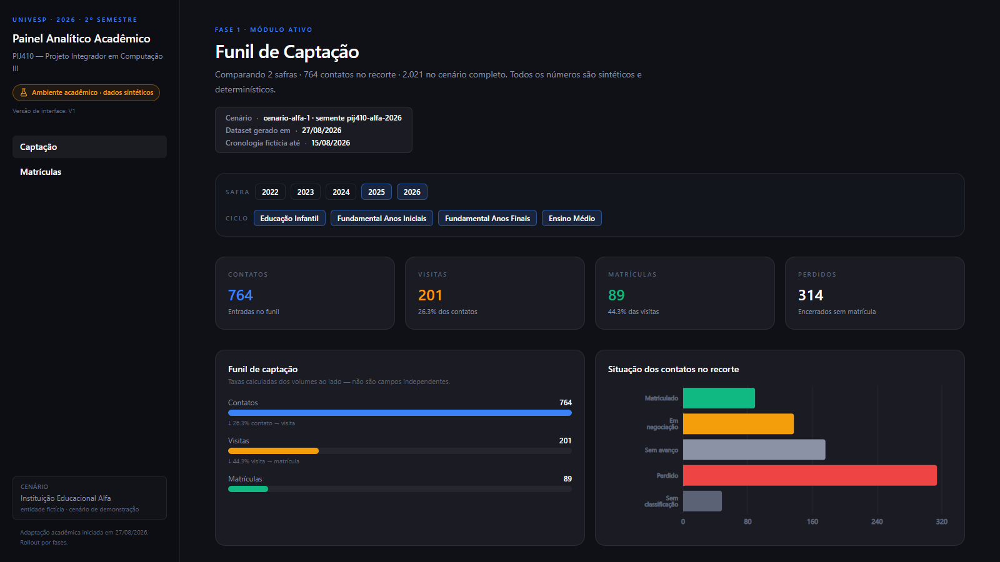

Fonte: Elaborado pelo grupo (2026), captura da aplicação acadêmica local com dados sintéticos.

Nota: as figuras da V1 preservam as capturas da interface apresentada a P1, inclusive o rótulo
legado “PIJ410 — Projeto Integrador em Computação III”. O componente correto deste trabalho é
PJI410 — Projeto Integrador em Computação IV.

### 3.1.4 Módulo de Matrículas

O módulo de Matrículas apresenta histórico sintético por safra, ciclo, turma e mês. A interface
permite filtrar os recortes e distinguir total de matrículas, rematrículas, novas matrículas e
participação de rematrículas no total da safra atual.

As visualizações complementares discriminam a composição por ciclo e turma, a efetivação mensal e
a participação de rematrículas por safra. O percentual apresentado corresponde à participação das
rematrículas no total atual das safras classificáveis; apesar do nome legado no campo interno, não
é retenção de coorte. A aplicação não calcula evasão nem continuidade individual entre safras.
Contagens, cálculos e casos sem base de comparação permanecem distintos.

Figura 2 – Indicadores e composição por safra em Matrículas na V1

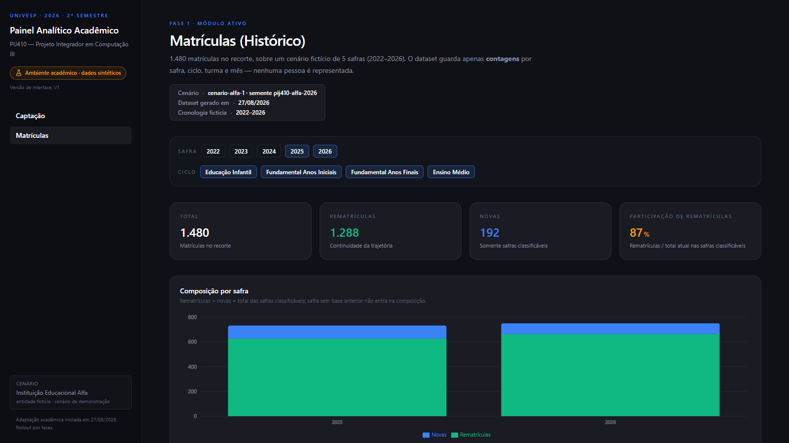

Fonte: Elaborado pelo grupo (2026), captura da aplicação acadêmica local com dados sintéticos.

### 3.1.5 Módulos de Ads

A V2 disponibiliza localmente Visão Geral Ads, Google Ads, Meta Ads e Estratégia, todos com dados
sintéticos. Não há integração com Google Ads API, Meta API ou CRM. Google Ads apresenta
investimento, impressões, cliques, conversões registradas, CTR, CPC, CPM e CPR, com filtros de
ano-calendário fictício e campanha e série mensal de CPR. CPR = investimento / conversões
registradas; não significa custo por matrícula ou lead único e não demonstra atribuição causal.
A granularidade é mensal, sem filtros diários artificiais.

Na Visão Geral, a comparação entre canais se limita a investimentos em períodos compatíveis;
resultados com denominadores distintos não são tratados como equivalentes. Meta Ads mantém
separados os resultados e custos por conversa e por interação; ausência de métrica produz valor
indisponível/agregado incompleto, não zero. Meta Ads não utiliza ML. Estratégia compara gastos
por canal com uma premissa mensal sintética de R$ 10.000 e apresenta gasto do último mês selecionado,
saldo e percentual de execução. Esse orçamento é fictício, não aprovado, ideal ou recomendação
automática; não há otimização nem execução de campanhas.

Figura 3 – Visão geral acadêmica de Ads na V2

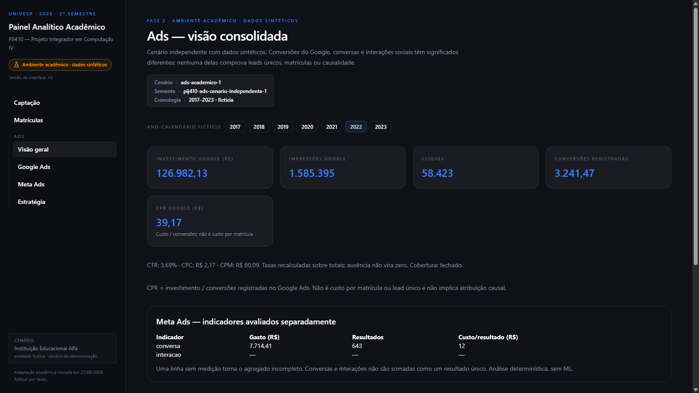

Fonte: Elaborado pelo grupo (2026), captura da aplicação acadêmica local com dados sintéticos.

### 3.1.6 Experimento de aprendizagem de máquina para CPR

Os dois experimentos de CPR descritos em 2.5.10 foram executados e seus resultados puderam ser
reproduzidos. No experimento inicial, a regressão teve erros menores que a regra simples. No
teste principal da extensão sazonal, porém, não superou a melhor regra de referência. Assim, o
conjunto dos resultados não sustenta o uso do modelo para orientar investimentos reais.

O treinamento ocorre por linha de comando, separado da interface. Google Ads apresenta os
arquivos de resultados, independentemente dos filtros de consulta. A variável prevista é
CPR = investimento / conversões registradas, não custo por matrícula ou lead único. A aplicação
não treina o modelo no navegador nem utiliza dados operacionais ou APIs reais.

Tabela 6 – Resultados do experimento inicial de CPR

| Modelo | MAE (R$ fictícios) | RMSE (R$ fictícios) | R² |
|---|---:|---:|---:|
| Persistência t−2 | 6,615678 | 8,363078 | −0,071903 |
| Regressão linear | 5,853007 | 7,673297 | 0,097625 |

Fonte: Elaborado pelo grupo, a partir da execução do experimento sintético (2026).

A regressão linear apresentou erros menores que a persistência nas métricas observadas, mas o
ganho foi modesto e o poder explicativo permaneceu baixo. Essa comparação vale para o cenário
sintético, inclusive para sua hipótese de maturação de 14 dias.

#### Previsão sazonal mensal — extensão técnica introduzida na V2 e mantida na V3

O experimento sazonal separado foi executado e reproduzido sobre o conjunto de dados sintéticos
de janeiro/2017 a janeiro/2023. O CPR mensal é calculado como soma
do investimento dividida pela soma das conversões registradas, quando a cobertura mensal é válida;
71 dos 73 meses do calendário têm CPR consolidado válido. O modelo OLS usa seno e cosseno do mês,
índice temporal e CPR de t−2 e t−12 como entradas. Pela hipótese sintética de maturação de 14
dias, t−1 não estava disponível. O teste principal reservou os 12 meses de 2022 e produziu:

Tabela 7 – Resultados da previsão sazonal de CPR no holdout

| Método | MAE (R$ fictícios) | RMSE (R$ fictícios) | R² |
|---|---:|---:|---:|
| Persistência t−2 | 6,563180 | 13,132417 | −0,082082 |
| Sazonal t−12 | 9,200559 | 15,375354 | −0,483273 |
| Regressão linear | 7,575144 | 14,257769 | −0,275481 |

Fonte: Elaborado pelo grupo a partir da execução sintética (2026).

A regressão superou o baseline sazonal t−12, com MAE 17,67% e RMSE 7,27% menores, mas não superou
a persistência t−2. O R² negativo e os erros observados indicam baixo poder explicativo neste
experimento sintético. O rolling origin mensal de um passo é análise complementar, não substitui
o holdout principal:

Tabela 8 – Resultados da previsão sazonal de CPR no rolling origin

| Método | MAE (R$ fictícios) | RMSE (R$ fictícios) | R² |
|---|---:|---:|---:|
| Persistência t−2 | 7,332367 | 12,576527 | 0,007587 |
| Sazonal t−12 | 8,321915 | 12,633565 | −0,001435 |
| Regressão linear | 6,335071 | 12,541304 | 0,013138 |

Fonte: Elaborado pelo grupo a partir da execução sintética (2026).

Os dois protocolos medem horizontes distintos; a limitação para uso real é discutida em 3.3.2.

Na análise descritiva retrospectiva, dezembro apresentou o maior índice sazonal (1,214), outubro
também ficou acima da média (1,131) e junho abaixo (0,893). O índice compara médias históricas
mensais com a média global; não é ML nem demonstra sazonalidade estável.

A V2 apresenta histórico sintético e projeção experimental recursiva de fevereiro/2023 a
janeiro/2024, além do índice sazonal e da comparação dos métodos. A V3 exibe o mesmo artefato,
sem alterar valores ou algoritmo, acrescido da explicitação dos limites (FB-V2-P1-007). As maiores
projeções são para
dezembro/2023 e fevereiro/2023; as menores, para maio e julho/2023. Os valores são estimativas do
cenário, não resultados futuros observados. Valores extremos e lags previstos podem se propagar
pela recursão. Essa extensão teve origem técnica/acadêmica, não comunitária; a alteração comunitária
FB-V1-P1-001 refere-se somente ao gráfico consolidado de Captação.

Tabela 9 – Valores projetados de CPR sintético

| Mês projetado | CPR sintético previsto (R$ fictícios) | Mês projetado | CPR sintético previsto (R$ fictícios) |
|---|---:|---|---:|
| Fev./2023 | 73,75 | Ago./2023 | 56,62 |
| Mar./2023 | 48,87 | Set./2023 | 51,36 |
| Abr./2023 | 67,15 | Out./2023 | 59,08 |
| Mai./2023 | 47,64 | Nov./2023 | 54,74 |
| Jun./2023 | 59,42 | Dez./2023 | 75,43 |
| Jul./2023 | 47,87 | Jan./2024 | 60,01 |

Fonte: Artefato sintético `src/data/google-cpr-sazonal.json` (2026).

Nota: Não foram calculados intervalos de confiança nem houve verificação dessas projeções com
dados reais posteriores.

Figura 4 – Histórico sintético e previsão sazonal experimental de CPR na V2

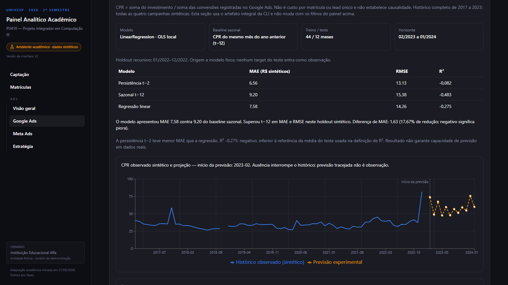

Fonte: Elaborado pelo grupo (2026), captura da aplicação acadêmica local com dados sintéticos.

### 3.1.7 Uso assistivo de IA agêntica

Em paralelo ao desenvolvimento da interface e aos experimentos de CPR, o grupo utilizou agentes
como apoio à programação, auditoria do repositório, revisão documental,
análise de consistência e verificação de testes e artefatos de CPR. O procedimento e os registros
de execução estão em 2.5.11 e `docs/run_log.md`. As saídas passaram por inspeção e decisão
humana; não houve avaliação independente da eficácia dos agentes nem simulação agêntica
específica documentada na solução analítica.

### 3.1.8 V4 e conclusão do escopo especificado das quatro fases

A V4 reúne, pela primeira vez em uma composição local, o escopo funcional explicitamente
especificado das quatro fases. Sua origem é **evolução técnica/acadêmica do grupo**; não houve
questionário ou avaliação comunitária entre V3 e V4. A quarta aplicação com P1 ocorreu somente
depois da implementação e é apresentada em 3.2.2. A V4 preserva os indicadores históricos de
V1–V3 e acrescenta módulos e análises identificados como sintéticos.

Em Conteúdo Orgânico, doze Reels fictícios têm mês, alcance e interações. A taxa de interação
divide interações por alcance. O score demonstrativo combina 70% da taxa normalizada e 30% do
alcance normalizado, segundo referências acadêmicas declaradas, e produz ranking com desempate
determinístico. Ausência de medição impede a classificação, enquanto zero interações observado
permanece um valor válido. A Figura 14 mostra a apresentação desse cenário; seu score não é
utilizado para ordenar anúncios pagos.

Em Objetivo da Gestão, o plano fictício calcula vagas alvo a partir de vagas hipotéticas e
taxas alvo por turma. Ele demonstra uma premissa de ocupação e não representa matrícula
observada, previsão institucional ou plano aprovado pela parceira (Figura 15). A página
Arquitetura & Algoritmos documenta na interface as fontes locais, as regras de cálculo,
as verificações e os limites de interpretação da solução.

Na segunda iteração técnica da V4, o Meta Ads passou a mostrar os cinco criativos fictícios
do mês associados ao indicador **conversa**, ordenados pelo menor CPR válido. Para cada
anúncio, CPR Meta = investimento ÷ conversas; sem conversas, o valor fica indisponível.
Interações são outro indicador e não entram nesse denominador. O ranking de anúncios pagos
da Figura 16 não utiliza o score de Reels orgânicos.

No Google Ads, o ranking mensal compara palavras-chave fictícias por custo, cliques,
conversões registradas e CPR (Figura 17). CPR Google = custo ÷ conversões registradas no
Google Ads; conversão zero ou ausente torna o CPR indisponível. Essas conversões não equivalem
a matrículas, leads únicos ou pessoas identificadas. Os registros granulares de ambos os
rankings são partições determinísticas das linhas mensais fechadas da base sintética;
preservam os totais de origem quando aplicável, sem acesso a APIs ou dados operacionais.

Em Estratégia, um gráfico complementar apresenta as séries mensais descritivas de CPR Google
por conversão registrada e CPR Meta por conversa (Figura 18). Os denominadores têm sentidos
diferentes: não há CPR agregado Google+Meta, atribuição causal de matrículas aos canais nem
mistura com a previsão experimental de CPR Google. O protótipo não contém dados pessoais,
integração com plataformas reais ou dados institucionais operacionais. As Figuras 14 a 18,
apresentadas após a rastreabilidade da seção 3.2, documentam essas funcionalidades técnicas;
não representam resultados produzidos pela avaliação de P1.

## 3.2 Avaliação com a comunidade e alterações decorrentes

V1 → 1ª avaliação de P1 → FB-V1-P1-001 → V2 → 2ª avaliação focal de P1 → V2 mantida →
3ª avaliação ampliada da V2 → FB-V2-P1-001 a FB-V2-P1-007 → V3 → evolução técnica/acadêmica
sem nova avaliação comunitária → V4 → 4ª avaliação de P1 → V4 mantida.

As quatro aplicações envolveram uma participante, não quatro amostras independentes. A segunda
avaliação encerrou o primeiro ciclo de alteração e retorno; não originou a V3. A quarta avaliou
uma V4 já implementada e não originou a própria V4.

### 3.2.1 Contato inicial e necessidades identificadas

Na conversa inicial, a gestora de marketing apresentou a necessidade de compreender quanto investir
em tráfego pago e avaliar a adequação dos valores aos objetivos da instituição. Em contato posterior
com a direção/mantenedora, o grupo buscou identificar informações e indicadores para acompanhar os
investimentos e resultados ao longo do tempo. O levantamento inicial também registrou a necessidade
de reunir dados dispersos, comparar resultados de canais e campanhas e apoiar decisões sobre a
distribuição do orçamento. Esses pontos orientaram indicadores, comparações e visualizações do
protótipo; descrevem o contato inicial e não constituem validação ou aprovação da interface. O
levantamento foi apoiado pelo questionário estruturado da comunidade externa preservado no
repositório, distinto dos instrumentos posteriores de validação da V1/V2.

### 3.2.2 Avaliação da solução pela participante

Os trechos citados a seguir preservam a redação de P1 nos registros primários; a marca [...] indica
supressão de parte da resposta. As interpretações e decisões apresentadas após cada fala são do
grupo, e as notas descrevem apenas a percepção dessa participante.

#### Primeiro momento — avaliação da V1

P1, gerente de Marketing, avaliou presencialmente em 07/10/2026 a V1, composta por Captação e
Matrículas com dados sintéticos; o TCLE foi obtido. Atribuiu 5/5 à clareza de Captação, 5/5 à
clareza de Matrículas e 5/5 à facilidade de localizar e utilizar os filtros. Considerou úteis os
gráficos temporais, mas identificou uma dificuldade: “Os gráficos em diversos lugares.” Sugeriu:
“Se tivesse uma opção de colocar no mesmo gráfico contato/visita e matrícula, com opção de
selecionar quando quer usar, facilitaria [...]”.

Figura 5 – Gráficos temporais separados de Captação na V1

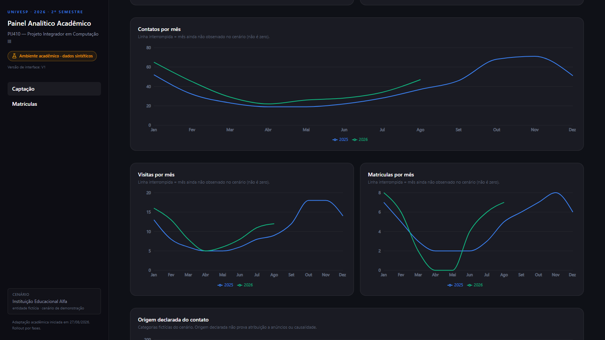

Fonte: Elaborado pelo grupo (2026), captura da aplicação acadêmica local com dados sintéticos.

O grupo interpretou que a dificuldade estava na dispersão de séries relacionadas, não nos
indicadores em si. Decidiu incorporar a sugestão como FB-V1-P1-001: os gráficos separados de
Contatos, Visitas e Matrículas deram lugar a uma visualização temporal consolidada, com seleção
independente das três séries. **Efeito no desenvolvimento:** esse ajuste foi implementado na V2.
Ads e o experimento inicial de CPR também entraram na V2, por evolução técnica e acadêmica
independente da primeira avaliação.

Figura 6 – Evolução temporal consolidada de Captação na V2

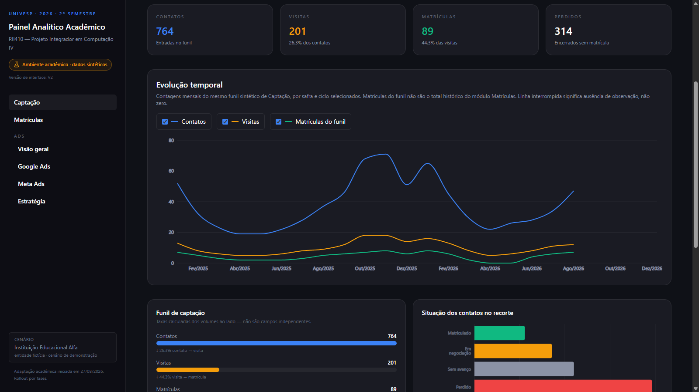

Fonte: Elaborado pelo grupo (2026), captura da aplicação acadêmica local com dados sintéticos.

#### Segundo momento — reavaliação da V2

Na mesma data, a mesma P1 utilizou a V2 para examinar o ajuste que havia solicitado. Atribuiu 5/5
à clareza de Captação, 5/5 à seleção das séries temporais e 5/5 à clareza de Matrículas. Sobre a
visualização conjunta, respondeu: “Facilitou pq consigo avaliar a qualidade do lead que relaciona
o contato ocm a visita, e a conversao final que é a matricula”. Em sua percepção, o novo
gráfico tornou mais fácil observar a relação entre contatos, visitas e matrículas; a fala não
constitui medida objetiva da qualidade dos leads. P1 não relatou nova dificuldade e respondeu
“Por enquanto, tudo ok.” à pergunta sobre outras alterações.

**Efeito no desenvolvimento:** esse retorno encerrou o primeiro ciclo de avaliação, alteração e
reavaliação com a participante. A V2 foi mantida para uma aplicação ampliada posterior, sem que
esse segundo momento originasse outra versão. Ads e ML não integraram as tarefas dessa reavaliação
focal.

#### Terceiro momento — avaliação ampliada da V2

Em aplicação posterior, P1 respondeu a 16 questões sobre navegação, Captação, Matrículas, Ads,
Estratégia e apresentação da previsão experimental. O TCLE foi obtido e assinado; data e
modalidade não constam do registro primário consultado. As notas de navegação foram 4, 5 e 4
(questões 1–3); as de Captação e Matrículas, 5 e 4 (questões 4–5); as quatro notas de Ads e
Estratégia foram 3 (questões 7–10); e as de apresentação do ML, 4, 5 e 5 (questões 11–13).
Na classificação final, escolheu “C  Precisa de alterações importantes antes da versão final.”
As menores notas concentraram-se em Ads e Estratégia. P1 também solicitou ajustes específicos em
Captação e Matrículas. Em conjunto com a classificação final da V2, essas observações motivaram
uma nova rodada de alterações. Ao apontar Matrículas como o resultado
mais relevante para seu trabalho, P1 expressou uma prioridade profissional, não uma relação
causal demonstrada pelo protótipo.

Em Captação, P1 pediu: “um gráfico temporal tb entrevisitas/matriculas onde mostra percentual de
efetivação.” Em Matrículas, sugeriu: “Em amtricula poderíamos ter uma avaliação de metriculas e
rematrículas por series.” O grupo registrou FB-V2-P1-001 e FB-V2-P1-002 e decidiu acrescentar,
na V3, a taxa mensal de efetivação visita–matrícula no mesmo funil e a comparação de matrículas
novas e rematrículas por série existente no cenário sintético.

Figura 7 – V3: efetivação visita–matrícula em Captação

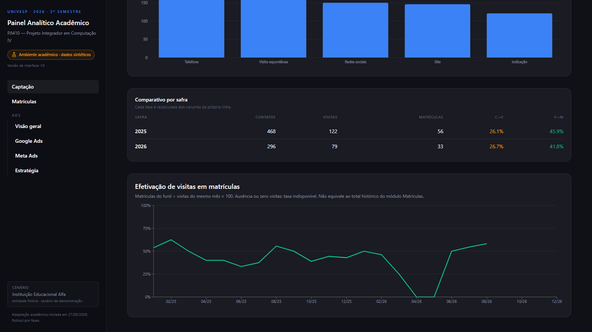

Fonte: Elaborado pelo grupo (2026), captura da V3 da aplicação acadêmica local com dados sintéticos, após incorporação de FB-V2-P1-001.

Figura 8 – V3: matrículas e rematrículas por série

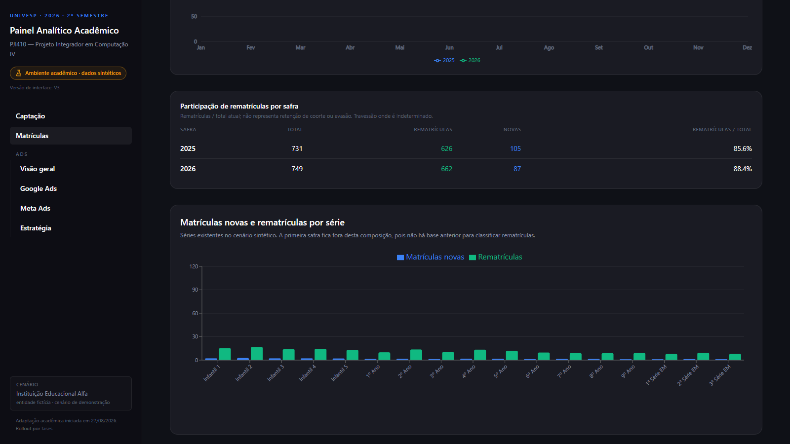

Fonte: Elaborado pelo grupo (2026), captura da V3 da aplicação acadêmica local com dados sintéticos, após incorporação de FB-V2-P1-002.

Na Visão Geral de Ads, P1 explicou: “Visao geral preciso de um resumo mensal pois avalio o
investimento mensalmente [...]” e pediu que o gráfico temporal mostrasse “quantos leads reais
gerou”. O grupo converteu essas necessidades em FB-V2-P1-003, resumo mensal na Visão Geral, e
FB-V2-P1-004, investimento e leads simulados por mês no Google Ads. Embora a participante tenha
pedido leads reais, a V3 apresenta apenas valores sintéticos, identificados como simulação.

Figura 9 – V3: resumo mensal da Visão Geral de Ads

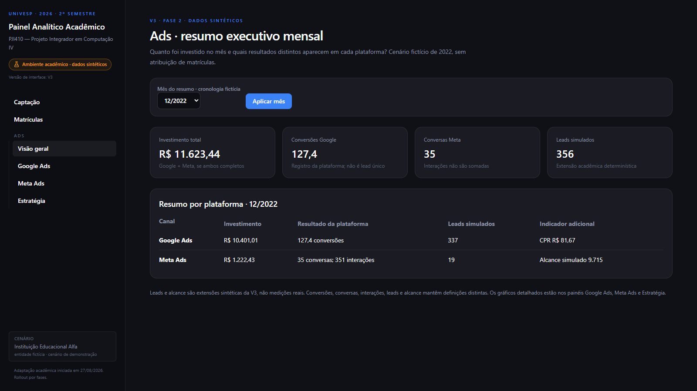

Fonte: Elaborado pelo grupo (2026), captura da V3 da aplicação acadêmica local com dados sintéticos, após incorporação de FB-V2-P1-003.

Figura 10 – V3: investimento e leads simulados no Google Ads

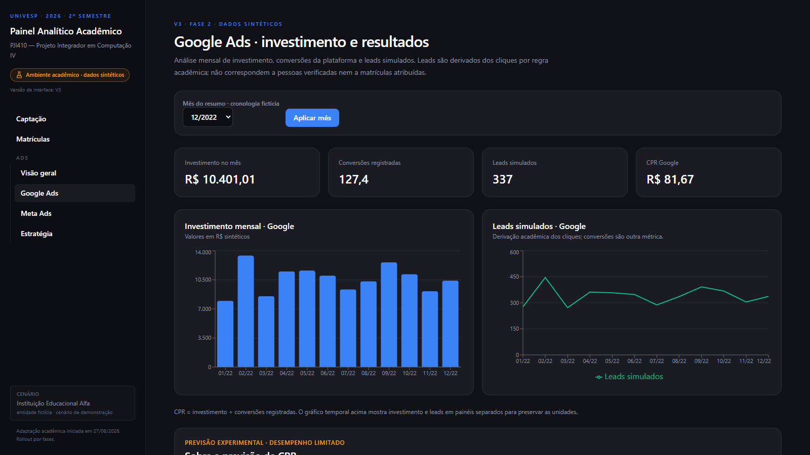

Fonte: Elaborado pelo grupo (2026), captura da V3 da aplicação acadêmica local com dados sintéticos, após incorporação de FB-V2-P1-004.

Para Meta Ads, P1 pediu dados sobre “quantos resultados alcançamo (pessoas alcançadas)” e “quanto
investimos nesse mês comparado aos leads gerados pela plataforma”. O grupo
registrou FB-V2-P1-005 e separou na V3 alcance, investimento e leads simulados, sem tratar alcance
ou lead como resultado de matrícula. Para Estratégia, solicitou “preciso aqui em gráfico temporal
quantos estamos investindo por mês, uma linha google, uma meta [...]”. A decisão FB-V2-P1-006
resultou em comparação temporal entre investimentos Google/Meta, leads simulados e matrículas
sintéticas; cenários independentes não autorizam inferência causal entre Ads e Matrículas.

Figura 11 – V3: alcance, investimento e resultados no Meta Ads

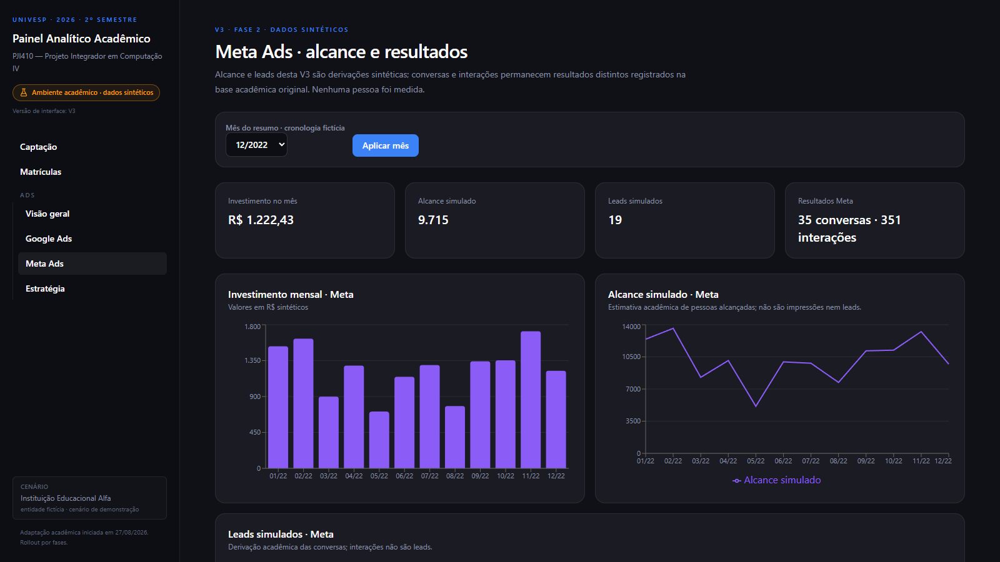

Fonte: Elaborado pelo grupo (2026), captura da V3 da aplicação acadêmica local com dados sintéticos, após incorporação de FB-V2-P1-005.

Figura 12 – V3: comparação temporal no módulo Estratégia

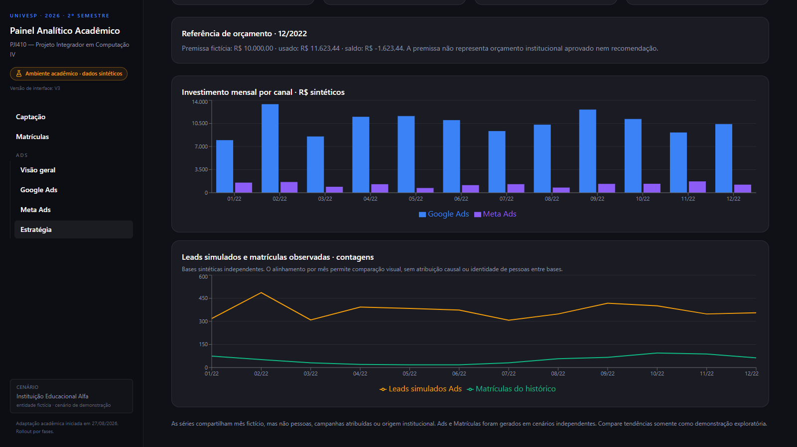

Fonte: Elaborado pelo grupo (2026), captura da V3 da aplicação acadêmica local com dados sintéticos, após incorporação de FB-V2-P1-006.

Sobre o CPR, o comentário espontâneo foi: “Achei que esta variando muito a previsão, da p entender
mas n parece proximo do real”. A participante compreendeu a apresentação, mas relatou baixa
confiança na proximidade da previsão com sua expectativa prática. Em FB-V2-P1-007, o grupo decidiu
melhorar a comunicação: a V3 distingue histórico e previsão e explicita o desempenho limitado.
Essa decisão não alterou algoritmo, valores ou métricas do experimento.

Figura 13 – V3: comunicação dos limites da previsão experimental de CPR

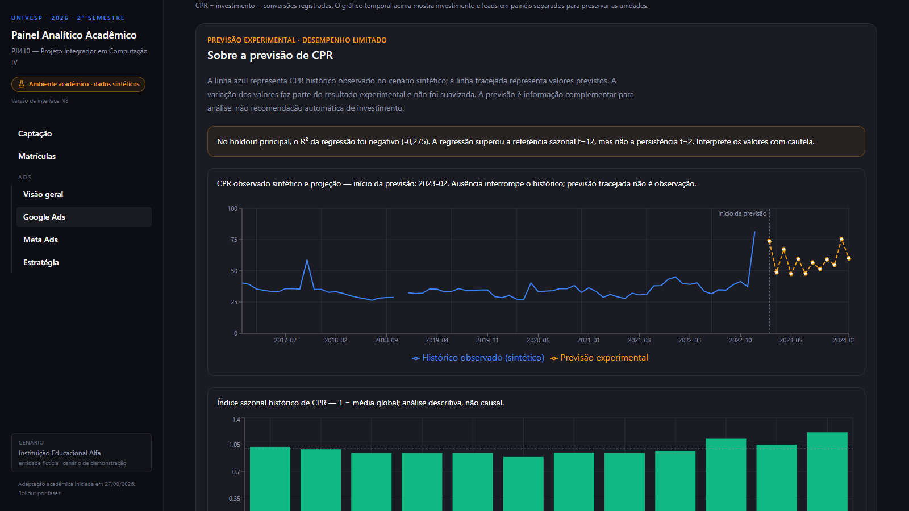

Fonte: Elaborado pelo grupo (2026), captura da V3 da aplicação acadêmica local com dados sintéticos, após incorporação de FB-V2-P1-007.

As Figuras 7 a 13 documentam a implementação visual das alterações. Não constituem avaliação da
V3 por P1 nem prova de impacto institucional ou de qualidade preditiva do modelo.

**Efeito no desenvolvimento:** os sete feedbacks da terceira avaliação foram analisados pelo
grupo e incorporados à V3. A implementação passou por verificação técnica, descrita em 3.3;
P1 não avaliou a V3. A aplicação seguinte ocorreu depois da evolução técnica que produziu a
V4. As falas anteriores citadas constam dos registros primários
`docs/validacao/respostas/v1-p1.md`, `docs/validacao/respostas/v2-p1-reavaliacao.md` e
`docs/validacao/respostas/v2-p1-para-v3.md`; o instrumento e a análise dos feedbacks estão
identificados na seção 2.5.12.

#### Quarto momento — avaliação da V4

P1, Gerente de Marketing, avaliou **online, em 14/10/2026**, a V4 já implementada. Nas oito
questões fechadas, relativas a navegação, Conteúdo Orgânico, Gestão, Arquitetura & Algoritmos,
ranking Meta, ranking Google, CPR temporal em Estratégia e utilidade geral, as notas foram:
**Q1 = 5; Q2 = 5; Q3 = 5; Q4 = 5; Q5 = 5; Q6 = 5; Q7 = 5; Q8 = 5**. A média descritiva foi
**5,0 / 5,0**. Na Q11, P1 escolheu **A — “A versão está adequada para uso no contexto
apresentado, sem necessidade de alterações relevantes.”** As notas descrevem a percepção de
uma participante; não constituem amostra estatística nem permitem generalização.

Os trechos a seguir preservam a redação da participante conforme o registro primário. Na Q9,
ela apontou como parte mais útil: “Aparte do ADS que mostra o relatório do quantitativo de
alcance e interações tanto google quanto meta”. Na Q10, respondeu: “No uso inicial parece
estar tudo dentro da minha necessidade”. Na Q12, não solicitou mudança específica e escreveu:
“No fluxo de utilização atual esta sendo o suficiente, estamos tendo um resultado comparativo
com ano passado melhor, e esses painéis estão ajudando muito a mensurar isso.”

P1 relatou perceber melhora comparativa em relação ao ano anterior e afirmou que os painéis
auxiliavam sua mensuração. Esse relato pertence ao contexto profissional da participante;
o protótipo acadêmico não verifica o resultado institucional referido nem permite atribuir
eventual melhora à plataforma ou aos investimentos em mídia. Nesta aplicação, **nenhuma
alteração relevante foi solicitada**, nenhuma necessidade de V5 foi identificada e a V4 foi
mantida como versão avaliada atual. Isso não equivale a validação definitiva. As respostas
literais estão em `docs/validacao/respostas/v4-p1.md`, separadas da análise em
`docs/validacao/analise-v4-p1.md`.

### 3.2.3 Comparação entre necessidades iniciais e avaliação do ciclo V1–V2

Esta matriz distingue as necessidades iniciais do que foi efetivamente observado nos dois
primeiros momentos da mesma participante. A terceira aplicação ampliada está descrita na seção
3.2.2 e não altera retroativamente o escopo desses dois registros.

Tabela 10 – Comparação entre necessidades iniciais e ciclo V1–V2

| Dimensão | Antes: necessidade ou expectativa inicial | Evidência deste ciclo (P1/V1 e P1/V2) |
|---|---|---|
| Investimento em mídia | Compreender quanto investir e avaliar a adequação dos valores | Não avaliado neste ciclo; Ads e orçamento não integraram as tarefas registradas. |
| Indicadores | Acompanhar informações relevantes para a gestão | P1 atribuiu 5/5 à clareza de Captação e Matrículas em cada versão; avaliação individual desses módulos. |
| Comparações | Comparar períodos e, quando houver dados, canais ou campanhas | P1 destacou gráficos temporais na V1 e relatou comparação facilitada pelo gráfico conjunto na V2; canais e campanhas não foram avaliados. |
| Organização | Reunir informações dispersas em uma visão compreensível | P1 apontou gráficos temporais em lugares diferentes na V1 e relatou facilidade de comparação após a consolidação na V2. |
| Interface | Apresentar resultados de modo sintético e acompanhável | P1 atribuiu 5/5 aos filtros na V1 e à seleção das séries na V2; sem inferência para a interface inteira. |

Fonte: Elaborado pelo grupo (2026).

O recorte documentado do ciclo V1–V2 permite a seguinte comparação descritiva dos dois momentos
da mesma P1. As notas não medem ganho experimental entre versões:

Tabela 11 – Evolução da visualização temporal da V1 à V2

| Aspecto | V1 | Evidência inicial | Alteração na V2 | Reavaliação |
|---|---|---|---|---|
| Visualização temporal | Séries de Contatos, Visitas e Matrículas em gráficos separados | Apontou “Os gráficos em diversos lugares” e sugeriu visualização conjunta selecionável | Gráfico temporal consolidado com seleção independente das séries | Relatou que a visualização conjunta facilitou a comparação ao longo do tempo |

Fonte: Elaborado pelo grupo com base nos dois registros anonimizados de P1 (2026).

Na terceira aplicação, as menores notas concentraram-se em Ads e Estratégia (3 em cada uma das
questões 7–10), ao passo que navegação, Captação/Matrículas e apresentação do ML receberam notas
de 4 ou 5. A comparação é descritiva e individual; os instrumentos dos três primeiros momentos têm escopos
distintos. A implementação posterior da V3 responde aos pedidos de resumo mensal, análise por
série, comparação temporal e comunicação mais explícita dos limites da previsão, sem comprovar
melhoria percebida pela participante.

### 3.2.4 Rastreabilidade entre necessidade, solução e avaliação externa

A tabela relaciona a escuta inicial, a solução construída e o alcance das duas primeiras
aplicações. As dimensões de Ads não foram apresentadas nessas tarefas; a terceira aplicação
ampliada e sua implementação V3 estão descritas adiante. A cadeia específica de FB-V1-P1-001
é discriminada na Tabela 13.

Tabela 12 – Rastreabilidade entre necessidade, solução e validação

| Necessidade identificada | Elemento da solução | Evidência no protótipo | Evidência do ciclo P1 |
|---|---|---|---|
| Compreender quanto investir em mídia | Indicadores e comparação determinística de orçamento | Ads sintéticos ativos localmente; premissa fictícia, sem determinar orçamento ideal | Não avaliado por P1 neste ciclo. |
| Avaliar a adequação dos investimentos | Métricas determinísticas e limites explícitos | Indicadores de Ads sintéticos; dados reais de mídia não autorizados | Não avaliado por P1 neste ciclo. |
| Acompanhar indicadores | Painéis de Captação e Matrículas | Indicadores, filtros e visualizações da Fase 1 | P1 atribuiu 5/5 à clareza de ambos os módulos nos dois momentos. |
| Comparar períodos e canais | Filtros temporais e visualizações comparativas | Safras na Fase 1; ano-calendário fictício e investimentos por canal na Fase 2 | P1 destacou a utilidade dos gráficos temporais; canais não foram avaliados. |
| Organizar informações dispersas | Interface web com dados e contexto padronizados | Módulos acadêmicos independentes com dados sintéticos | P1 apontou dispersão dos gráficos temporais na V1 e relatou comparação facilitada na V2 após o ajuste. |

Fonte: Elaborado pelo grupo (2026).

Tabela 13 – Rastreabilidade do ajuste FB-V1-P1-001

| Necessidade/observação | Evidência | Decisão | Implementação | Avaliação posterior |
|---|---|---|---|---|
| Visualizações temporais distribuídas (FB-V1-P1-001) | P1/V1 relatou a dispersão e sugeriu um gráfico conjunto selecionável | O grupo aprovou a consolidação | V2 reuniu Contatos, Visitas e Matrículas em visualização temporal multissérie selecionável | P1/V2 relatou que a apresentação facilitou a comparação; não relatou nova dificuldade |

Fonte: Elaborado pelo grupo com base nos dois registros anonimizados de P1 (2026).

Na avaliação ampliada da V2, a cadeia de rastreabilidade foi estendida aos sete feedbacks
aceitos e incorporados à V3. A Tabela 14 reúne origem, análise, decisão, alteração e verificação
de cada item; as respostas literais permanecem em `docs/validacao/feedback-v2-v3.md`.

### 3.2.5 Feedback, decisões e alterações implementadas

A Tabela 14 distingue os ajustes originados em feedback de P1, a evolução técnica V3→V4 e a
avaliação posterior da V4. O grupo incorporou os sete feedbacks da terceira aplicação à V3;
nenhuma alteração relevante decorreu da quarta.

Tabela 14 – Rastreabilidade das avaliações, decisões e alterações implementadas

| Origem | Feedback ou item | Análise e decisão do grupo | Alteração implementada | Versão | Verificação ou evidência |
|---|---|---|---|---|---|
| P1 — 1ª avaliação da V1 | FB-V1-P1-001: gráficos temporais dispersos | Consolidação aprovada, preservando as séries do mesmo funil | Gráfico multissérie selecionável de Contatos, Visitas e Matrículas | V2 | Testes de V2 e preservação dos 17 hashes da V1; P1 reavaliou a apresentação |
| P1 — 2ª avaliação focal da V2 | Confirmação do ajuste anterior; sem novo feedback de mudança | Manter V2 naquele ciclo | Nenhuma nova alteração solicitada | V2 mantida | Registro primário da reavaliação V2 |
| P1 — 3ª avaliação ampliada da V2 | FB-V2-P1-001: efetivação visita–matrícula | Aceito para o mesmo funil, com denominador definido | Taxa mensal e indisponibilidade quando visitas são zero ou ausentes | V3 | `test:v3-feedback` e `test:interface:http` |
| P1 — 3ª avaliação ampliada da V2 | FB-V2-P1-002: matrículas e rematrículas por série | Aceito apenas para séries existentes no dado sintético | Comparação por série; safra sem classificação excluída | V3 | `test:v3-feedback` e `test:interface:http` |
| P1 — 3ª avaliação ampliada da V2 | FB-V2-P1-003: resumo mensal de Ads | Aceito; detalhes permanecem nos painéis específicos | Seletor mensal, indicadores e tabela por canal na Visão Geral | V3 | `test:interface:http` e captura local |
| P1 — 3ª avaliação ampliada da V2 | FB-V2-P1-004: evolução de leads no Google | Aceito com rótulo de simulação e distinção de conversões | Investimento e leads simulados por mês | V3 | `test:v3-feedback` e `test:interface:http` |
| P1 — 3ª avaliação ampliada da V2 | FB-V2-P1-005: alcance, investimento e leads Meta | Aceito mantendo alcance, lead e resultado distintos | Métricas e gráficos separados no Meta Ads | V3 | `test:v3-feedback` e `test:interface:http` |
| P1 — 3ª avaliação ampliada da V2 | FB-V2-P1-006: comparação temporal em Estratégia | Aceito sem inferir atribuição causal entre cenários | Investimento por canal e contagens de leads/matrículas no mesmo eixo temporal | V3 | `test:v3-feedback` e `test:interface:http` |
| P1 — 3ª avaliação ampliada da V2 | FB-V2-P1-007: previsão percebida como variável | Aceito como melhoria de comunicação, sem alterar algoritmo ou valores | Explicação simples, aviso de desempenho limitado e gráfico histórico/previsão | V3 | `test:google-cpr:sazonal` e reprodução do artefato |
| Grupo — sem avaliação entre V3 e V4 | TEC-002 a TEC-005: conclusão do escopo das Fases 3 e 4 e composição V4 | Evolução técnica/acadêmica previamente especificada | Reels orgânicos, plano fictício de gestão, documentação da arquitetura e composição das quatro fases | V4 | `test:v4`, gates e capturas locais |
| Grupo — segunda iteração técnica da V4 | TEC-006 a TEC-008: rankings Ads e CPR temporal | Evolução técnica/acadêmica, sem origem em P1 | Criativos Meta, palavras-chave Google e CPR separado por canal | V4 | `test:v4`, `test:interface:http` e capturas locais |
| P1 — 4ª avaliação posterior da V4 | Oito notas 5/5, opção A; nenhuma alteração relevante solicitada | Manter V4; nenhuma V5 aberta neste ciclo | Nenhuma alteração decorrente desta aplicação | V4 mantida | Registro primário `respostas/v4-p1.md` e análise separada |

Fonte: Elaborado pelo grupo (2026).

Ads e o experimento inicial de CPR entraram na V2 por evolução técnica e acadêmica independente
de FB-V1-P1-001. As alterações comunitárias V2→V3 constam de
`docs/validacao/feedback-v2-v3.md`; os itens técnicos V3→V4, de
`docs/validacao/v3-v4-matriz.md`. A V3 reúne cenários sintéticos independentes, sem atribuição
causal, e não foi avaliada por P1. As Figuras 1 a 6 preservam a evidência histórica da V1/V2;
as Figuras 7 a 13 documentam a V3; as Figuras 14 a 18 mostram a V4 já implementada, sem
constituir prova de impacto institucional.

Em síntese, a V1 oferecia Captação e Matrículas; a primeira avaliação apontou a dispersão dos
gráficos e originou o ajuste incorporado à V2. Essa versão reuniu o gráfico selecionável e ganhou
Ads/CPR por evolução técnica independente. A segunda avaliação confirmou, na percepção de P1, a
utilidade do ajuste, sem gerar outra versão. Na terceira avaliação, agora ampliada à V2, P1 indicou
sete necessidades que o grupo incorporou à V3. A transição V3→V4 concluiu tecnicamente o
escopo especificado das quatro fases, sem aplicação comunitária intermediária. Só depois P1
avaliou a V4, atribuiu oito notas 5/5, escolheu A e não solicitou alteração relevante. O
grupo manteve a V4, sem abrir V5.

As cinco capturas seguintes registram a interface técnica da V4 já implementada. Sua posição
após a tabela mantém a sequência das figuras históricas; as imagens não são evidência de
desempenho institucional nem resultado produzido pela avaliação de P1.

Figura 14 – V4: ranking sintético de Reels orgânicos

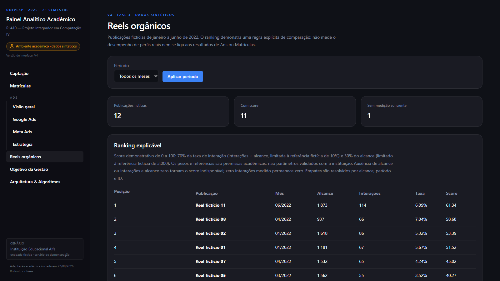

Fonte: Elaborado pelo grupo (2026), captura da V4 da aplicação acadêmica local com dados sintéticos.

Figura 15 – V4: plano fictício de vagas e ocupação em Gestão

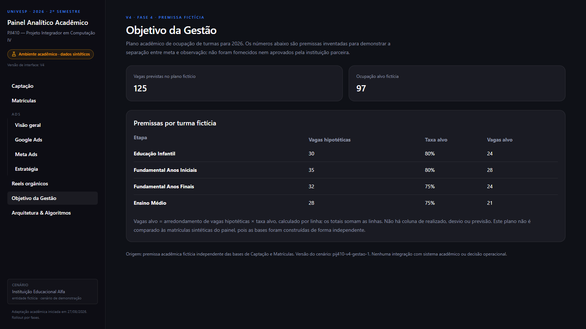

Fonte: Elaborado pelo grupo (2026), captura da V4 da aplicação acadêmica local com dados sintéticos.

Figura 16 – V4: ranking sintético de anúncios no Meta Ads

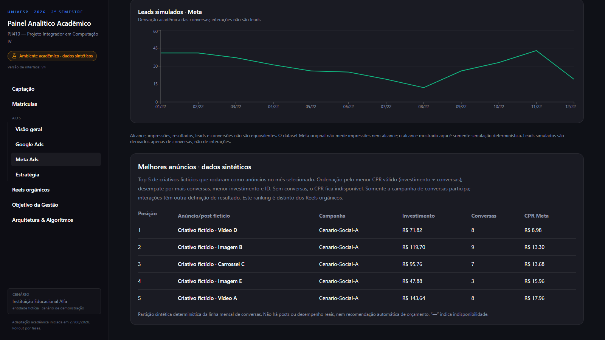

Fonte: Elaborado pelo grupo (2026), captura da V4 da aplicação acadêmica local com dados sintéticos.

Figura 17 – V4: ranking sintético de palavras-chave no Google Ads

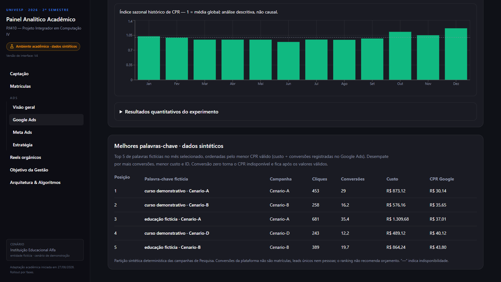

Fonte: Elaborado pelo grupo (2026), captura da V4 da aplicação acadêmica local com dados sintéticos.

Figura 18 – V4: séries temporais separadas de CPR em Estratégia

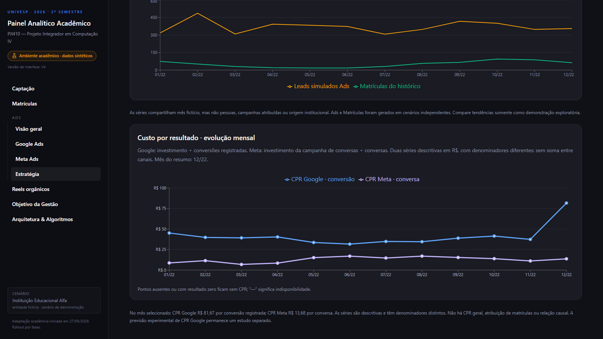

Fonte: Elaborado pelo grupo (2026), captura da V4 da aplicação acadêmica local com dados sintéticos.

## 3.3 Verificação técnica da solução e limitações

### 3.3.1 Testes e verificação técnica

A verificação técnica examinou se os cálculos produziam os valores esperados, se os arquivos de
resultados podiam ser reproduzidos e se cada versão liberava somente os módulos previstos. Em
06/10/2026, passaram os testes (`npm test`), as análises de código (lint e TypeScript), a geração
da aplicação (build), os verificadores dos dois experimentos de CPR e 38 verificações de não
vazamento. Quarenta acessos locais às páginas (verificações HTTP) cobriram V1/V2, a extensão
sazonal disponível somente na V2 e o bloqueio das Fases 3 e 4. Os resultados reproduzidos foram
comparados integralmente, byte a byte, aos arquivos versionados.

Na implementação da V3, `npm run build`, `npm test` e `npm run test:interface:http` voltaram a
passar. A suíte verificou a nova taxa com denominador zero, as regras sintéticas, as 17
assinaturas que protegem os arquivos da V1, o acesso às páginas V1/V2/V3 e o bloqueio das Fases
3 e 4. As capturas da V3 foram conferidas visualmente e incorporadas ao capítulo 3, sem substituir
as figuras históricas. Esse é o estado **histórico da V3**: os testes verificaram sua execução
técnica, mas P1 não avaliou seu uso.

Na V4, os testes de interface passaram a verificar a composição das quatro fases, o isolamento
de V1–V3, os rankings sintéticos de anúncios e palavras-chave e o CPR temporal com denominadores
separados. As proteções dos 17 hashes V1 e 13 hashes V3 foram preservadas. As Figuras 14 a 18
foram conferidas visualmente; a quarta aplicação com P1 avaliou a percepção de uso da V4 já
implementada, separadamente da verificação de código e cálculo.

Os testes também examinam integridade e determinismo dos dados sintéticos, cálculo dos
indicadores e separação entre alcance, lead e conversão.

### 3.3.2 Limitações

Quatro limites orientam a interpretação dos resultados: os dados são sintéticos; a aplicação não
se integra aos sistemas operacionais da instituição; as quatro avaliações externas envolveram
uma única participante; e o experimento de CPR apresentou desempenho preditivo limitado. Em
conjunto, eles restringem o trabalho à demonstração acadêmica de organização, cálculo e
visualização, sem prova de impacto institucional ou generalização estatística.

Os módulos funcionais não se conectam a contas de anúncios, CRM, sistemas acadêmicos ou bases da
instituição. Assim, não permitem medir o desempenho real das campanhas.

As fontes disponíveis não permitem atribuir individualmente uma matrícula a uma ação de mídia
nem estabelecer inferência causal. Na V3 e na V4, Ads e Matrículas compartilham meses fictícios de 2022,
mas provêm de cenários sintéticos independentes, sem chave de ligação. Leads e alcance dos painéis
Ads são derivações determinísticas
criadas para demonstração e não medições de plataforma ou pessoas. O total de leads simulados não
representa pessoas únicas deduplicadas. A taxa visita–matrícula usa somente as contagens do funil
de Captação; não deve ser confundida com a base histórica do módulo Matrículas. A classificação
de matrículas novas/rematrículas não é conhecida na primeira safra do cenário.
Associações agregadas devem ser interpretadas dentro do período, da unidade de análise e da regra
de atribuição declarados. A ausência de períodos históricos autorizados para Google Ads, Meta Ads e
conteúdo orgânico impede apresentar resultados operacionais desses componentes. Não impede
o experimento separado de CPR, executado exclusivamente sobre dados sintéticos.

Na V4, os criativos Meta e as palavras-chave Google foram derivados por partição determinística
das linhas sintéticas, não observados nas plataformas. CPR Meta por conversa e CPR Google por
conversão registrada têm denominadores distintos, por isso não são agregados. Os rankings
não comprovam eficiência real nem constituem recomendação automática de orçamento. O plano
de Gestão é fictício e não representa ocupação aprovada ou medida pela instituição.

Resultados obtidos em cenário sintético não podem ser generalizados para a operação da instituição
ou para outras organizações. Os experimentos de CPR são exploratórios, apresentam poder preditivo
limitado e dependem do processo gerador e da hipótese sintética de maturação de 14 dias. A previsão
recursiva pode amplificar valores extremos. Esses resultados não demonstram disponibilidade
histórica de métricas reais ou utilidade operacional. A interpretação assistida por IA não
substitui evidência, cálculo ou decisão humana.

A validação comunitária contou com uma participante, gerente de Marketing. Ela avaliou
presencialmente a V1 e reavaliou a V2 em 07/10/2026; depois, avaliou a V2 de forma ampliada.
O TCLE dessas três aplicações foi obtido e assinado. Data e modalidade do terceiro momento não
constam do registro primário consultado. A V3 não foi avaliada por P1. Em quarto momento,
P1 avaliou online a V4 em 14/10/2026. As oito notas 5/5 e a opção A expressam sua percepção
individual, não validação definitiva. O relato de Q12 sobre comparação com o ano anterior
não foi verificado com dados operacionais e não demonstra que a plataforma ou os anúncios
tenham causado melhora institucional. As avaliações sucessivas não formam amostra independente
ou comparação quantitativa controlada. As séries sintéticas agregadas não medem a qualidade
individual dos leads nem sustentam rastreamento de pessoas ou atribuição causal entre etapas
do funil.

# 4 CONSIDERAÇÕES FINAIS

O projeto demonstrou, no protótipo acadêmico, que é possível organizar os conjuntos de dados
definidos para o estudo, calcular indicadores rastreáveis e apresentar recortes temporais e
comparações para apoiar a interpretação de investimentos em mídia digital. Isso responde à
pergunta central quanto à organização e à apresentação das informações. Os indicadores oferecem
elementos para análise, sem substituir a decisão dos responsáveis.

A V1 apresentou Captação e Matrículas com cálculos determinísticos. P1, gerente de Marketing,
avaliou-a presencialmente em 07/10/2026, com TCLE obtido, e apontou a dispersão dos gráficos
temporais. O grupo aprovou FB-V1-P1-001 e reuniu as séries na V2. Na reavaliação presencial da
mesma data, ela relatou comparação facilitada, sem nova dificuldade ou pedido de alteração naquele
momento. Esse retorno encerrou o primeiro ciclo com P1 e manteve a V2. A versão também acrescentou
Visão Geral de Ads, Google Ads, Meta Ads, Estratégia e a apresentação acadêmica do CPR por
evolução técnica independente desse feedback.

Na terceira aplicação, P1 avaliou a V2 de forma ampliada, solicitou sete grupos de ajustes e
classificou a versão como necessitando alterações importantes. O grupo analisou os feedbacks,
decidiu incorporá-los e implementou a V3: apresentação mensal, composição de matrículas por
série, efetivação de visitas, comparações temporais e comunicação mais clara dos limites da
previsão. P1 não avaliou a V3. Em seguida, por evolução técnica/acadêmica **sem nova aplicação
comunitária entre as versões**, o grupo implementou a V4 com o escopo especificado das quatro
fases, rankings sintéticos de Ads e CPR temporal por canal. A quarta avaliação ocorreu depois
dessa implementação: P1 atribuiu 5/5 às oito questões fechadas, escolheu A e não solicitou
alteração relevante. A V4 foi mantida, sem abertura de V5. Os quatro momentos atendem ao
objetivo de avaliar o protótipo com uma profissional e incorporar contribuições viáveis, dentro
do limite de uma única participante; não equivalem a validação externa ampla.

Os experimentos de CPR delimitam o alcance da solução. No experimento inicial, a
regressão apresentou erros menores que a persistência t−2. No período de teste principal do
experimento sazonal, superou a referência t−12, mas não a persistência t−2, e obteve R²
negativo. Esse resultado é um achado válido: o experimento foi executado e reproduzido com
controle da informação disponível no momento da previsão, mas não demonstrou desempenho
preditivo suficiente para uso operacional ou recomendação automática de investimento. Testes
automatizados, verificações de não vazamento e reprodução dos arquivos de resultados sustentam
o funcionamento técnico descrito. As práticas de IA agêntica apoiaram construção, análise e
verificação sob revisão humana; não houve avaliação de sua eficácia nem simulação agêntica
específica via linha de comando.

A contribuição do estudo inclui a distinção entre ausência de dado e valor zero, a separação
entre indicadores calculados e previsões experimentais e a rastreabilidade das alterações.
Dados sintéticos independentes, uma única participante, séries agregadas sem rastreamento
individual ou inferência causal, ausência de integrações operacionais e desempenho preditivo
limitado impedem generalizar as percepções de P1 ou afirmar melhoria real de decisões de
orçamento, redução de custos, aumento de matrículas ou impacto institucional. A fala de Q12
sobre comparação anual permanece relato da participante, sem verificação institucional ou
inferência causal. As quatro fases foram implementadas na V4 dentro do escopo documental;
nenhum uso operacional real foi demonstrado.

Avaliações futuras com outros profissionais poderão ampliar a compreensão de uso da V4, sem
pressupor uma nova versão. O exame de dados reais dependerá de autorização e anonimização;
integrações operacionais exigirão requisitos próprios de segurança. Séries mais amplas e
outros modelos dependerão de dados suficientes e de qualidade. O CPR experimental permanece
limitado e separado dos indicadores descritivos da V4.

# REFERÊNCIAS

AMERSHI, Saleema *et al.* Guidelines for Human-AI Interaction. In: CHI CONFERENCE ON HUMAN FACTORS IN COMPUTING SYSTEMS, 2019, Glasgow. **Proceedings** [...]. New York: ACM, 2019. p. 1-13. DOI: 10.1145/3290605.3300233. Disponível em: https://doi.org/10.1145/3290605.3300233. Acesso em: 9 out. 2026.

BACH, Benjamin *et al.* Dashboard Design Patterns. **IEEE Transactions on Visualization and Computer Graphics**, v. 29, n. 1, p. 342-352, 2023. DOI: 10.1109/tvcg.2022.3209448. Disponível em: https://doi.org/10.1109/tvcg.2022.3209448. Acesso em: 26 ago. 2026.

BERGMEIR, Christoph; BENÍTEZ, José M. On the use of cross-validation for time series predictor evaluation. **Information Sciences**, v. 191, p. 192-213, 2012. DOI: 10.1016/j.ins.2011.12.028. Disponível em: https://doi.org/10.1016/j.ins.2011.12.028. Acesso em: 9 out. 2026.

DE MAURO, Andrea; SESTINO, Andrea; BACCONI, Andrea. Machine learning and artificial intelligence use in marketing: a general taxonomy. **Italian Journal of Marketing**, v. 2022, n. 4, p. 439-457, 2022. DOI: 10.1007/s43039-022-00057-w. Disponível em: https://doi.org/10.1007/s43039-022-00057-w. Acesso em: 26 ago. 2026.

FENG, Shuzhao; CHEN, Boqi; MEYER, Brett H.; MUSSBACHER, Gunter. LLM-Assisted Repository-Level Generation with Structured Spec-Driven Engineering. In: ACM INTERNATIONAL CONFERENCE ON THE FOUNDATIONS OF SOFTWARE ENGINEERING, 34., 2026, Montreal. **Proceedings** [...]: FSE Companion '26. New York: ACM, 2026. p. 1257-1261. DOI: 10.1145/3803437.3805567. Disponível em: https://doi.org/10.1145/3803437.3805567. Acesso em: 10 out. 2026.

FOIDL, Harald *et al.* Data pipeline quality: influencing factors, root causes of data-related issues, and processing problem areas for developers. **Journal of Systems and Software**, v. 207, p. 111855, 2024. DOI: 10.1016/j.jss.2023.111855. Disponível em: https://doi.org/10.1016/j.jss.2023.111855. Acesso em: 26 ago. 2026.

GRUPO DO PROJETO INTEGRADOR. **Plano de ação**: PIJ410-DRP14-A2026S2-T002. [S. l.]: UNIVESP, 2026. Documento interno do grupo.

HAN, Hojae *et al.* ArchCode: Incorporating Software Requirements in Code Generation with Large Language Models. In: ANNUAL MEETING OF THE ASSOCIATION FOR COMPUTATIONAL LINGUISTICS, 62., 2024, Bangkok. **Proceedings** [...]. Bangkok: Association for Computational Linguistics, 2024. p. 13520-13552. DOI: 10.18653/v1/2024.acl-long.730. Disponível em: https://doi.org/10.18653/v1/2024.acl-long.730. Acesso em: 9 out. 2026.

HYNDMAN, Rob J.; KOEHLER, Anne B. Another look at measures of forecast accuracy. **International Journal of Forecasting**, v. 22, n. 4, p. 679-688, 2006. DOI: 10.1016/j.ijforecast.2006.03.001. Disponível em: https://doi.org/10.1016/j.ijforecast.2006.03.001. Acesso em: 9 out. 2026.

JORDAN, Michael I.; MITCHELL, Tom M. Machine learning: trends, perspectives, and prospects. **Science**, v. 349, n. 6245, p. 255-260, 2015. DOI: 10.1126/science.aaa8415. Disponível em: https://doi.org/10.1126/science.aaa8415. Acesso em: 26 ago. 2026.

KAMOI, Ryo *et al.* When Can LLMs Actually Correct Their Own Mistakes? A Critical Survey of Self-Correction of LLMs. **Transactions of the Association for Computational Linguistics**, v. 12, p. 1417-1440, 2024. DOI: 10.1162/tacl_a_00713. Disponível em: https://doi.org/10.1162/tacl_a_00713. Acesso em: 9 out. 2026.

KANNAN, P. K.; LI, Hongshuang "Alice". Digital marketing: a framework, review and research agenda. **International Journal of Research in Marketing**, v. 34, n. 1, p. 22-45, 2017. DOI: 10.1016/j.ijresmar.2016.11.006. Disponível em: https://doi.org/10.1016/j.ijresmar.2016.11.006. Acesso em: 26 ago. 2026.

LEMES, Thieny de Cássio; DIAS, Marina Oliveira de Souza; OLIVEIRA, Tiago de. Análise do uso de dashboard como ferramenta de apoio a tomada de decisão em instituições de ensino: uma revisão sistemática da literatura. **RENOTE**, v. 21, n. 1, p. 281-290, 2023. DOI: 10.22456/1679-1916.134356. Disponível em: https://doi.org/10.22456/1679-1916.134356. Acesso em: 24 ago. 2026.

LI, Hongshuang "Alice"; KANNAN, P. K.; VISWANATHAN, Siva; PANI, Abhishek. Attribution strategies and return on keyword investment in paid search advertising. **Marketing Science**, v. 35, n. 6, p. 831-848, 2016. DOI: 10.1287/mksc.2016.0987. Disponível em: https://doi.org/10.1287/mksc.2016.0987. Acesso em: 26 ago. 2026.

LIU, Nelson F. *et al.* Lost in the Middle: How Language Models Use Long Contexts. **Transactions of the Association for Computational Linguistics**, v. 12, p. 157-173, 2024. DOI: 10.1162/tacl_a_00638. Disponível em: https://doi.org/10.1162/tacl_a_00638. Acesso em: 9 out. 2026.

MARTINS, Felipe. **Otimização de uma campanha publicitária na rede de pesquisa do Google Ads utilizando Teoria da Decisão Bayesiana**. 2019. Dissertação (Mestrado) – Universidade de São Paulo, São Paulo, 2019. DOI: 10.11606/d.45.2019.tde-22102019-115749. Disponível em: https://doi.org/10.11606/d.45.2019.tde-22102019-115749. Acesso em: 24 ago. 2026.

MEI, Lingrui *et al.* **A Survey of Context Engineering for Large Language Models**. arXiv, 2025. Preprint, não revisado por pares. DOI: 10.48550/arXiv.2507.13334. Disponível em: https://doi.org/10.48550/arXiv.2507.13334. Acesso em: 10 out. 2026.

PENG, Roger D. Reproducible research in computational science. **Science**, v. 334, n. 6060, p. 1226-1227, 2011. DOI: 10.1126/science.1213847. Disponível em: https://doi.org/10.1126/science.1213847. Acesso em: 25 ago. 2026.

PINHEIRO, Gabriela da Silva Santos; DIAS, Célia da Consolação. Técnicas e métodos de pesquisa de experiência do usuário (UX) para avaliação de estudo de usuários da informação. **Perspectivas em Gestão & Conhecimento**, v. 13, n. 2, p. 133-148, 2023. DOI: 10.22478/ufpb.2236-417x.2023v13n2.63290. Disponível em: https://doi.org/10.22478/ufpb.2236-417x.2023v13n2.63290. Acesso em: 24 ago. 2026.

ROSADO, Keila Mara Lara; DIAS, Célia da Consolação. A metodologia Design Thinking nas pesquisas científicas e a pertinência de sua apropriação pela Ciência da Informação. **Encontros Bibli: Revista Eletrônica de Biblioteconomia e Ciência da Informação**, v. 29, e96222, 2024. DOI: 10.5007/1518-2924.2024.e96222. Disponível em: https://doi.org/10.5007/1518-2924.2024.e96222. Acesso em: 26 ago. 2026.

SAURA, José Ramón. Using Data Sciences in Digital Marketing: framework, methods, and performance metrics. **Journal of Innovation & Knowledge**, v. 6, n. 2, p. 92-102, 2021. DOI: 10.1016/j.jik.2020.08.001. Disponível em: https://doi.org/10.1016/j.jik.2020.08.001. Acesso em: 25 ago. 2026.

SAURA, José Ramón; PALOS-SÁNCHEZ, Pedro; CERDÁ SUÁREZ, Luis Manuel. Understanding the Digital Marketing Environment with KPIs and Web Analytics. **Future Internet**, v. 9, n. 4, p. 76, 2017. DOI: 10.3390/fi9040076. Disponível em: https://doi.org/10.3390/fi9040076. Acesso em: 24 ago. 2026.

UNIVERSIDADE VIRTUAL DO ESTADO DE SÃO PAULO (UNIVESP). **Plano de Ensino**: disciplina Projeto Integrador em Computação IV (PJI410). [S. l.]: UNIVESP, [s. d.]. Disponível em: https://assets.univesp.br/blackboard/plano-de-ensino/disciplinas/PJI410.html. Acesso em: 9 out. 2026.

UNIVERSIDADE VIRTUAL DO ESTADO DE SÃO PAULO (UNIVESP). **Projeto pedagógico dos cursos de Bacharelado em Tecnologia da Informação, Ciência de Dados e Engenharia de Computação**. São Paulo: UNIVESP, 2020. Disponível em: https://apps.univesp.br/manual-do-aluno/assets/PPC/ciencia-de-dados/PPC-BTI.pdf. Acesso em: 25 ago. 2026.

WANG, Lei *et al.* A survey on large language model based autonomous agents. **Frontiers of Computer Science**, v. 18, n. 6, art. 186345, 2024. DOI: 10.1007/s11704-024-40231-1. Disponível em: https://doi.org/10.1007/s11704-024-40231-1. Acesso em: 24 ago. 2026.

YANG, John *et al.* SWE-agent: Agent-Computer Interfaces Enable Automated Software Engineering. **Advances in Neural Information Processing Systems**, v. 37, 2024. DOI: 10.52202/079017-1601. Disponível em: https://proceedings.neurips.cc/paper_files/paper/2024/hash/5a7c947568c1b1328ccc5230172e1e7c-Abstract-Conference.html. Acesso em: 9 out. 2026.

YAO, Shunyu *et al.* ReAct: Synergizing Reasoning and Acting in Language Models. In: INTERNATIONAL CONFERENCE ON LEARNING REPRESENTATIONS, 11., 2023, Kigali. **Proceedings** [...]. [S. l.: s. n.], 2023. Disponível em: https://arxiv.org/abs/2210.03629. Acesso em: 9 out. 2026.

ZELIKMAN, Eric; LORCH, Eliana; MACKEY, Lester; KALAI, Adam Tauman. Self-Taught Optimizer (STOP): Recursively Self-Improving Code Generation. In: CONFERENCE ON LANGUAGE MODELING, 1., 2024, Philadelphia. **Proceedings** [...]. [S. l.: s. n.], 2024. Disponível em: https://arxiv.org/abs/2310.02304. Acesso em: 10 out. 2026.

<!-- Na versão institucional final, inserir manualmente o Anexo A com os TCLEs preenchidos e assinados, mantidos fora do Git. Incluir o anexo no sumário somente após essa inserção protegida. -->

# APÊNDICES

## Apêndice A – Instrumento de levantamento inicial

Transposição dos 30 itens e campos de `docs/questionario_comunidade_externa.md`, sem respostas preenchidas, síntese da conversa ou identificação pessoal. Este instrumento antecede e não substitui a avaliação da V1/V2.

### A.1 Identificação da conversa

- Data.
- Formato: ☐ Presencial; ☐ Videochamada; ☐ Telefone; ☐ Outro.
- Participante(s) da instituição.
- Cargo(s): ☐ Coordenação de marketing; ☐ Direção; ☐ Ambos; ☐ Outro.
- Integrantes do grupo presentes.
- Autorização para registrar respostas sem identificação nominal: ☐ Sim; ☐ Não.

### A.2 Perguntas comuns à coordenação de marketing e à direção

#### A.2.1 Contexto e prioridade

1. Quais são hoje os principais objetivos da instituição relacionados à captação e à comunicação
   digital?

2. Quais decisões sobre investimentos em marketing são mais difíceis de tomar atualmente?

3. Em quais períodos do ano a demanda por matrículas, visitas ou contatos costuma ser mais relevante?
   Existem limitações de capacidade que precisam ser consideradas?

4. Quais públicos, ciclos/modalidades ou serviços são prioritários? Há públicos ou frentes que não
   devem ser priorizados neste momento?

#### A.2.2 Dados e informações disponíveis

5. Quais fontes de informação são usadas atualmente para acompanhar marketing e captação?

   - ☐ Google Ads
   - ☐ Meta Ads
   - ☐ Instagram/Facebook orgânico
   - ☐ Planilha de contatos ou funil
   - ☐ Sistema acadêmico/matrículas
   - ☐ CRM
   - ☐ Relatórios manuais
   - ☐ Outra:

6. Quais informações dessas fontes são mais confiáveis para a tomada de decisão? Quais apresentam
   lacunas, atrasos ou dificuldades de interpretação?

7. Há dados que não podem ser compartilhados, mesmo de forma sanitizada, no contexto acadêmico?

8. É possível disponibilizar relatórios históricos sem dados pessoais, por exemplo com métricas
   agregadas por campanha, período ou publicação?

   - ☐ Sim
   - ☐ Sim, mediante validação prévia
   - ☐ Não neste momento
   - ☐ Não sei informar

#### A.2.3 Critérios de sucesso e limitações

9. Quais indicadores ajudam a decidir se uma ação de marketing merece continuidade, revisão ou
   interrupção?

   - ☐ Investimento
   - ☐ Alcance/impressões
   - ☐ Frequência
   - ☐ Cliques/CTR
   - ☐ CPC/CPM
   - ☐ Conversões
   - ☐ Custo por conversão/CPA
   - ☐ Conversas iniciadas
   - ☐ Visitas
   - ☐ Matrículas
   - ☐ Outro:

10. Há alguma regra, limite ou princípio que uma recomendação de investimento deve respeitar?

   Exemplos: teto de orçamento, período de matrícula, capacidade de atendimento, público
   prioritário, campanha que não deve ser alterada.

11. Quais conclusões seriam inadequadas ou arriscadas de tirar apenas a partir dos dados atuais?

### A.3 Bloco específico — coordenação de marketing

12. Como as campanhas de mídia paga são planejadas, acompanhadas e revisadas atualmente?

13. Quais plataformas e formatos de campanha são usados? Para cada um, qual é o objetivo esperado?

14. Quais métricas são vistas com maior frequência? Quais são difíceis de calcular ou comparar?

15. As campanhas possuem recortes de período, público, região, ciclo ou objetivo que devem ser
    preservados na análise?

16. Como é registrada uma conversão em cada plataforma? Há alguma regra de atribuição conhecida
    (por exemplo, último clique, primeiro clique ou outra)?

17. Sobre conteúdo orgânico da Meta, existem relatórios históricos de publicações e métricas de
    alcance, interações, salvamentos, compartilhamentos, reproduções ou seguidores?

    - ☐ Sim, com histórico suficiente
    - ☐ Sim, mas com histórico limitado
    - ☐ Não
    - ☐ Não sei informar

    Observações sobre formato, período e possibilidade de uso sanitizado:

18. Que perguntas um painel deveria responder rapidamente para facilitar seu trabalho?

19. Que tipo de alerta, comparação ou explicação seria útil — e qual poderia gerar interpretação
    equivocada?

### A.4 Bloco específico — direção da instituição

20. Que tipo de decisão estratégica a direção espera apoiar com uma análise de marketing digital?

21. Quais resultados institucionais devem ser considerados além das métricas de mídia?

    - ☐ Capacidade de atendimento
    - ☐ Visitas/agendamentos
    - ☐ Novas matrículas
    - ☐ Retenção/rematrículas
    - ☐ Posicionamento institucional
    - ☐ Outro:

22. Quais restrições institucionais devem aparecer antes de qualquer sugestão de distribuição de
    orçamento?

23. Como a direção prefere receber uma análise: painel resumido, comparativo por período, cenários
    de investimento, relatório textual ou combinação desses formatos?

24. Quais elementos tornariam a análise suficientemente confiável para apoiar uma discussão de
    gestão? E quais exigiriam confirmação adicional?

25. Que riscos éticos, reputacionais, operacionais ou de confidencialidade precisam ser evitados?

### A.5 Perguntas prospectivas sobre a solução

26. Qual conjunto mínimo de informações a interface deve mostrar para ser útil?

27. Quais filtros seriam indispensáveis?

    - ☐ Período
    - ☐ Canal/plataforma
    - ☐ Campanha
    - ☐ Objetivo da campanha
    - ☐ Público/segmento agregado
    - ☐ Ciclo/modalidade
    - ☐ Outro:

28. Como deve ficar explícita a diferença entre dado observado, cálculo determinístico e estimativa?

29. Uma interpretação assistida por IA, sempre acompanhada dos dados, cálculos e fontes que a
    sustentam, seria útil? Que limites ela deveria respeitar?

30. A instituição teria disponibilidade para avaliar uma versão inicial do protótipo e registrar
    sugestões de melhoria?

    - ☐ Sim
    - ☐ Talvez, dependendo do período
    - ☐ Não neste momento

## Apêndice B – Instrumentos de validação aplicados à V1, à V2 e à V4

### B.1 Instrumento V1 — primeira avaliação de P1

A avaliação utilizou somente Captação e Matrículas da V1, com dados sintéticos. As duas tarefas e as seis perguntas abaixo foram transpostas de `docs/validacao/instrumento_validacao_v1.md`, sem as respostas da participante.

**Tarefa 1 — Captação:** Observe a tela de Captação, altere um dos filtros e explique o que você entende dos indicadores apresentados.

**Tarefa 2 — Matrículas:** Observe a tela de Matrículas e explique o que você entende sobre o total, novas matrículas e rematrículas.

Nas perguntas 1 a 3, a escala foi de 1 a 5, em que 1 representa a menor concordância e 5 a maior. As perguntas 4 a 6 foram abertas. O instrumento permitia “não sei”, “não se aplica” ou recusa.

1. As informações apresentadas em Captação ficaram fáceis de compreender?
2. As informações apresentadas em Matrículas ficaram fáceis de compreender?
3. Foi fácil localizar e utilizar os filtros?
4. Qual informação apresentada você considera mais útil para acompanhar a captação e as matrículas?
5. Houve alguma informação, gráfico ou elemento da tela que você não entendeu ou teve dificuldade para utilizar?
6. O que você alteraria ou acrescentaria nesta primeira versão?

### B.2 Perguntas da reavaliação V2 — mesma P1

As seis perguntas abaixo foram transpostas do registro efetivo em `docs/validacao/respostas/v2-p1-reavaliacao.md`. Não há instrumento V2 independente para esta reavaliação; o documento posterior de 18 perguntas não foi aplicado a P1. O escopo registrado foi Captação, Matrículas e a visualização temporal consolidada, com dados sintéticos. As respostas numéricas registradas para as perguntas 1, 2 e 4 foram expressas em escala de cinco pontos; as demais foram abertas.

1. As informações apresentadas em Captação ficaram fáceis de compreender?
2. Foi fácil utilizar a seleção de Contatos, Visitas e Matrículas no gráfico temporal?
3. Visualizar essas informações no mesmo gráfico ajudou ou dificultou a comparação ao longo do tempo? Por quê?
4. As informações apresentadas em Matrículas ficaram fáceis de compreender?
5. Houve alguma informação, gráfico ou elemento que você não entendeu ou teve dificuldade para utilizar?
6. O que você ainda alteraria ou acrescentaria nesta versão?

As respostas originais e a distinção entre transcrição e versão normalizada permanecem nos registros de validação. A síntese necessária está no corpo deste relatório.

### B.3 Avaliação ampliada da V2 para orientar a V3 — mesma P1

O instrumento aplicado neste terceiro momento contém 16 questões e escala de cinco pontos.
Está preservado em `docs/validacao/instrumento_validacao_v2_para_v3.md`, com as respostas
literais em `docs/validacao/respostas/v2-p1-para-v3.md`. A separação entre falas, interpretação,
decisão e implementação está em `docs/validacao/feedback-v2-v3.md`. O TCLE da terceira aplicação
foi obtido e assinado; data e modalidade não constam do registro primário consultado. P1 avaliou
a V2; a V3 subsequente não foi avaliada por ela naquele momento.

Escala das questões fechadas: 1 — Muito ruim / Discordo totalmente; 2 — Ruim / Discordo;
3 — Regular / Neutro; 4 — Bom / Concordo; 5 — Muito bom / Concordo totalmente.

**A. Navegação e visão geral**

1. A organização geral da plataforma permite encontrar facilmente as informações desejadas?
2. Os menus, filtros, seletores e demais controles são fáceis de entender e utilizar?
3. A divisão da plataforma entre Captação, Matrículas, Ads e Estratégia está clara?

**B. Captação e Matrículas**

4. O gráfico conjunto de Contatos, Visitas e Matrículas facilita a análise da evolução desses indicadores ao longo do tempo?
5. As informações apresentadas em Captação e Matrículas são claras e suficientes para uma análise geral desses processos?
6. Comparando com a versão anterior, a visualização atual tornou a análise mais simples ou útil? Por quê?

**C. Ads e Estratégia**

7. A visão geral de Ads permite compreender os principais indicadores de investimento e desempenho das campanhas?
8. A separação entre Google Ads, Meta Ads e Estratégia ajuda na interpretação das informações?
9. Os indicadores apresentados  investimento, impressões, cliques, conversões, CTR, CPC, CPM e CPR  estão suficientemente claros?

Pergunta complementar da questão 9: Se algum não estiver claro, qual?

10. A tela de Estratégia facilita a compreensão da relação entre orçamento previsto, valor utilizado e saldo disponível?

**D. Previsão experimental / aprendizado de máquina**

Aqui não estamos pedindo para avaliar matematicamente se o modelo acerta. Queremos avaliar se a forma como o resultado experimental é apresentada faz sentido para o usuário.

11. A apresentação da previsão experimental de CPR é compreensível mesmo para alguém que não tenha conhecimento aprofundado de aprendizado de máquina?
12. Está clara a diferença entre os dados históricos apresentados e os valores de previsão experimental?
13. Você considera que esse tipo de previsão pode ser útil como informação complementar durante uma análise de marketing, desde que suas limitações sejam consideradas?

**E. Avaliação da versão final**

14. Existe alguma informação, gráfico, indicador ou controle que você mudaria, retiraria ou acrescentaria antes da versão final?
15. Considerando tudo o que foi apresentado, como você classificaria a V2 para chegar à versão final?

Opções: A) Adequada como está. B) Adequada, mas faria pequenos ajustes. C) Precisa de alterações importantes antes da versão final.

Pergunta complementar: Quais ajustes você considera necessários?

**F. Pergunta complementar**

16. Qual parte da plataforma você considera mais útil para apoiar a análise de marketing e por quê?

### B.4 Instrumento de avaliação da V4 — quarta aplicação com P1

As doze perguntas abaixo foram transpostas do registro da aplicação online de 14/10/2026,
`docs/validacao/respostas/v4-p1.md`. P1 avaliou a V4 depois de sua implementação. As respostas
primárias e a interpretação permanecem fora deste apêndice, respectivamente em
`docs/validacao/respostas/v4-p1.md` e `docs/validacao/analise-v4-p1.md`. Não há assinatura,
TCLE preenchido ou dado pessoal identificável neste instrumento.

Escala das questões 1 a 8: 1 — Muito ruim; 2 — Ruim; 3 — Regular; 4 — Bom; 5 — Muito bom.

1. A navegação entre os módulos da V4 está clara e fácil de utilizar?
2. O módulo de Conteúdo Orgânico permite compreender quais publicações tiveram melhor desempenho?
3. O módulo de Gestão apresenta de forma clara o planejamento fictício de vagas e ocupação?
4. A área de Arquitetura & Algoritmos ajuda a compreender de onde vêm os dados, como os indicadores são calculados e quais são seus limites?
5. No Meta Ads, o ranking dos melhores anúncios facilita identificar os criativos com melhor desempenho?
6. No Google Ads, o ranking de palavras-chave facilita comparar investimento, conversões e custo por resultado?
7. No módulo Estratégia, a visualização temporal do custo por resultado de Google e Meta está clara e útil?
8. Considerando a V4 como um todo, a plataforma apresenta informações úteis para apoiar análises e decisões de marketing?
9. Qual parte da V4 você considera mais útil para o seu trabalho? Por quê?
10. Há alguma informação, gráfico, ranking ou funcionalidade que deveria ser alterado, retirado ou acrescentado?
11. Após utilizar a V4, qual opção melhor representa sua avaliação?
12. Se você pudesse solicitar apenas uma mudança para uma próxima versão, qual seria?

Opção A da questão 11: A versão está adequada para uso no contexto apresentado, sem necessidade
de alterações relevantes.
